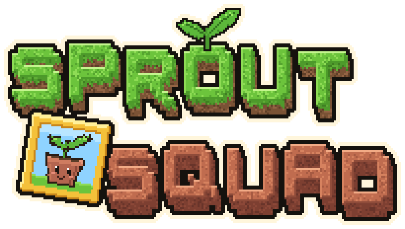

<p align="center">
  
</p>

<p align="center">A Minecraft 26.3 mod for <b>NeoForge</b>: plants defend your base from zombies, and the squad keeps growing with characters of its own.</p>

<p align="center"><b>English</b> · <a href="docs/ru/README.md">Русский</a></p>

> Unofficial NeoForge fork of [Plants & Zombies](https://github.com/joshxviii/plants-and-zombies) by **joshxviii**, ported from Fabric, licensed under MPL-2.0.

## Status

The port to NeoForge and the rename to Sprout Squad are done; in-game testing is in progress.

What the fork adds on top of the original:

- **Fixes for content you could not get or use**: battle machines built from blueprints fight for the player, the lawn mower works as the last line of defence, Squash attacks, brewable potions, loot for raids and mobs, Zombie Goat spawns, no kicks for flying on balloons ([full list](docs/en/UPSTREAM.md)).
- **Its own characters**, starting with the mascot plant Potling ([characters](docs/en/CHARACTERS.md)).

| | |
|---|---|
| Minecraft | 26.3 |
| Loader | NeoForge 26.3.x |
| Dependencies | Kotlin for Forge; optional TerraBlender, Iris |
| Java | 25 |

## Building

```bash
./gradlew build              # the jar ends up in build/libs/ (sprout-squad-<version>.jar)
./gradlew runClient          # start a client for testing
./gradlew runServer          # start a dedicated server
./gradlew runGameTestServer  # load the mod and run its GameTests, then exit
```

JDK 25 is required.

Debug commands (server operator, level 2):

```text
/pz gallery           # line up every plant, zombie and variant in front of you (with name labels)
/pz gallery false     # the same without labels, for screenshots
/pz gallery clear     # remove the gallery (the pedestals stay)
```

## Documentation

English is the main version; the same documents are available [in Russian](docs/ru/README.md).

| Document | English | Русский |
|---|---|---|
| Own characters | [CHARACTERS](docs/en/CHARACTERS.md) | [CHARACTERS](docs/ru/CHARACTERS.md) |
| How to add a character, style guide | [WORKSHOP](docs/en/WORKSHOP.md) | [WORKSHOP](docs/ru/WORKSHOP.md) |
| Upstream changes and fixes to the original | [UPSTREAM](docs/en/UPSTREAM.md) | [UPSTREAM](docs/ru/UPSTREAM.md) |

## License and credits

The code is based on [Plants & Zombies](https://github.com/joshxviii/plants-and-zombies) (© joshxviii) and is distributed under the [Mozilla Public License 2.0](LICENSE). Files of the original that were changed in this fork remain under MPL-2.0.

Plants vs. Zombies is a trademark of PopCap Games / Electronic Arts. This project is not affiliated with them.
