# Sprout Squad features

Sprout Squad is a Minecraft 26.3 mod for NeoForge that brings plants and zombies into the game. Plants are mobs you plant from seed packets and pay for with sun: they shoot, lob, explode, block, make sun, sleep, need water to produce new seeds and can even ride on your head. Zombies of many kinds roam the world, and a Plantz Flag lets you start zombie raids: wave after wave, with special waves, bosses, layered raid music and rewards delivered by mail. Blueprints build battle machines that fight for you, and Brainz Alloy taken from zombies goes into tech blocks and items. The mod is a fork of Plants & Zombies by joshxviii; Sprout Squad fixes content that could not be obtained or used in the original and adds characters of its own ([list of fixes](UPSTREAM.md)).

Contents: [Quick start](#quick-start) · [Plants](#plants) · [Zombies](#zombies) · [Raids](#raids) · [Battle machines and blueprints](#battle-machines-and-blueprints) · [Items and blocks](#items-and-blocks) · [World](#world) · [Commands and configuration](#commands-and-configuration) · [Characters](#characters) · [Not available in survival](#not-available-in-survival)

## Quick start

1. Find wild Sunflowers (plains, flower forests). They drop sun during the day; stand close and the sun flies to you.
2. Right-click a wild plant with sun to try to tame it. A tamed plant is yours: dig it up with a shovel to get its seed packet.
3. Plant seed packets on grass or dirt. Every planting costs sun.
4. To get more seeds, put your plants on farmland or in a Zen Plant Pot, water them and feed them sun when they wake up.
5. Get a Brainz Flag, craft a Plantz Flag from it and 8 sun, place it and drink an Ominous Bottle nearby: a zombie raid begins.

## Plants

### Seed packets and planting

<!-- pictures: seed_packet -->

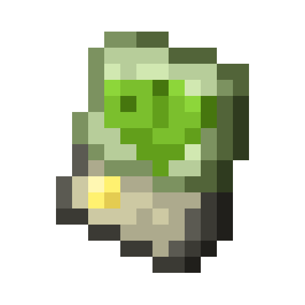

- A seed packet ("Peashooter Seeds" and so on) holds one plant. Right-click the top of a block to plant it. Water plants (Sea-shroom, Tangle Kelp) are placed on the water surface.
- Planting costs sun: the cost is shown in the packet's tooltip. Sun is taken from Sun items in your inventory and from Solar Batteries you carry. In creative mode planting is free and ignores limits.
- The block below must suit the plant. Every plant grows on dirt, grass, mud, moss, clay, soul soil, nylium, dirt paths, flower pots, lily pads, farmland and plant pots. Some accept more: Cactus (sand, soul sand), Potato Mine (sand, gravel), Snow Pea and Ice-shroom (snow), Doom-shroom (gravel, basalt), Grave Buster (gravestones), Cherry Bomb and Coffee Bean (any solid block), Squash and Pumpkin (anything).
- One plant per block. A plant standing on unsuitable ground or overlapping another one slowly dries out and takes damage.
- A new plant faces you; in a pot it faces the same way as the pot.
- A plant you plant is tamed to you.
- A dispenser plants seed packets if a Solar Battery with enough sun is attached to it; the sun is taken from the battery, and the plant goes to the nearest player within 64 blocks.

### Sun

Sun is the plant currency.

<!-- pictures: sun sun_battery -->

 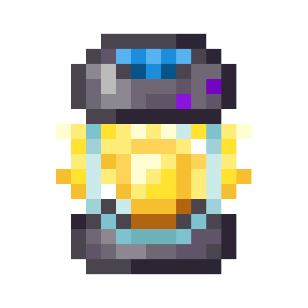

| | Source | What you get |
|---|---|---|
| 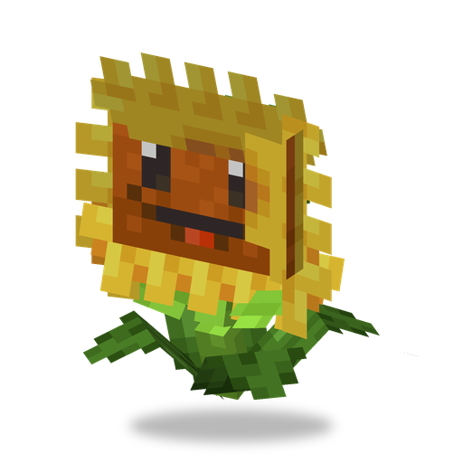 | [Sunflower](characters/sunflower.md) | 1 sun about every 45 s while the sun is visible; sleeps at night |
| 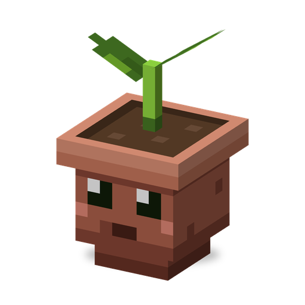 | [Potling](characters/potling.md) | 1 sun about every 60 s while the sun is visible; sleeps at night |
| 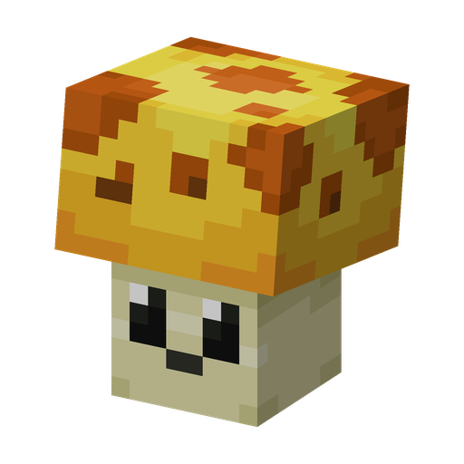 | [Sun-shroom](characters/sunshroom.md) | 1 sun about every 65 s, 2 once it has grown up; a mushroom, so it works at night and underground |
|  | Killing a plant yourself | half of its sun cost |
| 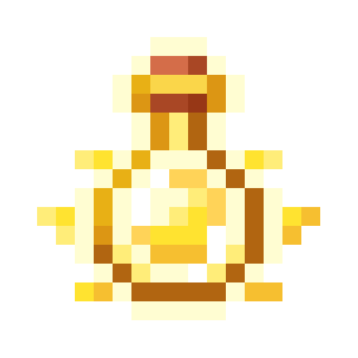 | Bottle of Sun | throw it to release 8 sun, or craft it back into 8 sun |
|  | Raid rewards | Bottles of Sun in many reward tables |

- Sun lies on the ground for about 37 seconds. Within 8 blocks it flies to the nearest player who has room for it, to a damaged plant (healing it) or to a placed Solar Battery.
- Other uses: works like bone meal on crops; burns briefly as furnace fuel; a Farmer (level 1) pays 1 emerald for 32 sun; heals and tames plants; goes into recipes (Plant Pot, Bottle of Sun, Plantz Flag, Potling).
- **Bottle of Sun**: 8 sun around a glass bottle. It can also be fired from a dispenser.
- **Solar Battery**: 4 Brainz Alloy, a Reinforced Brainz Alloy block, a Daylight Detector and 2 glass. It stores up to 512 sun. In the inventory, drop sun onto it to charge it, or right-click it with an empty cursor to take out up to a stack. Picked-up sun goes into the battery first, and planting, taming and feeding use its charge. Sneak and right-click to place it on any face of a block: a placed battery pulls in sun within 8 blocks, glows brighter the fuller it is, gives a comparator signal, accepts sun by right-click, feeds an attached dispenser and powers the [Time Machine](#time-machine).
- The client option "Sun Info HUD" shows your total sun and the cost of the held seed packet.

### Plants and sun costs

Costs are defaults (server option `sunCosts`). Plant names link to their cards.

| | Plant | Sun | What it does | Where to get it |
|---|---|---|---|---|
|  | [Sunflower](characters/sunflower.md) | 5 | Makes sun by day | Plains, flower forests, oak and birch forests; Browncoat drop (1%) |
| 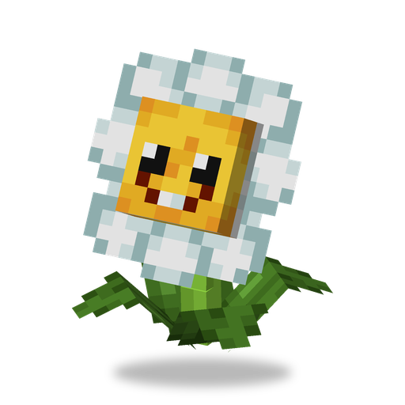 | [Marigold](characters/marigold.md) | 5 | Does not fight; when "grown" gives treasure instead of seeds (see below) | Raid rewards of later waves |
|  | [Potling](characters/potling.md) | 3 | Sprout Squad's mascot: cheap sun maker | Crafting: flower pot, wheat seeds, 3 sun |
|  | [Sun-shroom](characters/sunshroom.md) | 6 | Mushroom that makes sun | Lush caves, dark forests, warped and crimson forests, mushroom fields; rarely plains |
| 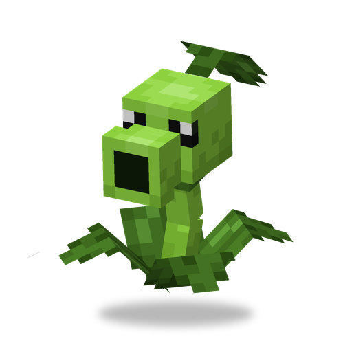 | [Peashooter](characters/peashooter.md) | 5 | Shoots peas | Plains, flower forests, oak forests; Browncoat drop (1%) |
| 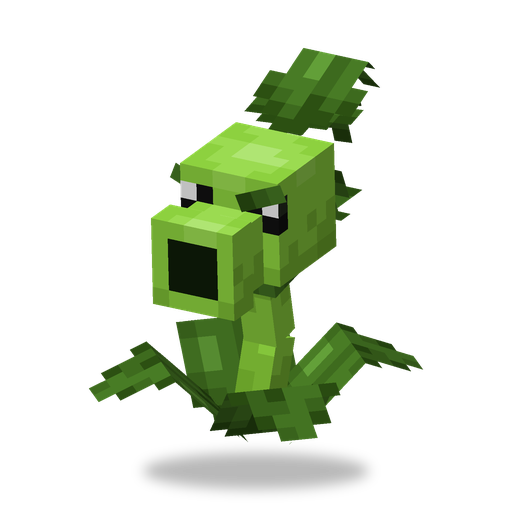 | [Repeater](characters/repeater.md) | 7 | Shoots two peas | Peashooter seed mutation; early raid rewards |
| 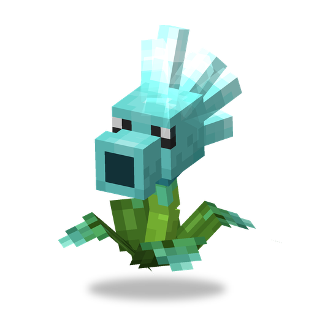 | [Snow Pea](characters/ice_peashooter.md) | 7 | Ice peas that Chill | Snowy and icy biomes; Zombie Yeti drop (6%); Winter Wonderland rewards |
| 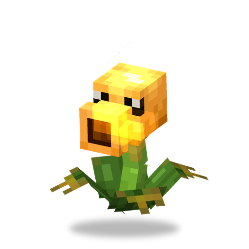 | [Fire Peashooter](characters/fire_peashooter.md) | 7 | Fire peas | Crimson Forest; Peashooter mutation there |
| 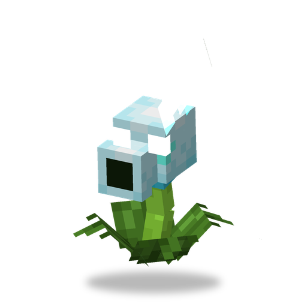 | [Electric Peashooter](characters/electric_peashooter.md) | 8 | Electric peas (Electrified) | A Peashooter struck by lightning turns into one; mutation during thunderstorms; late raid rewards |
| 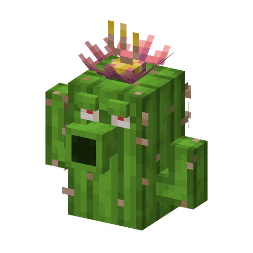 | [Cactus](characters/cactus.md) | 6 | Shoots needles | Deserts, badlands |
| 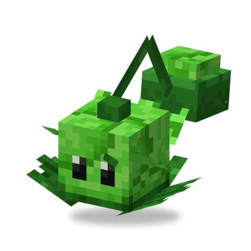 | [Cabbage-pult](characters/cabbagepult.md) | 5 | Lobs cabbages over obstacles | Plains, forests; village chests |
| 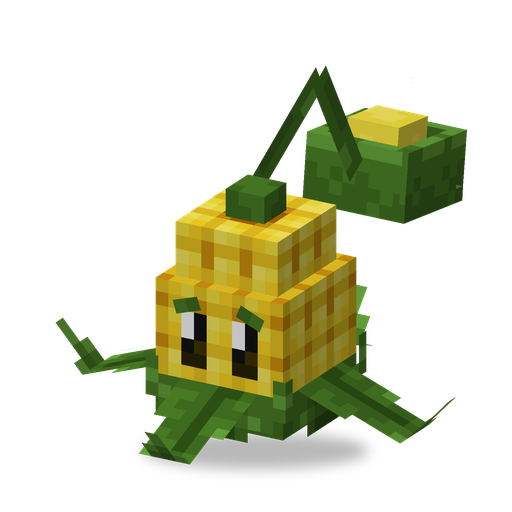 | [Kernel-pult](characters/kernelpult.md) | 6 | Lobs kernels, every fourth shot or so is butter (Buttered) | Plains, savannas; village chests |
| 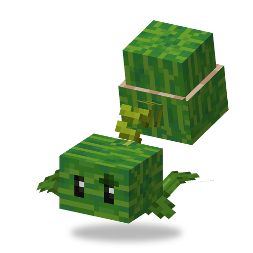 | [Melon-pult](characters/melonpult.md) | 10 | Lobs heavy melons | Jungles |
| 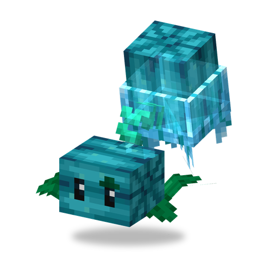 | [Winter Melon](characters/winter_melon.md) | 12 | Lobs frozen melons (Chilled) | Melon-pult mutation in cold biomes; Winter Wonderland rewards |
|  | [Wall-nut](characters/wallnut.md) | 5 | Blocks zombies, deflects arrows, tridents, wind charges and rockets; can be rolled | Plains, forests; Browncoat drop (1%) |
| 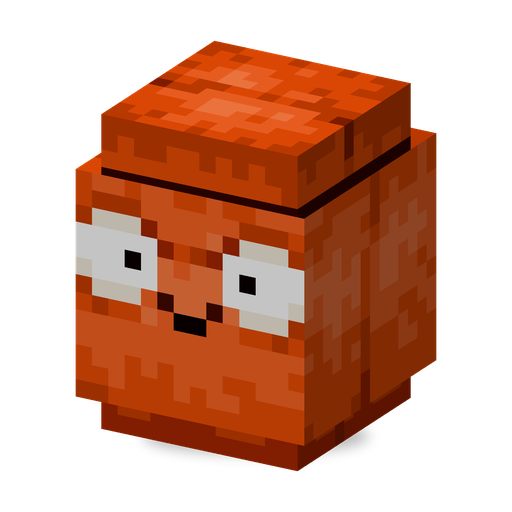 | [Explode-o-nut](characters/explode_o_nut.md) | 5 | A Wall-nut that explodes when it rolls into a mob or is killed by a hit | Wall-nut mutation |
| 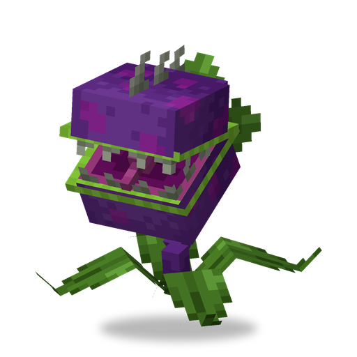 | [Chomper](characters/chomper.md) | 7 | Swallows a mob whole and chews for a while (large mobs are immune) | Swamps, jungles |
| 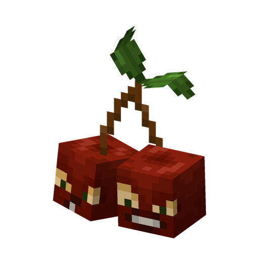 | [Cherry Bomb](characters/cherrybomb.md) | 7 | Explodes | Basalt Deltas; bastion and village chests; Farmer; Digger Zombie drop (8%) |
| 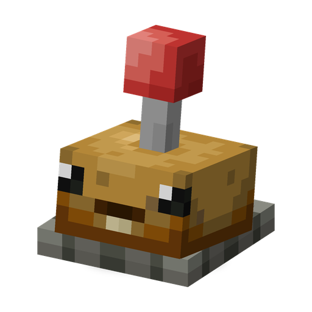 | [Potato Mine](characters/potatomine.md) | 3 | Arms after about 10 s and explodes on contact; zombies do not target it | Farmer; village chests; Imp drop (5%); early raid rewards |
|  | [Squash](characters/squash.md) | 4 | Leaps onto a zombie within 3 blocks and squashes it, then is gone (single use) | Plains, savannas |
| 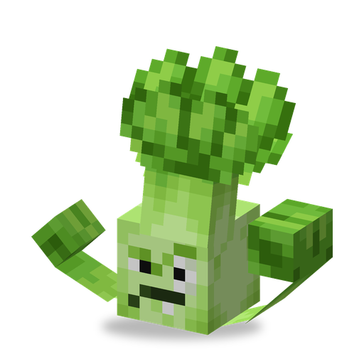 | [Bonk Choy](characters/bonkchoy.md) | 4 | Punches up close | Bamboo jungles, savannas; early raid rewards |
| 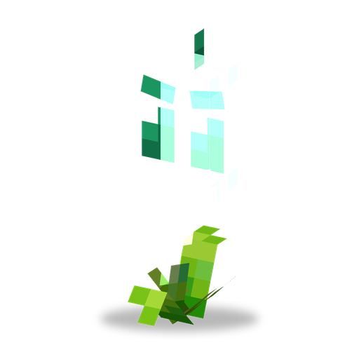 | [Lightning Reed](characters/lightning_reed.md) | 8 | Electric zaps (Electrified) | Swamps, rivers |
| 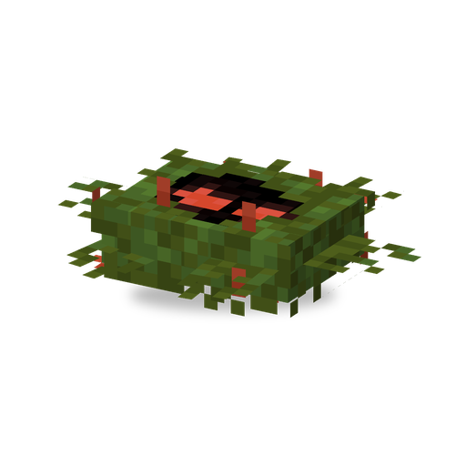 | [Tangle Kelp](characters/tanglekelp.md) | 2 | Water plant: grabs a mob and holds it (Tangled); zombies do not target it | Swamps, mangroves |
| 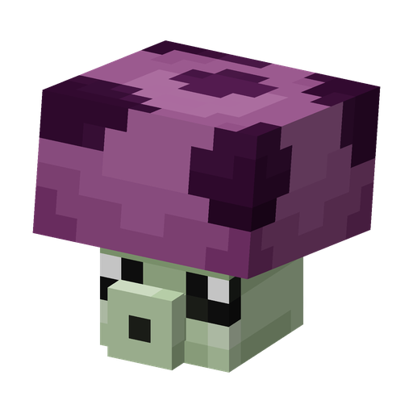 | [Puff-shroom](characters/puffshroom.md) | 0 | Short-range spores | Dark forests, taigas, mushroom fields, caves |
| 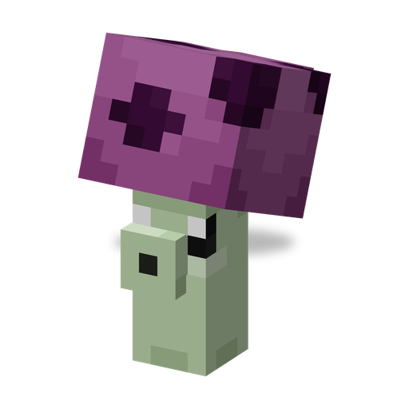 | [Scaredy-shroom](characters/scaredyshroom.md) | 3 | Long-range spores, hides when enemies come close | Same as Puff-shroom |
| 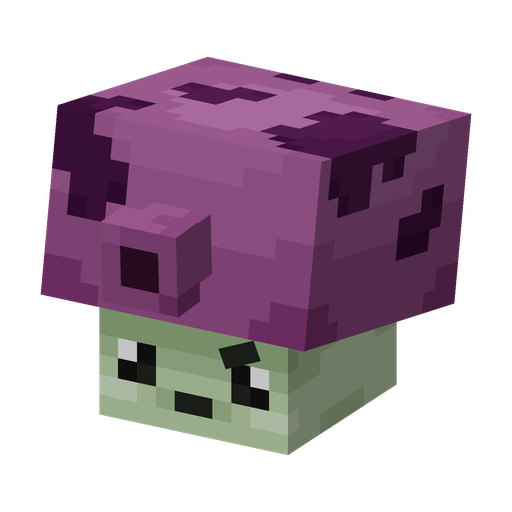 | [Fume-shroom](characters/fumeshroom.md) | 6 | A stream of toxic fumes (Toxic) | Same as Puff-shroom; mausoleum chests |
| 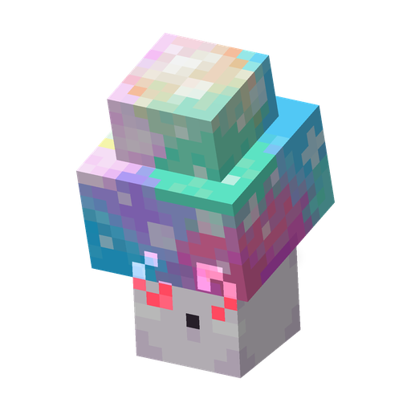 | [Hypno-shroom](characters/hypnoshroom.md) | 7 | Whoever hits it is Hypnotized; releases a hypnosis cloud when it dies | Lush caves, dark and warped forests, mushroom fields; Disco Zombie drop (4%); early raid rewards |
| 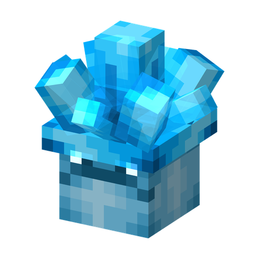 | [Ice-shroom](characters/iceshroom.md) | 5 | Freezes everything around it (Frozen) | Snowy taigas, groves, ice spikes, frozen peaks and oceans |
| 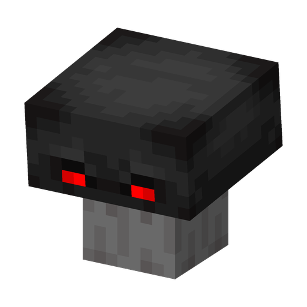 | [Doom-shroom](characters/doomshroom.md) | 14 | Huge explosion | Basalt Deltas; bastion chests; late raid rewards |
| 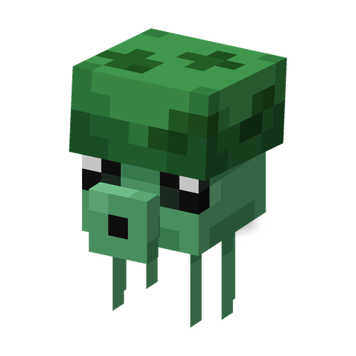 | [Sea-shroom](characters/seashroom.md) | 0 | Water plant: water spores | Rivers, deep oceans; fishing; Pirate Captain Ghost drop (3%) |
| 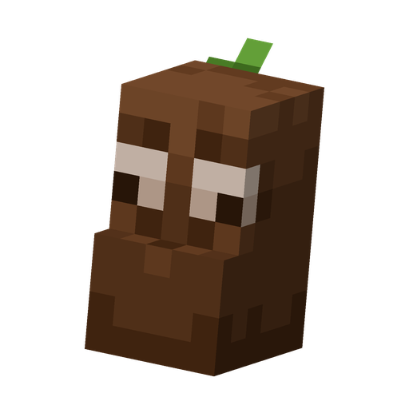 | [Coffee Bean](characters/coffeebean.md) | 2 | Wakes up a sleeping plant | Jungles; Winter Wonderland rewards |
|  | [Grave Buster](characters/grave_buster.md) | 3 | Planted on a gravestone, eats it and leaves grave loot; zombies do not target it | Graveyard, Pale Garden; Grave Digger (10%) and Zombat (3%) drops; raid rewards; mausoleum chests |
|  | [Pumpkin](characters/pumpkin.md) | 6 | Armor for another plant | Carving pumpkins (5.5%); Zomboween rewards |

About wild plants:

- They appear as ambient mobs, alone or in small groups, far from any other plant (about 42 blocks), and never near an active raid.
- Most wild attackers fight only zombies. Careful: wild Cherry Bombs, Doom-shrooms, Ice-shrooms, Chompers, Bonk Choys, Lightning Reeds, Tangle Kelp and Fire and Electric Peashooters attack players too, and wild Scaredy-shrooms hide from players.
- Once tamed, attacking plants also fight other hostile mobs. Some of them (peashooters, pults, Cactus) leave creepers alone.

**Pumpkin armor.** Use a Pumpkin seed packet on one of your plants (it costs the Pumpkin's 6 sun): the plant gets a pumpkin shell that absorbs 35 damage before breaking. You can also use another plant's seed packet on a planted Pumpkin to put that plant inside. Shears take the shell off and give the Pumpkin seed packet back.

**Plantz Flag power-up.** Plants within 5 blocks of a [Plantz Flag](#flags) act 20% faster.

### Sleep, mushrooms and coffee

- Sunflowers and Potlings sleep at night, that is, whenever the sun is not visible.
- Mushrooms (Puff-, Scaredy-, Fume-, Sun-, Hypno-, Ice-, Doom- and Sea-shroom) sleep while the sun is visible: by day under the open sky. At night, in caves or under a roof they are awake.
- A sleeping plant does not attack and does not make sun.
- A Coffee Bean planted nearby wakes the closest sleeping plant and is used up. You can also use a Coffee Bean seed packet directly on a sleeping plant (2 sun). A plant woken this way stays awake for 40 minutes.
- A plant that is growing seeds also sleeps, and coffee does not wake it.

### Growing seeds from plants

1. Put one of your plants on **farmland** or in a **Zen Plant Pot**.
2. Water it: a water bottle, a water bucket, a watering can or rain.
3. The plant falls asleep while the seeds grow: 10 minutes plus 2 minutes per sun of its cost (server options `seedGrowTime` and `extraGrowTimePerSun`); a Zen Plant Pot shortens the wait by 25%.
4. When it wakes up (a sun icon floats above it), right-click it with sun, one at a time. It needs about twice its sun cost, at least 4. If it was watered with a bucket or a watering can, it needs half as much.
5. The plant pops out a seed packet, possibly of a different plant (see mutations). Water it again to start over.

Important: a tamed plant on farmland or in a Zen Plant Pot is busy growing seeds all the time. It does not attack and does not make sun, so defend your base with plants on ordinary ground or in plain Plant Pots.

The Marigold is special: it needs 32 sun and gives treasure instead of seeds (4–6 rolls of diamonds, emeralds and gold, and a 1% chance of a Golden Garden Gnome).

**Seed mutations.** Rules are checked from top to bottom; the first one that matches decides.

| | Plant | What its seeds can turn into |
|---|---|---|
|  | Peashooter | Electric Peashooter (50%) during a thunderstorm; Fire Peashooter (50%) in a Crimson Forest; otherwise Repeater (10%) |
|  | Electric Peashooter | always itself during a thunderstorm; otherwise Peashooter (15%) |
|  | Fire Peashooter | always itself in a Crimson Forest; otherwise Peashooter (15%) |
|  | Wall-nut | Explode-o-nut (8%) |
|  | Explode-o-nut | Wall-nut (20%) |
|  | Melon-pult | Winter Melon (33.3%) in snowy and icy biomes |
|  | Winter Melon | always itself in those biomes; otherwise Melon-pult (15%) |

Datapacks can change these rules in `data/<namespace>/seed_mutation/<plant>.json`.

### Plant pots and watering

| | Item | Recipe | What it does |
|---|---|---|---|
| 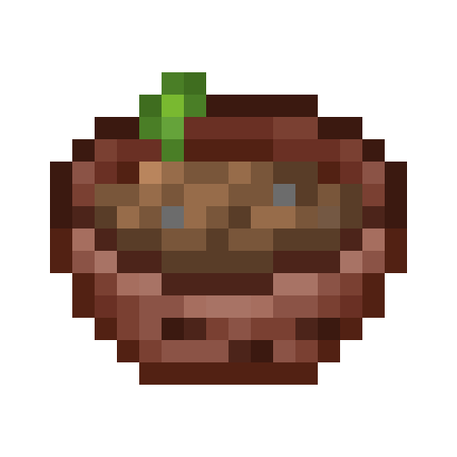 | Plant Pot | 3 bricks, dirt, sun | A plant in it takes 50% less damage from monsters; zombies cannot walk through pots. Digger Zombies can break plain pots |
| 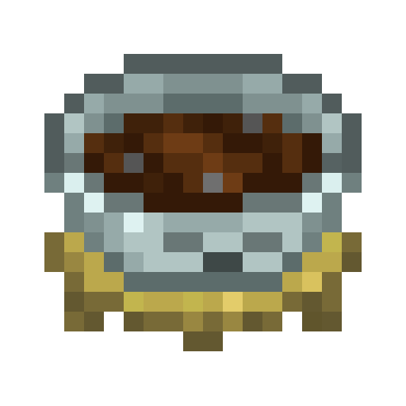 | Zen Plant Pot | Plant Pot, 2 bamboo, a bamboo slab | The same protection, and it counts as farmland for growing seeds (25% faster) |
| 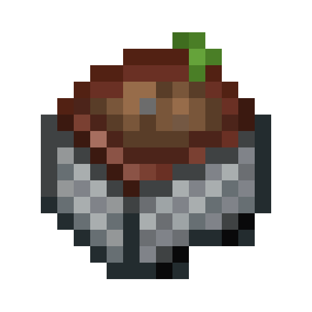 | Minecart with Plant Pot | Plant Pot + minecart | A plant planted in it rides along on rails |
| 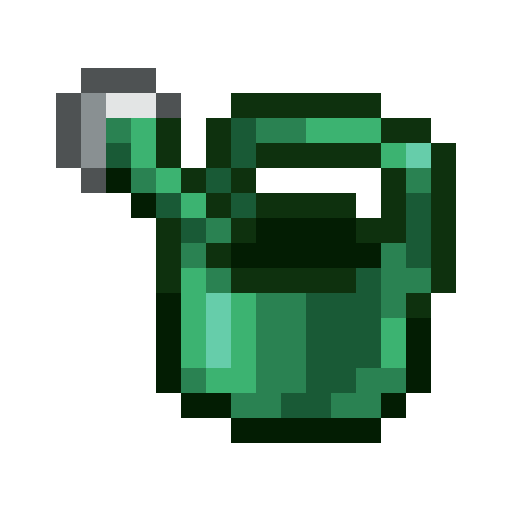 | Watering Can | Farmer (level 2), village chests, fishing treasure, raid rewards | Holds 32 water. Fill it at water or, sneaking, from a water cauldron. Each use spends 2 water: waters a plant (counts as a big watering), moistens farmland, turns dirt into mud, puts out fire, fills a cauldron, turns lava into obsidian. Sneak to place it as a decoration |

### Taming and ownership

- Right-click a wild plant with sun (or with a Solar Battery that holds sun) to try to tame it. Every attempt costs 1 sun. Cheap plants are easy to tame, expensive ones are hard (server option `sunCostTamingThreshold`):

| Sun cost | 0 | 2 | 3 | 5 | 7 | 10 | 14 |
|---|---|---|---|---|---|---|---|
| Chance per attempt | 100% | 67% | 55% | 36% | 24% | 12.5% | 5% |

- Right-click one of your damaged plants with sun to heal it by 4 health per sun.
- Dig up your plant with any shovel to get its seed packet back (a named plant keeps its name). Only tamed plants can be dug up.
- Your plants never hurt you, defend you from whoever attacks you and attack your targets.

### Co-op planting

Server option `coopPlanting` (on by default): any player can dig up, feed and collect seeds from anyone's plants, tamed plants treat all players and tamed pets as friends, and the per-area [plant limit](#plant-limits) counts everyone's plants. With the option off, only the owner can do that ("You do not own this plant!").

### Plants on your head

<!-- pictures: plant_pot_helmet -->

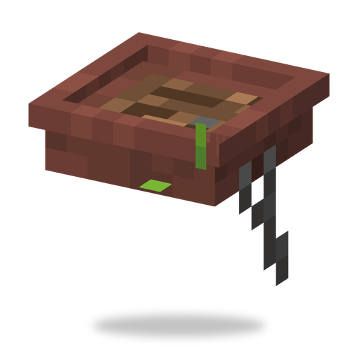

**Plant Pot Helmet** (late raid rewards and the Farmer at level 4; repaired with bricks, can be enchanted). Wear it, then sneak and right-click one of your plants with an empty hand: the plant sits on your head and keeps working, taking 50% less damage from monsters. To put it down, sneak and right-click the top of a block with an empty hand or with a Gardening Glove. If you take the helmet off, the plant drops as a seed packet.

<!-- pictures: gardening_glove -->

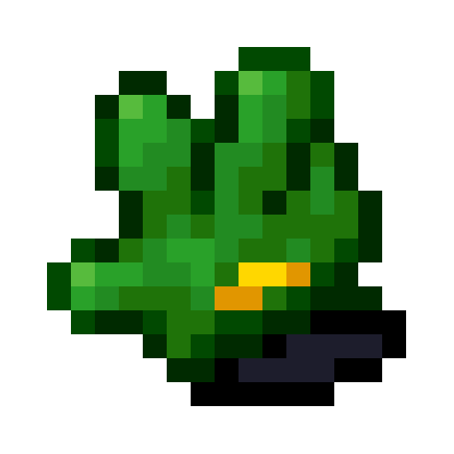

**Gardening Glove** (Farmer level 3, late raid rewards; 325 durability, repaired with leather):

- right-click your plant to pet it;
- sneak and right-click to pick the plant up with all its data, then right-click a block to put it down without paying sun again;
- right-click a fully grown crop to harvest it, and it is replanted if you have its seeds;
- punch a Wall-nut to roll it;
- +1.5 blocks of reach to mobs;
- the **Lobbing** enchantment (I–II, for example on enchanted books from raid rewards) lets you throw the plant you carry.

### Plant limits

You can have at most 30 plants of the same kind within 32 blocks (with co-op planting this counts everyone's plants). Melon-pult, Winter Melon and Doom-shroom are limited to 20, Coffee Bean and Grave Buster have no limit. Creative mode ignores the limit. Server options `defaultPlantEntityLimit` and `customPlantEntityLimits`.

## Zombies

### Natural spawns

Zombies spawn in the dark like vanilla monsters, never on Peaceful. In the Graveyard most of them spawn regardless of light. Browncoats and Newspaper Zombies also appear in water (more often in the rain), and a zombie that spawns in water wears a Ducky Tube. "Common biomes" are forests, plains, taigas, jungles, savannas, beaches, swamps, deserts, icy biomes, mountain peaks and the Graveyard (tag `#sproutsquad:zombie/common_spawns`).

| | Zombie | Where | Notes |
|---|---|---|---|
| 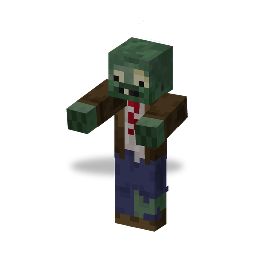 | [Browncoat](characters/browncoat.md) | Common biomes, rivers, oceans | The most common zombie; its look depends on the biome |
| 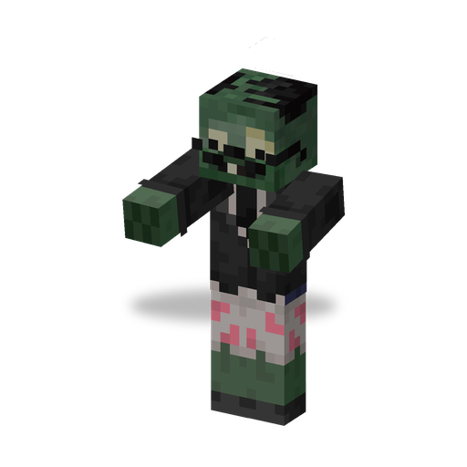 | [Newspaper Zombie](characters/newspaper_zombie.md) | Common biomes, water | Gets angry when it loses its newspaper |
| 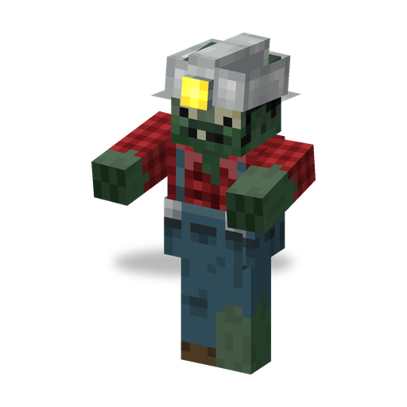 | [Digger Zombie](characters/digger_zombie.md) | Common biomes, underground | Tunnels toward its target, digs through blocks in its way |
| 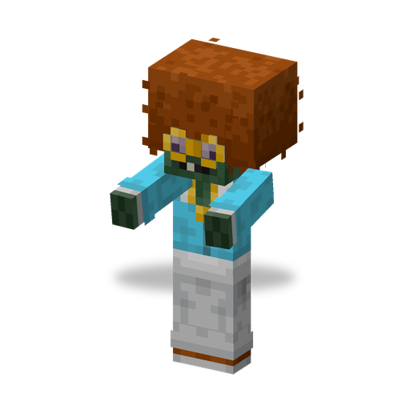 | [Disco Zombie](characters/disco_zombie.md) | Common biomes | Summons Backup Dancers |
| 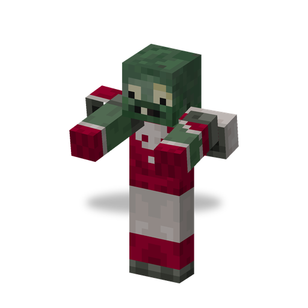 | [All Star](characters/all_star.md) | Common biomes | Charges and tramples |
| 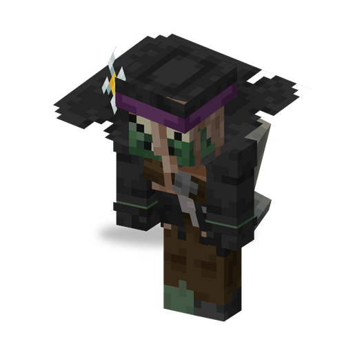 | [Grave Digger](characters/grave_digger.md) | Common biomes | Digs up gravestones while chasing you, then retreats |
| 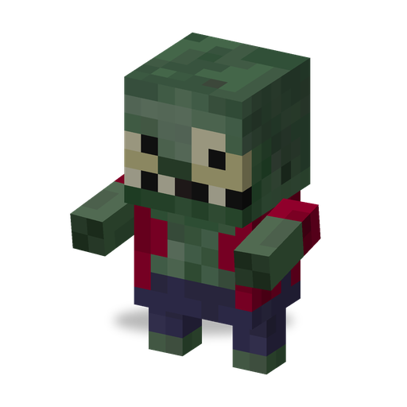 | [Imp](characters/imp.md) | Common biomes | Small and quick, its bite can be Toxic |
| 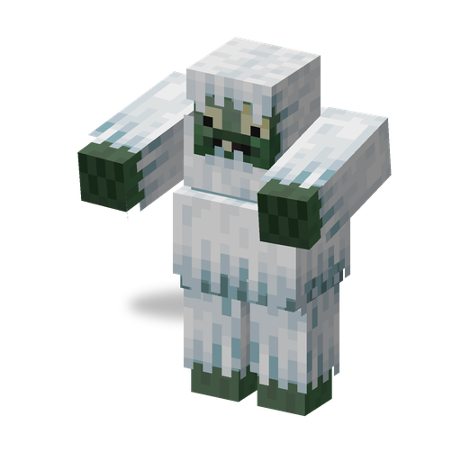 | [Zombie Yeti](characters/zombie_yeti.md) | Snowy and cold biomes, icy peaks | Throws powder snow (Chilled) |
| 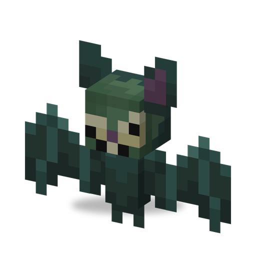 | [Zombat](characters/zombat.md) | Graveyard, even by day | Flies, heals itself when it hurts a mob |
| 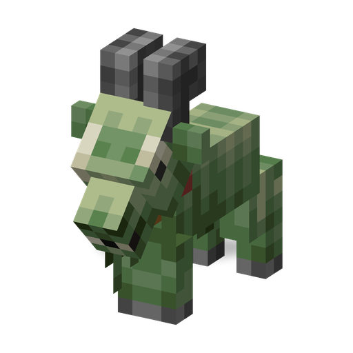 | [Zombie Goat](characters/zombie_goat.md) | Snowy slopes, peaks, groves, windswept hills, at night | 40% of them carry an Imp rider (Sprout Squad) |

Only in raids (or from spawn eggs):

| | Zombie | Notes |
|---|---|---|
| 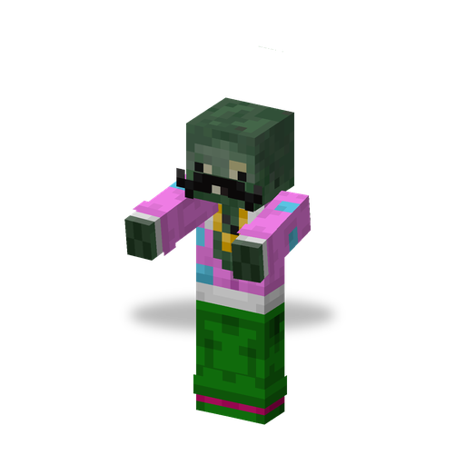 | [Backup Dancer](characters/backup_dancer.md) | Summoned by the Disco Zombie |
| 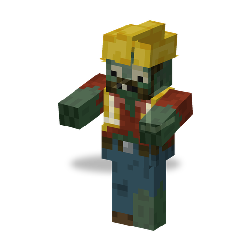 | [Engineer Zombie](characters/engineer_zombie.md) | Avoids players and plants and builds hostile machines |
|  | [Soldier Zombie](characters/soldier_zombie.md) | Fires a Dye Blaster |
|  | [Robo-Zombie](characters/robo_zombie.md) | Transforms, fires missiles |
|  | [Pirate Captain](characters/pirate_captain.md) | Fires fireworks; comes back as a [Pirate Captain Ghost](characters/pirate_captain_ghost.md) |
|  | [Super Brainz](characters/super_brainz.md) | Energy beams and punches |
|  | [Gargantuar](characters/gargantuar.md) | Huge, smashes and throws Imps |
|  | [Baron Von Bats](characters/baron_von_bats.md) | Boss: summons Zombats, transforms |
|  | [Electric Slide](characters/electric_slide.md) | Roller skater with electric attacks |

### Variants

| | Zombie | Variant | When |
|---|---|---|---|
|  | Browncoat | Snowcoat | snowy biomes (75%), Winter Wonderland |
|  | Browncoat | Desert Zombie | deserts and badlands (75%) |
|  | Browncoat | Buccaneer | shipwrecks, beaches (60%), Pirate Invasion |
|  | Browncoat | Vampire Zombie | the Halloween season (8%), Zomboween |
|  | Browncoat | Balloon Zombie | floats on balloons; drops balloons |
|  | Imp | Yeti Imp | snowy biomes, Winter Wonderland; its bite Chills |
|  | Imp | Pirate Imp | Pirate Invasion; arrives in an explosive barrel |
|  | Gargantuar | Pirate Gargantuar | Gargantuar boss of a Pirate Invasion |
|   | Super Brainz | Toxic, Electro | League of Awesome; Toxic also in Zomboween |
|  | All Star | Giga-Football Zombie | boss |
|  | Electric Slide | Electric Boogaloo | boss |
|  | Robo-Zombie | Robo-General | boss |

The Halloween season is from 14 days before to 1 day after 31 October (by the real date).

### Equipment

- Browncoats can spawn with a **Cone**, a **Bucket**, a **Screen Door** (door shield) or a **Coffin**; the higher the local difficulty, the more often. In raids, equipment gets better as the waves go on.
- Cones and buckets protect only against hits from above, so lobbed projectiles bounce off while straight shots go through. They can break. Door shields and newspapers block from the front, a coffin from all sides.
- All Stars wear a Football Helmet; zombies may wear party hats, pumpkins or iron armor in special waves.
- You can wear all of this yourself, see [helmets and armor](#helmets-armor-and-equipment).

### What zombies attack

- Players, villagers, iron golems, baby turtles and plants. This applies to the vanilla zombie, husk and drowned too (but not to zombified piglins). Villagers flee from the mod's zombies.
- Potato Mines, Tangle Kelp and Grave Busters are not targeted. Zombies attack a Wall-nut, an Explode-o-nut or a Hypno-shroom when they bump into it.
- Raid zombies march to the Plantz Flag and attack it.

### Leaders

A rare leader zombie (zombie, husk, drowned, Browncoat, Newspaper Zombie, Soldier Zombie, Imp) carries a Brainz Flag in its offhand, arrives with at least three more zombies and drops the flag when a player kills it. In a raid the first zombie of every wave is the leader; that flag does not drop.

### Gravestones

<!-- pictures: gravestone -->

A Gravestone raises a zombie every 20–30 seconds when it is dark and a player is within 24 blocks (server option `graveStoneActivationRange`); in the Graveyard it works by day too. It keeps no more than two of its own zombies alive and waits while three zombies are near. It can only be picked up with Silk Touch. Plant a Grave Buster on it to remove it and get grave loot: Ominous Bottles, cones, newspapers, Ducky Tubes, Brainz Alloy, ingots and emeralds.

## Raids

### Flags

| | Flag | How to get | What it does |
|---|---|---|---|
|  | Brainz Flag | Leader zombies, Grave Digger (5%), Wandering Trader (12 emeralds), Graveyard mausoleum chest (always) | Decoration; ingredient of the Plantz Flag |
|  | Plantz Flag | Brainz Flag + 8 sun | Center of a raid; plants within 5 blocks act 20% faster; held in hand: +20% movement and attack speed |

- Both flags are placed while sneaking.
- A Plantz Flag has 40 health, 500 during a raid, and slowly heals when it has not been hit for a while. When it is destroyed, it drops a Brainz Flag.
- During a raid the flag shows a beacon beam from far away.

### How a raid starts

1. Place a Plantz Flag.
2. Get Bad Omen, for example from an Ominous Bottle (they are in grave loot and mausoleum chests).
3. Come within 24 blocks of the flag: Bad Omen turns into **Zombie Omen** of the same level for 30 seconds.
4. When Zombie Omen runs out and a Plantz Flag is within 64 blocks, the raid starts at that flag.

The `raids` game rule must be on and the difficulty must not be Peaceful. Players within 160 blocks join the raid. Wild plants within that radius vanish, and new ones do not spawn there until the raid ends. Zombie Omen absorbed during a raid (before the final wave) adds more waves.

### Number of waves

2 + difficulty (Easy 1, Normal 2, Hard 3) + 2 per level of Zombie Omen + 2 if the player who started the raid has seen the End credits, at most 20. For example, Normal with Bad Omen I gives 6 waves; Hard with Bad Omen V after the credits gives 17.

After the credits ("The Zombies are coming back stronger...") waves are about 20% larger, Soldier Zombies join default waves from wave 11, and the Robo Army and League of Awesome waves become possible.

### Waves

- Zombies come out of the ground about 88 blocks from the flag and walk to it.
- A wave lasts 2.5 minutes, a boss wave 3.75 minutes, the final wave 5 minutes. Kill all zombies and the next wave comes after 5 seconds; if the time of an ordinary wave runs out, the next one starts anyway.
- On the final wave, or while a boss is alive, running out of time destroys the flag and loses the raid. The last 10 seconds are counted down; 30 seconds before the end, zombies far from the flag teleport close to it, and the music speeds up.
- A default wave grows with its number: Browncoats and Newspaper Zombies from the start, Digger Zombies from wave 4, Imps from wave 5, All Stars and Disco Zombies from wave 6, Engineers from wave 8, Soldiers from wave 11 (after the credits), and Super Brainz from wave 16 or Robo-Zombies from wave 17. From wave 5 a Grave Digger joins with a 17.5% chance; from wave 3 some zombies fly in on balloons.

### Special waves

| Wave (`wave_type`) | Waves | What comes |
|---|---|---|
| Bucket Brigade (`bucket_brigade`) | 1–4 | Browncoats and Newspaper Zombies with buckets, iron armor and iron door shields |
| Half-Time Showdown (`halftime_showdown`) | 2–6 | All Stars, Imps in football helmets, Browncoats on balloons |
| Disco of the Undead (`disco_party`) | 4–15 | Disco Zombies, party hats, balloons; Electric Slide from wave 8 |
| Zomboween (`zomboween`) | 4–11 | Halloween season only: Vampire Zombies, pumpkin heads, Zombats, Grave Diggers, then Toxic Super Brainz or Pirate Captain Ghosts |
| Winter Wonderland (`winter_wonderland`) | 5–9 | Snowcoats in frost-walking boots, Yeti Imps, Zombie Yetis |
| Pirate Invasion (`pirate_invasion`) | 9–15 | Buccaneers with swords, Pirate Imps, Pirate Captains |
| Robo Army (`robo_army`) | 10–16 | After the credits: Zombie Drones, Engineers, Soldiers, Robo-Zombies (some ridden by Soldiers) |
| League of Awesome (`league_of_awesome`) | 12–20 | After the credits: Super Brainz of every kind |

### Leaders and bosses

- Every wave has a leader carrying a Brainz Flag.
- The **boss chance** is shown on the raid screen between waves and while you hold the player list key (Tab). It grows with every wave without a boss, reaches 100% after five such waves and resets once a boss appears.
- A boss wave shows a boss bar. If a boss is still alive when the wave time runs out, the raid is lost.

| | Boss (`boss_type`) | Waves | Wave types | Notes |
|---|---|---|---|---|
|  | Giga-Football Zombie (`giga_all_star`) | 1–7 | any | one more for every 3 waves |
|  | Baron Von Bats (`baron_von_bats`) | 6–18 | default, Zomboween | drops Baron's Staff (8.5%) |
|  | Electric Boogaloo (`electric_boogaloo`) | 6–18 | default, Disco | |
|  | Gargantuar (`gargantuar`) | 9–20 | default, Pirate Invasion (as the Pirate Gargantuar) | |
|  | Robo-General (`robo_general`) | 10–20 | default, Robo Army | |

The Giga-Football Zombie, Electric Boogaloo and Robo-General are enlarged versions with much more health and damage.

### Victory, defeat and rewards

- **Victory**: when the last zombie of the final wave dies, fireworks go off and every player in the raid gets **Hero of the Garden** for 60 minutes.
- **Defeat**: if the flag is destroyed, the remaining zombies vanish and there are no rewards.
- **Collecting the reward**: while you have Hero of the Garden, right-click any Mailbox. It throws out one reward for every completed wave, chosen by the type of that wave, plus a bonus for every wave that had a boss. The effect ends then.

| Rewards of | Typical contents |
|---|---|
| Default waves 1–8 | Food, iron, gold, emeralds; Bottles of Sun; Potato Mine, Bonk Choy, Repeater and Hypno-shroom seeds; tools, experience bottles, Brainz Alloy, cones, Ducky Tube |
| Default waves from 9 | Golden apples, Brainz Alloy, emeralds, diamonds; Marigold, Grave Buster, Doom-shroom and Electric Peashooter seeds; diamond tools, potions, Smite and Lobbing books, Watering Can, Gardening Glove, Plant Pot Helmet |
| Bucket Brigade | Buckets, cones, Brainz Alloy, Ducky Tube |
| Half-Time Showdown | Football Helmet, balloons |
| Disco of the Undead | Party Hat, balloons, fireworks, a jukebox, the music disc |
| Zomboween | Pumpkin and Grave Buster seeds, jack o'lanterns, candles, pumpkin pie |
| Winter Wonderland | Coffee Bean, Snow Pea and Winter Melon seeds; powder snow, blue ice, Frost Walker books |
| Pirate Invasion | Gold, TNT, Protection, Looting and Fortune books, treasure maps, a trident, a crossbow, enchanted golden apples, diamonds |
| Robo Army | Netherite scrap, diamonds, gold blocks; Brainzium, Dye Blaster, blueprints of all four machines |
| League of Awesome | Enchanted golden apples, diamonds, gold blocks; Brainzium, balloons |
| Boss bonus | 12–24 tacos, balloons, garden gnomes or a lawn flamingo; Brainzium (25%) |

### Raid screen and music

- The raid screen shows the waves, the zombies' remaining health, the flag's health and the boss chance. The client option `showRaidUi` hides it.
- The raid has its own layered soundtrack, "Loon Griefers" by Patrika: calmer or more intense layers depending on the wave, a theme for every special wave, and a faster tempo in the last minute of a final or boss wave. It plays on the Music volume.

## Battle machines and blueprints

A blueprint builds a machine. Right-click a block with it: the machine appears facing you, and its cost in Brainz Alloy is taken from your inventory. A blueprint lasts 20 builds.

<!-- pictures: blueprint -->

| | Machine | Brainz Alloy | What it does |
|---|---|---|---|
|  | [Zombie Turret](characters/zombie_turret.md) | 12 | Shoots laser bolts |
|  | [Electro Turret](characters/electro_turret.md) | 10 | Zaps mobs within about 8 blocks and Electrifies them |
|  | [Zombie Drone](characters/zombie_drone.md) | 8 | Flies and attacks |
|  | [Lawn Mower](characters/lawn_mower.md) | 14 | The last line of defence: waits until a monster comes right up to its front, then drives up to 40 blocks (or until it hits a wall) and mows down every monster on its way; bosses take 40 damage. Used up after one run, placed with its handle toward you, and only a player can break it |

- Blueprints: Engineer Zombie (8.5%, one of its three machines), the Robo Army treasure (all four machines, the Lawn Mower is rare) and the workshop chest of the [Robo Junkyard](STRUCTURES.md#robo-junkyard) (always one, the Lawn Mower is rare). Costs are set by the server option `alloyCosts`.
- In Sprout Squad a machine you build is **yours**: it attacks only hostile mobs (not creepers, not neutral mobs such as endermen), never hurts players, plants or other players' machines, ignores the raid flag and never despawns, even on Peaceful. A one-shot attack deals 40 damage to bosses instead of killing them. Machines built by Engineer Zombies stay hostile.

<!-- pictures: brainz_alloy -->

**Brainz Alloy** comes from zombies: a Gargantuar always drops 18–25, a Robo-Zombie 2–5 (90%), Super Brainz 1–3 (70%), an Engineer 1–2 (30%). It is also found in grave loot, mausoleum chests, Robo Junkyard chests and barrels and raid rewards, and 1 Brainzium + 4 copper ingots + 4 iron ingots make 16. It builds machines, repairs the Dye Blaster and is used for Brainz Alloy blocks (block, stairs, slab, smooth, treaded, reinforced, fence, door, trapdoor), the Solar Battery, the Collection Box and the Time Machine.

<!-- pictures: brainzium -->

**Brainzium** is a rare glowing material: 25% in a boss bonus, and in the Robo Army and League of Awesome treasure. It is used for Brainz Alloy and the Time Machine.

## Items and blocks

### Potions and effects

Potions are brewed from an Awkward Potion; gunpowder turns them into splash potions, dragon's breath into lingering ones, and lingering potions make tipped arrows.

| | Potion | Ingredient | Effect and duration |
|---|---|---|---|
|  | Potion of Hypnosis | Red Mushroom | Hypnotized, 3:00 |
|  | Potion of Buttered | Honeycomb | Buttered, 0:05 |
|  | Potion of Electricity | Lightning Rod (any) | Electrified, 0:10 |

| | Effect | What it does | Where it comes from |
|---|---|---|---|
|  | Hypnotized | The mob turns on its own kind and on other monsters and never attacks plants or players. Gargantuars, Electric Slides, Baron Von Bats, Robo-Zombies, machines, plants and bosses are immune | Hypno-shroom, potion |
|  | Buttered | Cannot move, jump or attack | Kernel-pult butter, potion |
|  | Electrified | Electric damage jumps to a nearby mob of the same side; standing in water hurts | Lightning Reed, Electric Peashooter, Electro Turret, Electric Slide, Super Brainz, lightning, potion |
|  | Toxic | Damage over time, stronger at full health | Fume-shroom, Puff- and Scaredy-shroom spores, Imps |
|  | Chilled | Slower, slightly weaker, frost at the screen edge | Snow Pea, Winter Melon, Zombie Yeti, Yeti Imp |
|  | Frozen | Frozen in place | Ice-shroom |
|  | Tangled | Cannot move or attack | Tangle Kelp |
|  | Painted (16 colors) | Paint covers your screen; water washes it off | Dye Blaster, Soldier Zombie |
|  | Zombie Omen | A raid starts when it ends | Bad Omen near a Plantz Flag |
|  | Hero of the Garden | Raid rewards from a Mailbox | Winning a raid |

### Balloons

<!-- pictures 64: item:*_balloon -->

               

- 16 White Balloons from a phantom membrane, a wind charge and string; 8 balloons + a dye give 8 colored ones. Balloon Zombies drop them, and they are in many raid rewards.
- Right-click a block with a balloon to inflate it, tied to you on a lead; right-click a fence to tie it there. A dispenser releases balloons and ties them to a mob standing in front of it.
- Each balloon makes you lighter: several soften a fall, more make you float. Sprout Squad makes sure you are not kicked for flying while a balloon is actually lifting you.
- A balloon pops when hit, when it rises too high, or 2 minutes after it was let go.

### Helmets, armor and equipment

| | Item | How to get | What it does |
|---|---|---|---|
|  | Cone | Zombies, grave loot, raid rewards | Helmet (8 armor) against hits from above; can also be placed as a block |
|  | Bucket | Vanilla bucket | Can be worn: 15 armor against hits from above |
|  | Football Helmet | All Star (2%), Half-Time rewards | While sprinting: faster, knocks back mobs in front of you |
|  | Party Hat | Backup Dancer (8%), Disco rewards | Decorative hat, 1 armor |
|  | Plant Pot Helmet | Late raid rewards, Farmer at level 4 | Carry a plant on your head ([see above](#plants-on-your-head)) |
|  | Coffin | 3 wooden trapdoors + 3 wooden slabs | Worn on the chest, blocks direct attacks from every side |
|  | Door Shield | Any door + a shield | A shield that looks like the door |
|  | Newspaper | Newspaper Zombie (5%), grave loot | Blocks from the front like a flimsy shield; used for Mailboxes |
|  | Ducky Tube | Fishing treasure, grave loot, raid rewards | Worn as leggings, keeps you afloat in water |
|  | Roller Skates | Electric Slide (2%) | Much faster, even more so while sprinting |
|  | Dye Blaster | Soldier Zombie (2%), Robo Army rewards | Hold use to fire paint balls; uses dye from your inventory as ammo, a 40% chance per shot to use up the loaded dye; Painted |
|  | Baron's Staff | Baron Von Bats (8.5%) | Fires an energy beam (7 damage, 14 blocks) |

<!-- pictures: taco -->

Taco: food (9 hunger). Recipe: bread, cooked beef, beetroot, carrot; there is a second recipe for farming mods. Boss bonuses give 12–24 at a time.

### Mail

<!-- pictures: mailbox mail_collection_box letter -->

  

<!-- pictures 64: item:*_mailbox -->

              

- **Mailbox**: 4 iron ingots, an iron trapdoor and a newspaper; any dye recolors it (16 colors). It has 5 slots. From its screen you send the contents to any other mailbox in the same dimension: the list is sorted by distance and can be searched. A mailbox with mail shows a notification icon; right-click it to take the mail out.
- **Collection Box**: 5 Brainz Alloy, a newspaper, 2 redstone and a mailbox. Choose a target mailbox in it; a redstone pulse sends its contents there.
- A Mailbox is also where raid rewards are collected.

### Decorations and other blocks

<!-- pictures: blue_garden_gnome green_garden_gnome red_garden_gnome yellow_garden_gnome golden_garden_gnome lawn_flamingo brainz_alloy_block smooth_brainz_alloy_block treaded_brainz_alloy_block reinforced_brainz_alloy_block brainz_alloy_stairs brainz_alloy_slab brainz_alloy_fence brainz_alloy_door brainz_alloy_trapdoor music_disc_grassy_groove -->

               

- **Garden Gnome statues** (blue, green, red, yellow and the rare golden one): from boss bonuses and the Marigold; right-click to change the pose.
- **Lawn Flamingo**: decoration from boss bonuses.
- **Gravestone**: see [Gravestones](#gravestones).
- **Brainz Alloy blocks**: block, stairs, slab, smooth (smelting or stonecutter), treaded, reinforced (very blast resistant), fence, door, trapdoor.
- **Music disc** "Grassy Groove" by joshxviii: dropped by a Disco Zombie killed by a Backup Dancer, also in Disco rewards.
- The mod has its own advancements: from "Get some sun!" to winning the hardest raid and defeating 30 bosses.

### Time Machine

<!-- pictures: time_machine -->

Recipe: 2 Brainz Alloy, an amethyst shard, 2 redstone, Brainzium and 3 Reinforced Brainz Alloy. Right-click it with a charged Solar Battery and power it with redstone: a portal opens two blocks above it and leads to the era dimension (see [World](#world)), and an identical machine waits at the same spot on the other side. While active it burns 1 sun about every 2 seconds. In the era dimension the machine cannot be broken, and you cannot sleep or set a respawn point there.

Time travel works only with the server option `enableExperimentalFeatures` turned on; otherwise the machine never activates.

## World

### Biomes

| Biome | Where | What is special |
|---|---|---|
| Graveyard | Overworld (with or without TerraBlender) | Gloomy fog, gravestones, dead trees, mausoleums and fences; monsters do not burn in daylight; zombies spawn regardless of light; Zombats and Grave Busters |
| Ancient Egypt | Era dimension | Hot and dry: husks, parched, camels, rabbits, desert wells, fossils |
| Jurassic Period | Era dimension | Ferns, parrots, pandas, ocelots, fossils |
| Dark Ages | Era dimension | Farm animals and plenty of monsters |
| Far Future | Era dimension | Endermen only, crystal spikes, floating particles |
| Gnome Space | Gnome Space dimension | No way to get there in the game, only with commands (`/execute in sproutsquad:gnome_space …`) |

The era dimension (`sproutsquad:time_space`) holds the four era biomes and is reached only through the [Time Machine](#time-machine).

### Structures

All structures, the planned ones with sketches, and how a structure is made: [STRUCTURES](STRUCTURES.md).

<!-- pictures 240: structure:graveyard_mausoleum -->

<!-- pictures 160: structure:graveyard_fence* -->

     

- **Mausoleum** (Graveyard). The treasure chest always holds a Brainz Flag, plus coffins, shovels, Ominous Bottles, bones, Grave Buster and Fume-shroom seeds and Brainz Alloy; pots hold bones, rotten flesh, beetroots, arrows and emeralds.
- **Graveyard fences**: small fence structures in the Graveyard.
- **Garden Shack** (plains, sunflower plains, meadows, flower forests, cherry groves; added by Sprout Squad): an abandoned vegetable garden with a shed of oak, spruce or cherry. Wild Sunflowers, Peashooters, Wall Nuts and a Potling grow on the beds and can be tamed with sun; the garden grows new ones once they are gone, and Browncoats come at night. The shed chest holds seed packets, sun, plant pots and bone meal, sometimes a Watering Can or a Gardening Glove; the barrels hold vegetables and seeds. The Mailbox by the gate holds the Gardener's Letter, a book with a taming tip: right-click the mailbox. A Cartographer (level 1) sells a map to the nearest one; finding one gives the advancement "Someone Else's Garden".

<!-- pictures 200: structure:garden_shack_* -->

  

- **Robo Junkyard** (badlands, savannas; added by Sprout Squad): a scrap yard with a workshop where Engineer Zombies build machines. A hostile Zombie Turret on a scrap pile and an Electro Turret by the workshop door guard it, and Engineer Zombies, Soldier Zombies and, rarely, a Robo-Zombie come at night. The workshop chest always holds a blueprint and Brainz Alloy, plus iron, copper and redstone, rarely Brainzium; the scrap barrels hold iron nuggets, copper, chains and a little alloy. A Cartographer (level 3) sells a map to the nearest one; finding one gives the advancement "Spare Parts".

<!-- pictures 200: structure:robo_junkyard_yard -->

### Loot in vanilla chests, fishing and trades

| Where | What |
|---|---|
| Village houses (desert, plains, savanna, snowy, taiga) | 40%: Watering Can or Potato Mine, Cabbage-pult, Kernel-pult or Cherry Bomb seeds |
| Bastion chests | 35%: Cherry Bomb or Doom-shroom seeds |
| Fishing | Sea-shroom seeds (7.5% of fish catches); treasure: Ducky Tube or Watering Can (30%) |
| Carving a pumpkin | Pumpkin seeds (5.5%) |
| Farmer, level 1 | Buys 32 sun for an emerald |
| Cartographer, level 1 | Garden Shack Map (6 emeralds and a compass) |
| Cartographer, level 3 | Robo Junkyard Map (12 emeralds and a compass) |
| Farmer, level 2 | Watering Can (emeralds + sun), Potato Mine seeds |
| Farmer, level 3 | Gardening Glove (emeralds + sun), Cherry Bomb seeds |
| Wandering Trader | Brainz Flag for 12 emeralds (rare) |

Zombie drops (seed packets, Brainz Alloy, equipment) need a kill by a player or by a plant.

## Commands and configuration

### Commands

| Command | Who | What it does |
|---|---|---|
| `/pz help` | everyone | Link to the issue tracker |
| `/pz options` | everyone | Opens the client options screen |
| `/pz raid start [wave_count]` | operators (level 2) | Starts a raid at a Plantz Flag within 64 blocks; `wave_count` is 1–99 |
| `/pz raid stop` | operators | Stops the raid nearby |
| `/pz raid wave_start [wave_type] [boss_type]` | operators | Starts the next wave right away, optionally of a given type and with a given boss (names as in the tables above) |
| `/pz gallery [labels]` | operators | Lines up every plant, zombie (with all variants and loadouts) and other mob of the mod in front of you, frozen and invulnerable; `false` hides the name labels, for screenshots |
| `/pz gallery clear` | operators | Removes the gallery (the pedestal blocks stay) |

### Server options (`config/sproutsquad/server.json`)

| Option | Default | Meaning |
|---|---|---|
| `coopPlanting` | `true` | Players can interact with each other's plants |
| `playerCreditForPlantKills` | `false` | Mobs killed by your plants count as killed by you (experience, player-only drops) |
| `seedGrowTime` | `12000` | Base wait for seeds, in ticks |
| `extraGrowTimePerSun` | `2400` | Extra wait per point of sun cost |
| `zenPotTimeReduction` | `0.25` | Zen Plant Pot shortens the wait by this share |
| `hydrationSunReduction` | `0.5` | Watering with a bucket or watering can cuts the sun needed for seeds by this share |
| `plantPotDamageReduction` | `0.5` | Share of monster damage blocked by plant pots and the Plant Pot Helmet |
| `poweredUpCooldownReduction` | `0.2` | Speed-up of plants near a Plantz Flag |
| `coffeeBuffDuration` | `48000` | How long a plant stays awake after coffee, in ticks |
| `pumpkinArmorAmount` | `35` | Pumpkin armor health |
| `sunCostTamingThreshold` | `30` | Sun cost at which taming reaches its lowest chance (2%) |
| `plantCooldownEnabled` | `false` | Planting cooldown for each plant type after planting from a seed packet (`plantCooldownTime` `4.0` s + `plantCooldownTimePerSun` `2.5` s per sun) |
| `solarBatteryMax` | `512` | Solar Battery capacity |
| `defaultPlantEntityLimit` | `30` | Plants of one kind within 32 blocks |
| `customPlantEntityLimits` | Melon-pult, Winter Melon, Doom-shroom `20`; Coffee Bean, Grave Buster `-1` | Per-plant limits, `-1` means no limit |
| `alloyCosts` | Zombie Turret `12`, Zombie Drone `8`, Electro Turret `10`, Lawn Mower `14` | Brainz Alloy cost of machines |
| `sunCosts` | see the [plant table](#plants-and-sun-costs) | Sun cost of every plant |
| `graveStoneActivationRange` | `24.0` | Distance to a player at which gravestones work |
| `enableExperimentalFeatures` | `false` | Time travel and unfinished content in the creative tabs |

### Client options (`config/sproutsquad/client.json`)

| Option | Default | Meaning |
|---|---|---|
| `showSunInfo` | `false` | Sun Info HUD: your total sun and the cost of the held seed packet |
| `showRaidUi` | `true` | Raid screen |
| `splitItemTabs` | `false` | Separate creative tabs for seed packets and zombies, plus eggs for every variant and loadout, blueprints and machine eggs |
| `showDebugInfo` | `false` | Debug labels over plants, zombies and flags |

The first three can be changed in game with `/pz options`.

## Characters

Every plant, zombie and machine has its own card with stats, abilities and where to find it: [character index](characters/README.md). For example: [Peashooter](characters/peashooter.md), [Wall-nut](characters/wallnut.md), [Browncoat](characters/browncoat.md), [Zombie Yeti](characters/zombie_yeti.md), [Gargantuar](characters/gargantuar.md), [Lawn Mower](characters/lawn_mower.md). Sprout Squad's own characters start with the mascot [Potling](characters/potling.md).

### Secret names

A name tag with one of these names gives a character a special look; letter case does not matter.

| | Character | Name |
|---|---|---|
|  | [Sunflower](characters/sunflower.md) | `Vampire` |
|  | [Marigold](characters/marigold.md) | `Flowey` |
|  | [Marigold](characters/marigold.md) | `Rainbow` |
|  | [Chomper](characters/chomper.md) | `Chester` |
|  | [Fire Peashooter](characters/fire_peashooter.md) | `Blaze` |
|  | [Disco Zombie](characters/disco_zombie.md) | `MJ` |
|  | [Browncoat](characters/browncoat.md) | `Tugboat` |
|  | [Browncoat](characters/browncoat.md) | `Mustache` |

A Marigold can also be dyed: right-click your own one with any dye (16 colors, see [its card](characters/marigold.md)).

## Not available in survival

- **Time travel** needs `enableExperimentalFeatures`.
- **Gnome Space** has no entrance.
- **Zomboss**: the wave and the boss exist in the command lists, but they contain no zombies and never come up by themselves.
- **[Garden Gnome](characters/gnome.md)** (the mob) does not spawn naturally; its spawn egg is shown only with `splitItemTabs`.
- **[Royal Sunflower](characters/royal_sunflower.md)**, **[Citron](characters/citron.md)** and the **Letter** appear in the creative tabs only with `enableExperimentalFeatures`.
