# Structures

What you can find in the world of Sprout Squad, which structures are planned and how a structure is made. Русская версия: [docs/ru/STRUCTURES.md](../ru/STRUCTURES.md).

- [In the mod now](#in-the-mod-now)
- [Planned structures](#planned-structures)
- [How a structure is made](#how-a-structure-is-made)

## In the mod now

The Mausoleum and the fences come from the original mod and appear only in the Graveyard biome; the Garden Shack and the Robo Junkyard are the fork's own. What is inside them is also described in [FEATURES](FEATURES.md#structures).

<!-- pictures 240: structure:graveyard_mausoleum -->
<p>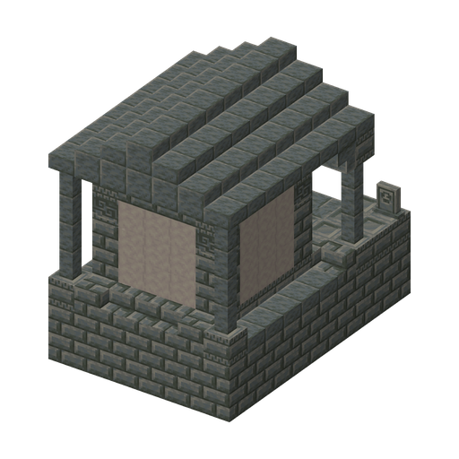</p>

<!-- pictures 160: structure:graveyard_fence* -->
<p>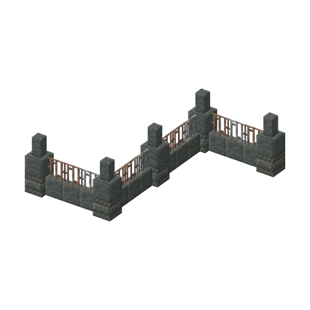 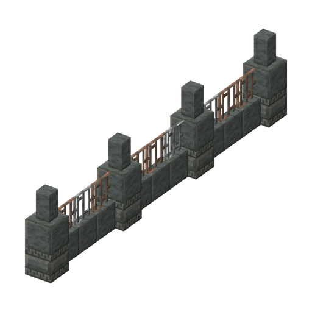 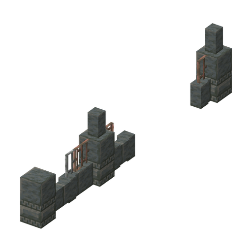 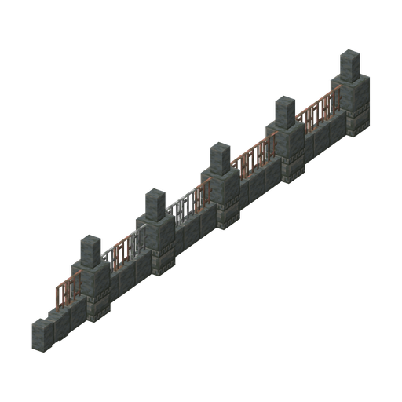 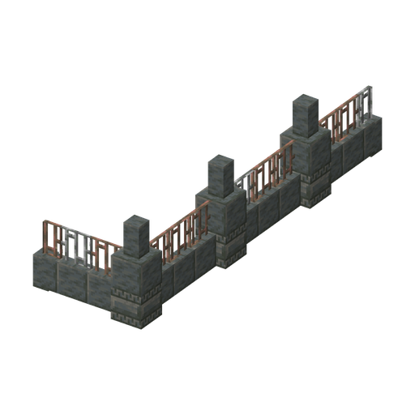 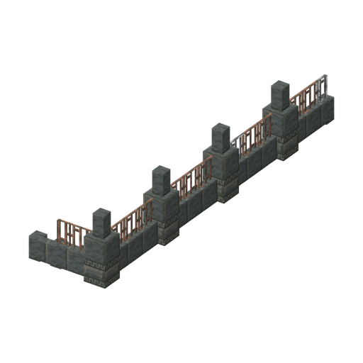</p>

- **Mausoleum**: a small tomb on the surface with a crypt underneath; its treasure chest always holds a Brainz Flag. The picture shows the part above the ground.
- **Graveyard fences**: six small fence pieces of tuff and iron bars that stand around the Graveyard.

### Garden Shack

`sproutsquad:garden_shack`

<!-- pictures 240: structure:garden_shack_* -->
<p>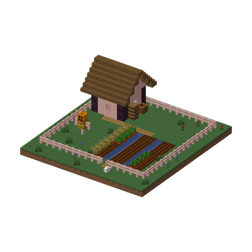 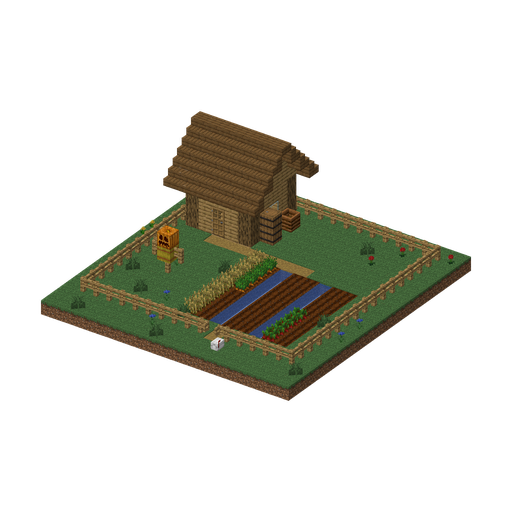 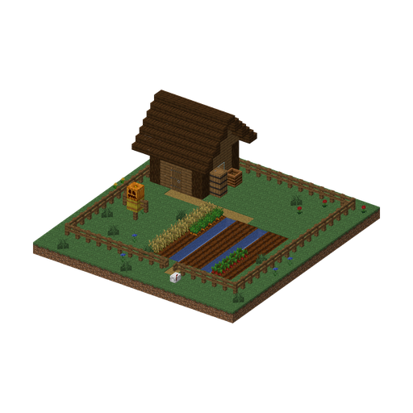</p>

An abandoned vegetable garden with a shed: someone grew fighting plants here and then left. Often the first find in a new world, and it teaches how to tame plants.

- **Where:** plains, sunflower plains, meadows, flower forests, cherry groves; about as rare as villages and never right next to one.
- **Look:** 19×20 blocks. A fenced garden with a gate, beds with water between them, a 5×5 shed of oak, spruce or cherry (the game picks one), a scarecrow, a composter, barrels and a Mailbox by the gate.
- **Inhabitants:** wild Sunflower, Peashooter, Wall Nut and Potling on the beds, which can be tamed with sun; once they are gone, the garden grows new ones. At night Browncoats come.
- **Inside:** the shed chest has 2–3 seed packets, 8–16 sun, plant pots, bone meal or seeds, sometimes a Watering Can (20%) or a Gardening Glove (5%); the barrels hold potatoes, carrots, beetroots and seeds. The Mailbox holds the Gardener's Letter, a book with a tip on taming plants: right-click the mailbox and it pops out.
- **Finding it:** a Cartographer at level 1 may sell a Garden Shack Map (6 emeralds and a compass); the first visit gives the advancement "Someone Else's Garden".

### Robo Junkyard

`sproutsquad:robo_junkyard`

<!-- pictures 240: structure:robo_junkyard_yard -->
<p>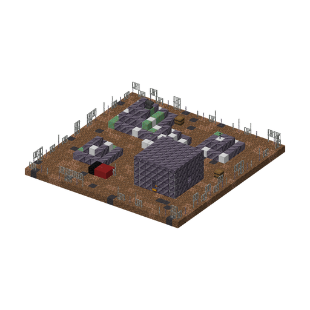</p>

A yard where Engineer Zombies build their machines: piles of scrap, a broken lawn mower and a workshop guarded by turrets. A way to get blueprints and Brainz Alloy without hunting the rare Engineer.

- **Where:** badlands, eroded badlands, wooded badlands, savannas and savanna plateaus; about half as common as villages and never right next to one.
- **Look:** 26×26 blocks. A fence of iron bars and Brainz Alloy posts, open on one side; scrap piles of Brainz Alloy blocks, iron and weathered copper with an anvil and a chain on top; a broken lawn mower; a 7×7 workshop of Brainz Alloy with a door, barred windows and a lantern. Inside: a crafting table, a smithing table, an anvil, the chest and a barrel.
- **Inhabitants:** a hostile Zombie Turret on top of a scrap pile and an Electro Turret by the workshop door. They stay where they are and never despawn (except on Peaceful, like every monster). At night Engineer Zombies, Soldier Zombies and, rarely, a Robo-Zombie come. An Engineer builds a machine only while fewer than two hostile machines stand within 16 blocks of it, so it replaces a turret that was broken.
- **Highlight:** the turrets shoot and zap players and plants that come close: put plants up against them or break them.
- **Inside:** the workshop chest always has one blueprint (Zombie Turret, Electro Turret or Zombie Drone; the Lawn Mower in one chest of ten), 4–10 Brainz Alloy, iron and copper ingots and redstone, and Brainzium in one chest of twenty. Three barrels of scrap hold iron nuggets, raw copper, copper ingots, iron chains and sometimes 1–3 Brainz Alloy.
- **Finding it:** a Cartographer at level 3 may sell a Robo Junkyard Map (12 emeralds and a compass); the first visit gives the advancement "Spare Parts".

## Planned structures

> **Concept, not a finished structure.** The pictures are sketches built from real game blocks (see [how they are made](#pictures)). Sizes, rooms, inhabitants and loot will change as the structures are built. Mobs and items marked *(planned)* do not exist yet; on the sketches, similar existing characters stand in for them. Underground structures are shown cut open.

<p align="center">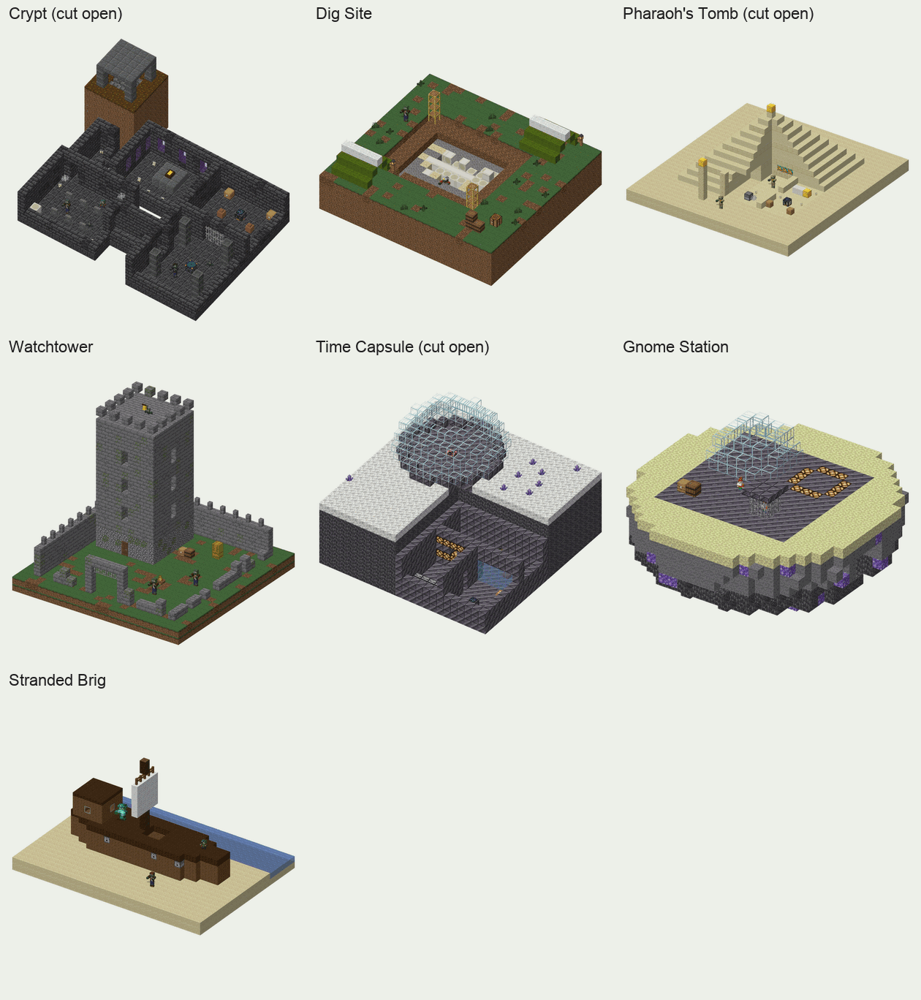</p>

| Structure | Where | Highlight | Main rewards |
|---|---|---|---|
| [Crypt](#crypt) | Graveyard, underground | A trial that gives the Crypt Key, and a vault | The disc "The Great Pumpkin", Brainz Flag, crypt blocks, seeds |
| [Dig Site](#dig-site) | Jurassic Period | A Rex skeleton in the ground, suspicious gravel for the brush | Amber, seeds of the era |
| [Pharaoh's Tomb](#pharaohs-tomb) | Ancient Egypt | The Sphinx's riddle: turn three frames as the hieroglyphs show | Stone Lid shield, gold, hieroglyph tiles |
| [Watchtower](#watchtower) | Dark Ages | "Siege": Tin-Can Knights rise in the courtyard | Old coins, armour, seeds of the era |
| [Time Capsule](#time-capsule) | Far Future | A sealed lab, a vault opened with a Keycard | Chrono crystals, Brainzium |
| [Gnome Station](#gnome-station) | Gnome Space | A caged Gardener Gnome, the landing pad of the boss saucer | Brainzium, an ally |
| [Stranded Brig](#stranded-brig) | Overworld: beaches | The Pirate Captain's ghost on deck at night | A treasure map, a pirate hat |

### What all of them share

- **One highlight.** Every structure has a place or an event to remember (a vault with a key, a riddle, a dinosaur skeleton), not just a box with a chest.
- **A reward for each player.** The main reward is in a vanilla vault: every player opens it with their own key and gets their own loot, so two players do not have to share one chest. Chests hold the small things.
- **Not deadly.** No lava, TNT, arrows, falling sand or pits deeper than three blocks without water. Traps are funny: cobwebs, honey blocks, wind charges and snowballs from dispensers, Buttered and Tangled. Candles light the way.
- **A source, not a warehouse.** A structure is a second way to get something important of its set: seeds, an era material, a key, a disc. Brainzium only rarely.
- **Data, not code.** A structure is templates (`.nbt`), world-generation JSON, processors, loot tables, and trial spawner and vault configs. Code is needed only for new key items and a few events.
- **Built from rooms.** Every room is its own template with jigsaw blocks at the joins, so the game puts the rooms together a little differently each time.
- **Inhabited by the mod's mobs.** Spawns inside the structure's bounds (`spawn_overrides`), Gravestones (each keeps at most two of its zombies alive) and trial spawners configured in JSON.

### Crypt

`sproutsquad:graveyard_crypt` (planned id)

<p align="center">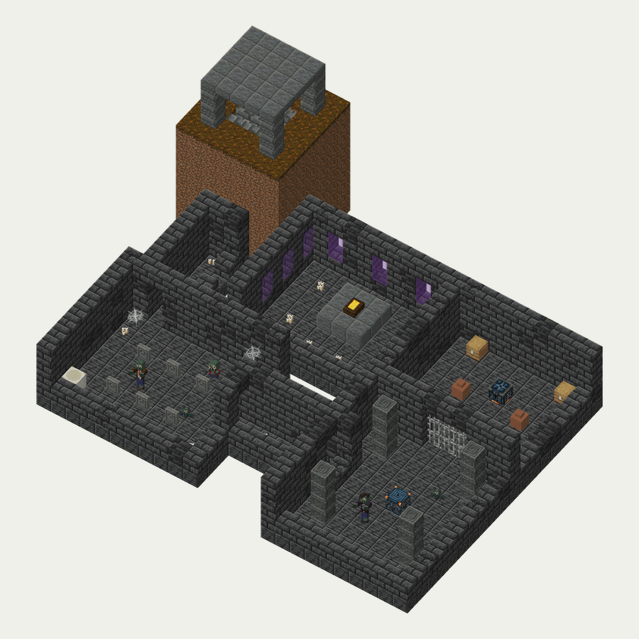</p>

A dungeon under the Graveyard: candle-lit corridors, a hall of gravestones, a trial and a vault at the end. The original Mausoleum stays a small structure on the surface; the Crypt is big and underground.

- **Where:** the Graveyard; only a stone pavilion with stairs going down shows on the surface.
- **Rooms:** entrance, corridors (straight, corner, fork), ossuary (bone blocks, shelves with decorated pots), chapel (stained glass, a coffin on a plinth), gravestone hall, trial hall, vault room. Tuff and deepslate bricks, crypt blocks *(planned)*, cobwebs, candles, pale moss.
- **Inhabitants:** the mod's Gravestones in the hall raise Browncoats, Imps and Zombats; the trial spawner releases Bedsheet Ghosts *(planned)* and Zombats; Lantern Keepers *(planned)* walk the corridors.
- **Highlight:** beat the trial, get the Crypt Key *(planned)*, open the vault: every player gets their own reward.
- **Rewards:** in the vault, the disc "The Great Pumpkin" *(planned)*, a Brainz Flag, seeds of Eyeblossom Watcher, Firefly Buddy *(both planned)* or Grave Buster, a coffin, crypt blocks, rarely Brainzium. Corridor chests: candles, bones, cones, Ominous Bottles, a Potion of Hypnosis, sun.

### Dig Site

`sproutsquad:dig_site` (planned id)

<p align="center">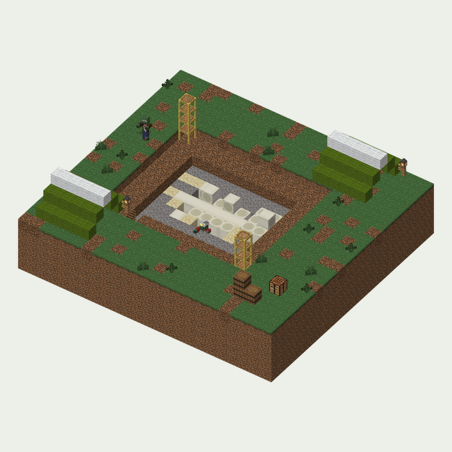</p>

A palaeontologists' camp in the Jurassic Period: tents, scaffolding and a dig with suspicious gravel and sand. The brush finds amber, bones and seeds of ancient plants; a Rex skeleton lies at the bottom of the dig.

- **Where:** the Jurassic Period (the Time Machine's era dimension).
- **Look:** a stepped dig 3–5 blocks deep, ladders and scaffolding, two tents, a skeleton of bone blocks about 15 blocks long, barrels, lanterns, ferns.
- **Inhabitants:** Eggshell Zombies and Pterozombs; Leafasauruses, wild Amberblooms and Horsetail Lancers around *(all planned)*. Rarely, at night, the Fossil Rex boss *(planned)*.
- **Inside:** suspicious gravel and sand give amber, "a bug in amber", bones, seeds of the era's plants, vanilla pottery sherds, rarely a disc. The tent chest has a brush, a map, torches and food.

### Pharaoh's Tomb

`sproutsquad:pharaoh_tomb` (planned id)

<p align="center">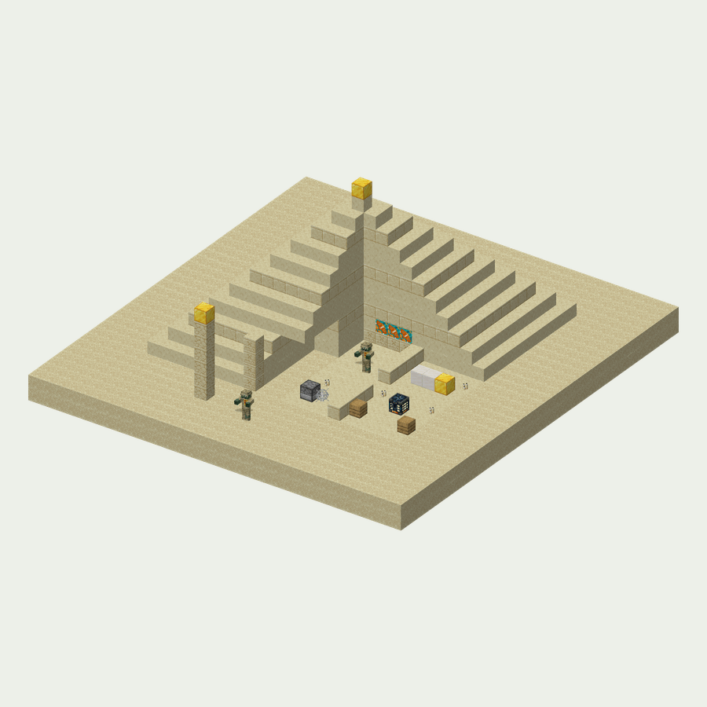</p>

A pyramid in Ancient Egypt with harmless traps and a riddle; the burial chamber holds a sarcophagus and a vault.

- **Rooms:** entrance between obelisks, a gallery walled with hieroglyph tiles *(planned)*, 2–3 trap rooms, the riddle hall, the burial chamber. Sandstone, terracotta, a little gold, candles.
- **Traps:** a pressure plate makes a dispenser shoot wind charges (they push you back) or a Potion of Buttered (you cannot move for 5 seconds); cobwebs in a narrow passage.
- **The Sphinx's riddle:** three frames on the wall, each with an item. Turn every item the way the hieroglyphs in the gallery show, and comparators and pistons open the way to the burial chamber. It is all redstone inside the structure; the hint is always in the same structure.
- **Inhabitants:** Bandage Runners, Lid Bearers and Sand Scarabs *(planned)*; a trial spawner with them in the burial chamber.
- **Rewards:** the vault opens with a Golden Scarab *(planned, the era material)* and holds the Stone Lid shield *(planned)*, gold, seeds of Date Lobber and Mirage Lotus *(planned)*, hieroglyph tiles and a disc. The trap rooms' chests hold Golden Scarabs, sandstone and bones.

### Watchtower

`sproutsquad:watchtower` (planned id)

<p align="center">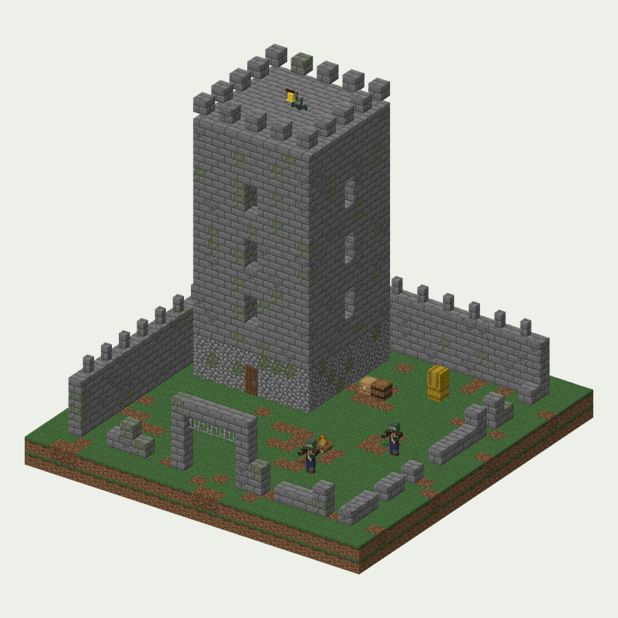</p>

A ruined castle tower on a hill in the Dark Ages: an armoury below, a bell on top. Walk into the courtyard and Tin-Can Knights rise from the walls: a "Siege".

- **Look:** a 9×9 tower of five floors with stairs along the wall, a ruined crenellated wall around a 20×20 courtyard, a gate with a portcullis, a bell on the top, a campfire, banners.
- **Inhabitants:** Tin-Can Knights, Bell Ringers and, at night, Wyrmlings *(all planned)*.
- **Siege:** 3–4 trial spawners in the courtyard and on the walls release Tin-Can Knights and Bell Ringers when a player enters the courtyard; beating them gives the key to the vault on the top. A later version may turn the bell into a three-wave mini raid.
- **Rewards:** the armoury has old coins *(planned)*, iron armour, buckets (the knights' helmets), a shield, arrows, seeds of Burdock Shield and Rosehip Lancer *(planned)*; the vault on the top has coins, a trophy, a disc and, rarely, Brainzium.

### Time Capsule

`sproutsquad:time_capsule` (planned id)

<p align="center">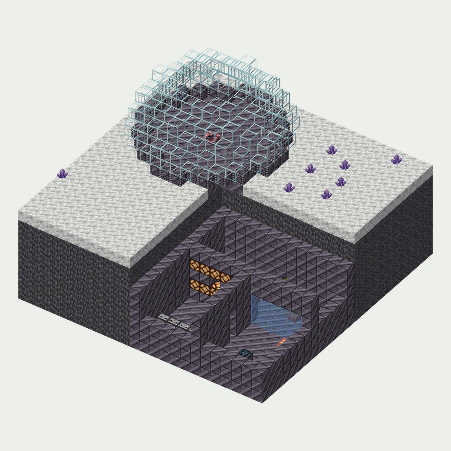</p>

A lab from the Far Future, sealed in time: a glass dome among chrono crystals on the surface, Brainz Alloy corridors, blinking lamps and a vault behind a "force field" underneath.

- **Rooms:** the dome, a shaft down, the lab (tables, glass "flasks", Solar Batteries, plants in pots), the server room (observers, copper and redstone lamps), the vault room behind a glass wall, whose door opens with a button behind the turrets.
- **Inhabitants:** hostile turrets placed with the structure; Hologram Zombies, Hoverboard Zombies and Repair Drones *(planned)*.
- **Rewards:** the vault opens with a Keycard *(planned; in the server room chest, and Hologram Zombies drop it)* and holds chrono crystals *(planned)*, often Brainzium and a disc. Lab chests: Brainz Alloy, redstone, an empty Solar Battery, seeds of Prism Iris and Warp Tulip *(planned)*.

### Gnome Station

`sproutsquad:gnome_station` (planned id)

<p align="center">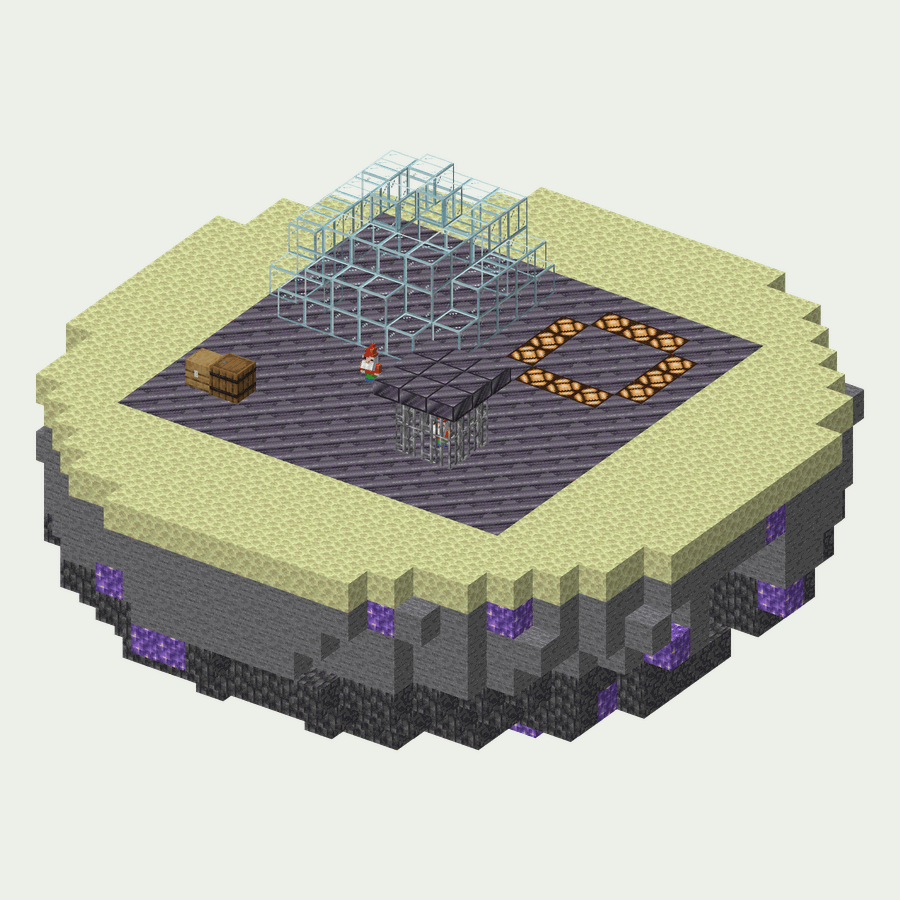</p>

A gnome station on an asteroid of Gnome Space: a Brainzium mine, a hangar, a cage with a captured Gardener Gnome and the landing pad of the Gnome Commander's saucer.

- **Look:** a 16×16 Brainz Alloy platform at the edge of an asteroid, a living dome, a mine with open Brainzium ore *(planned)*, a cage of iron bars, a pad ringed with landing lights.
- **Inhabitants:** Astro Gnomes and Jetpack Gnomes *(planned)*.
- **Highlight:** free the Gardener Gnome *(planned ally)* from the cage and tame it with a golden gnome statue; put a golden statue on the pad to call the saucer boss *(planned)*.
- **Rewards:** the hangar chest has Brainzium, Brainz Alloy, gnome statues and firework rockets for flying in low gravity.

### Stranded Brig

`sproutsquad:stranded_brig` (planned id; optional)

<p align="center">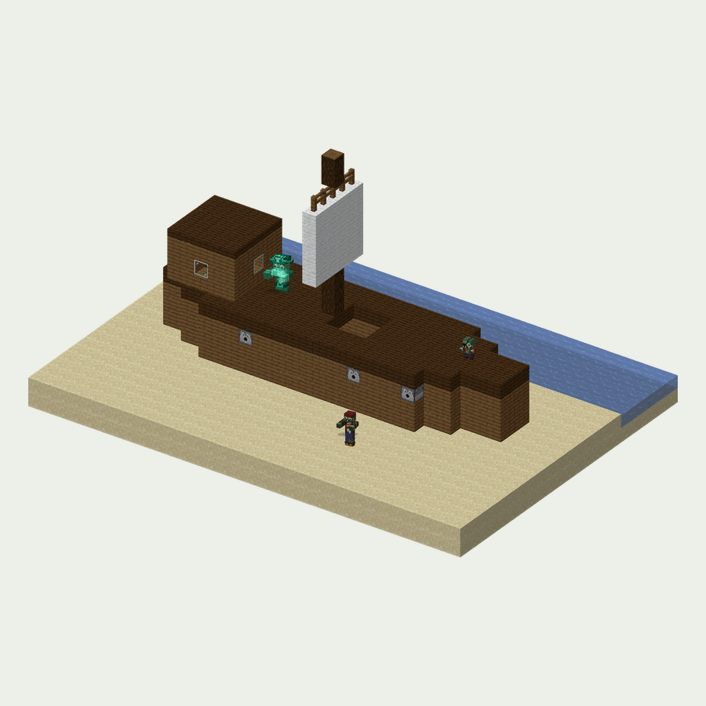</p>

A pirate brig washed up on a beach. In the original the Pirate Captain appears only in raids; the brig gives the pirates a home in the Overworld.

- **Look:** a hull of spruce and dark oak on the sand, a mast with a sail, the captain's cabin, "cannons" of dispensers.
- **Inhabitants:** Buccaneers and Pirate Imps by day, the Pirate Captain Ghost on deck at night.
- **Rewards:** the captain's chest has a treasure map to a vanilla buried treasure, a pirate hat *(planned)*, gold, Sea-shroom seeds and a message in a bottle (a Letter).

## How a structure is made

1. **Sketch.** A plan on squared paper (one square, one block): rooms, the entrance, where the main reward and the highlight are.
2. **Build.** In a separate superflat creative world with the daylight cycle and weather off.
3. **Pieces.** Every room goes into its own structure block (at most 48×48×48), with jigsaw blocks named `sproutsquad:<id>/<join>` at the joins.
4. **Loot.** Chests stay empty and get a loot table: `/data merge block <x y z> {LootTable:"sproutsquad:chests/<id>/<place>"}`. The vault (key, loot) and the trial spawner (config) are set up with `/data merge` too.
5. **Save.** Structure block in Save mode, name `sproutsquad:<id>/<piece>`; turn on "include entities" if there are armour stands, item frames or mobs.
6. **Into the mod.** Copy `run/saves/<world>/generated/sproutsquad/structure/<id>/*.nbt` to `src/main/resources/data/sproutsquad/structure/<id>/`.
7. **World generation.** The JSON files below.
8. **Check.** `/place structure sproutsquad:<id>`, `/locate structure sproutsquad:<id>`, a look at 5–10 of them; `./gradlew runServer`. A GameTest that loads every template and checks its loot tables, vault keys and trial spawner configs is planned.
9. **Docs.** A paragraph here and in [FEATURES](FEATURES.md#structures) (both languages), a `<!-- pictures: structure:<id>_<piece> -->` line and the name in `STRUCTURE_NAMES` (`tools/docs/pictures.py`), then `python3 tools/docs/refresh.py`.

**Or from a scene.** A structure can also start as a scene of blocks in `tools/docs/sketch_structures.py`: `python3 tools/docs/sketch_structures.py --export <id>` writes its templates, with loot tables, block entities and the characters marked as entities. The Garden Shack and the Robo Junkyard were made this way. Once a template is reworked in the game with a structure block, the `.nbt` is the source.

Files of one structure:

```
data/sproutsquad/
  structure/<id>/<piece>.nbt                         templates (rooms)
  worldgen/structure/<id>.json                       jigsaw: biomes, height, terrain adaptation, spawn_overrides
  worldgen/structure_set/<id>.json                   how rare: random_spread (spacing, separation, salt)
  worldgen/template_pool/<id>/{start,rooms,…}.json   pools of rooms
  worldgen/processor_list/<id>_aging.json            ageing: some bricks become cracked or mossy
  tags/worldgen/biome/has_structure/<id>.json        where it stands
  tags/worldgen/structure/on_<id>_maps.json          target of explorer maps
  loot_table/chests/<id>/*.json                      chests, barrels, the vault
  loot_table/archaeology/<id>.json                   suspicious sand and gravel
  trial_spawner/<id>/*.json                          what a trial spawner releases and how many
  advancement/<id>/*.json                            "Found it", "Opened the vault"
assets/sproutsquad/lang/{en_us,ru_ru}.json           names of keys, maps, advancements
```

A structure's id and its template paths do not change after a release: structures in already generated chunks refer to their templates by name.

### Pictures

- **Structures in the mod:** `python3 tools/docs/render_structure.py <path>` draws a template from its `.nbt` (a structure the world generation sinks into the ground is drawn from the ground up; `--whole` draws all of it). `tools/docs/refresh.py` does it for every structure the docs show.
- **Planned structures:** `python3 tools/docs/sketch_structures.py [id]` builds each sketch from blocks described in the script and draws it the same way, with the mod's characters as their pictures. Edit a structure there and run it again; the pictures go to `docs/images/sketches/structures/`.
