# Characters

Every plant, zombie and machine of the mod has its own card. How to add a new character, the checklist and the style guide are in [WORKSHOP](../WORKSHOP.md); what the mod offers overall is in [FEATURES](../FEATURES.md).

## Own characters (Sprout Squad) (1)

| | Character | Role | Status | What it does |
|---|---|---|---|---|
|  | [Potling](potling.md) | sun producer | in code | The mod's mascot: a terracotta pot with a face and a two-leaf sprout. |

## Plants (34)

| | Character | Role | Health | What it does |
|---|---|---|---|---|
| 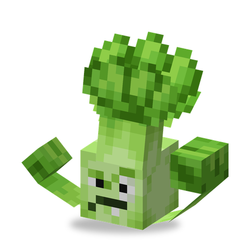 | [Bonk Choy](bonkchoy.md) | melee fighter | 20 | A close-combat plant that punches anything within reach and now and then knocks it into the air with an uppercut. |
| 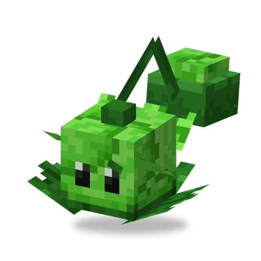 | [Cabbage Pult](cabbagepult.md) | catapult | 20 | A catapult that lobs cabbages over walls and fences at enemies it does not even need to see. |
|  | [Cactus](cactus.md) | long-range shooter | 20 | A desert sniper: it shoots piercing needles at the farthest enemy it can see and pops balloons. |
| 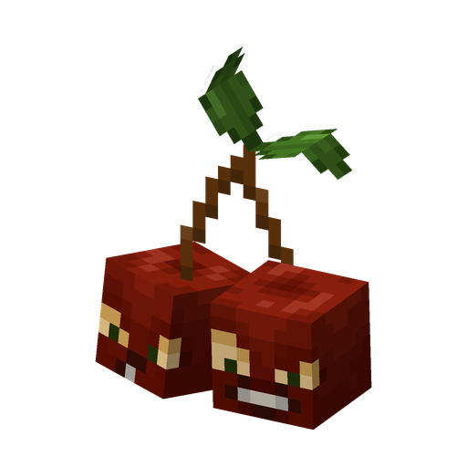 | [Cherry Bomb](cherrybomb.md) | explosive | 20 | A single-use bomb: when an enemy comes close, it swells up and explodes, hitting everything around it. |
|  | [Chomper](chomper.md) | melee | 25 | A carnivorous plant that swallows a nearby zombie in one bite, then spends a long time chewing. |
| 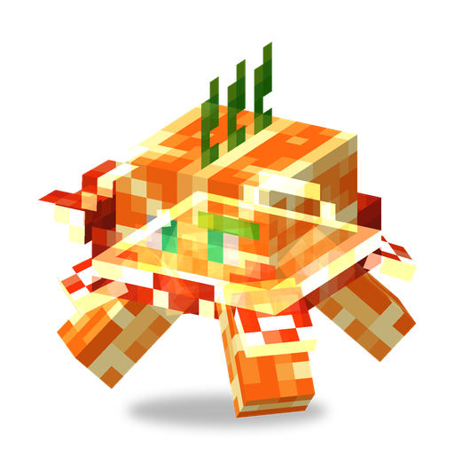 | [Citron](citron.md) | walking laser | 50 | A walking citrus that chases enemies and shoots a thin laser beam at them. |
| 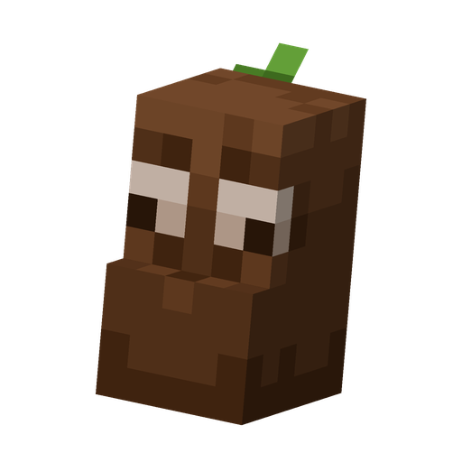 | [Coffee Bean](coffeebean.md) | support | 4 | A one-shot wake-up call: it wakes a sleeping plant next to it for 40 minutes and then disappears. |
| 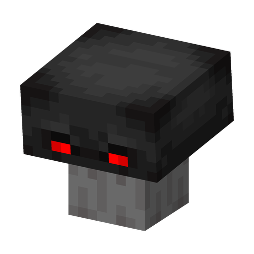 | [Doom Shroom](doomshroom.md) | explosive | 28 | The strongest explosive plant: one huge blast that also tears a crater into the ground. |
|  | [Electric Peashooter](electric_peashooter.md) | shooter | 20 | A Peashooter charged by lightning: its peas electrify enemies, and the charge jumps from one to another. |
| 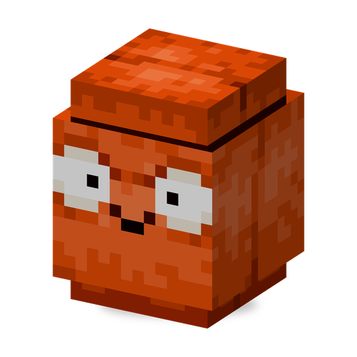 | [Explode-O-Nut](explode_o_nut.md) | explosive wall | 50 | A Wall Nut with a surprise: it holds the line like an ordinary one, but explodes when an enemy finishes it off. |
| 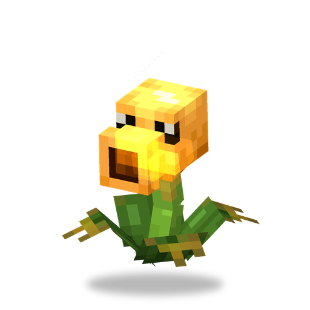 | [Fire Peashooter](fire_peashooter.md) | shooter | 20 | A Peashooter from the Nether whose peas set targets on fire. |
| 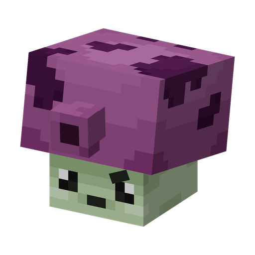 | [Fume Shroom](fumeshroom.md) | fume sprayer | 20 | A mushroom that sprays toxic fumes through every enemy in a line in front of it. |
|  | [Grave Buster](grave_buster.md) | grave remover | 6 | Eats gravestones: planted on one, it chews it up, drops the grave's treasure and disappears. |
| 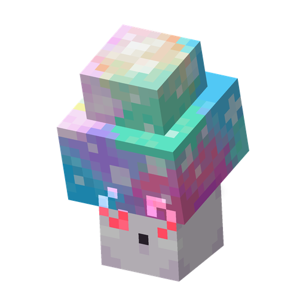 | [Hypno Shroom](hypnoshroom.md) | hypnotist | 4 | A fragile mushroom that turns attackers against their own kind: whoever hits it gets hypnotized. |
| 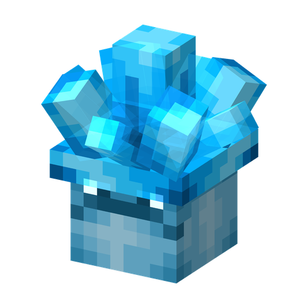 | [Ice Shroom](iceshroom.md) | freezer | 15 | A reusable frost bomb: when an enemy comes close, it bursts with cold and freezes everything around it in place. |
| 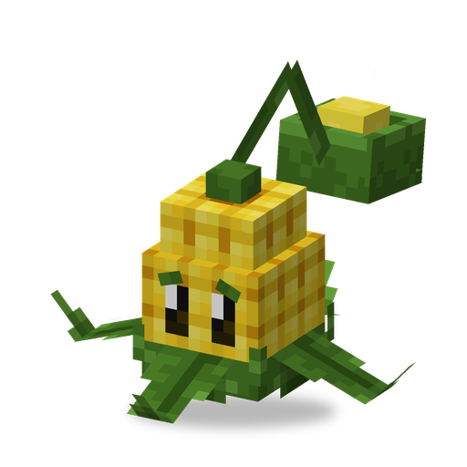 | [Kernel Pult](kernelpult.md) | catapult | 20 | A catapult that lobs corn kernels and, now and then, a pat of butter that sticks the target in place. |
| 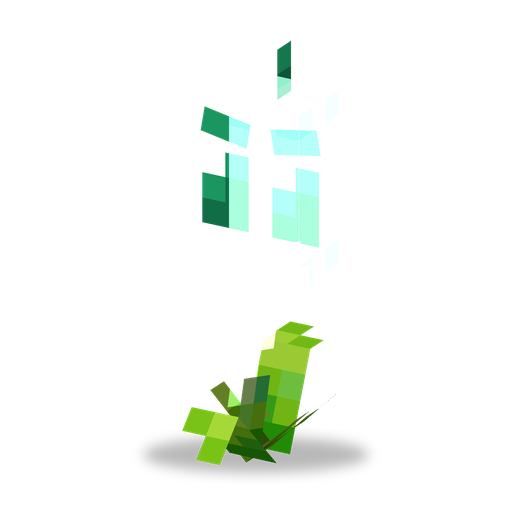 | [Lightning Reed](lightning_reed.md) | zapper | 18 | A thin reed that appears in thunderstorms and strikes nearby enemies with electric arcs that jump on to their neighbours. |
|  | [Marigold](marigold.md) | treasure producer | 16 | A farming plant: instead of a seed packet, its harvest is gold ingots, emeralds and diamonds. |
| 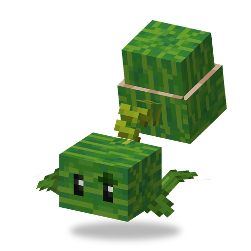 | [Melon Pult](melonpult.md) | catapult | 35 | The heaviest catapult: slow, but every melon hits hard and damages everything around the impact. |
|  | [Peashooter](peashooter.md) | shooter | 20 | The basic shooter: fires peas at zombies it can see. |
| 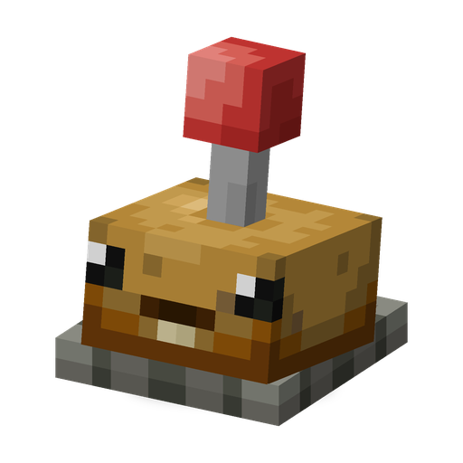 | [Potatomine](potatomine.md) | mine | 8 | A cheap trap: it arms itself after planting and blows up the first enemy that steps on it. |
| 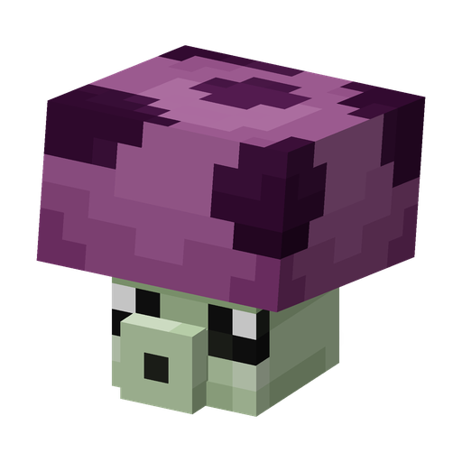 | [Puff Shroom](puffshroom.md) | shooter | 12 | A free short-range mushroom that shoots toxic spores; it works at night and sleeps in daylight. |
|  | [Pumpkin](pumpkin.md) | armor | 35 | A protective shell: put over another plant, it soaks up damage before the plant inside gets hurt. |
| 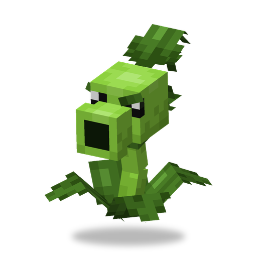 | [Repeater](repeater.md) | shooter | 20 | A Peashooter that fires peas in pairs, doing twice the damage of the ordinary one. |
| 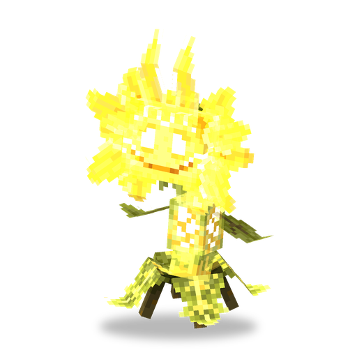 | [Royal Sunflower](royal_sunflower.md) | walking laser | 450 | A giant walking sunflower that burns enemies with a long sun beam. |
| 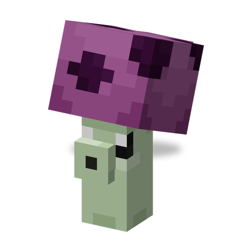 | [Scaredy Shroom](scaredyshroom.md) | long-range shooter | 18 | A long-range spore shooter that hides as soon as an enemy gets too close. |
| 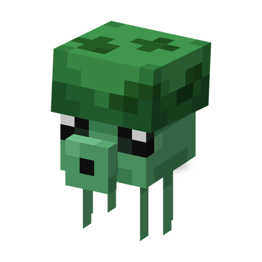 | [Sea Shroom](seashroom.md) | aquatic shooter | 12 | A free mushroom that sits on the water and shoots water spores at nearby zombies. |
| 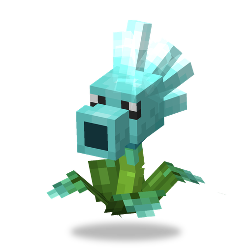 | [Snow Pea](ice_peashooter.md) | shooter | 20 | A Peashooter from snowy lands whose frozen peas slow enemies down. |
|  | [Squash](squash.md) | crusher | 20 | A single-use plant that leaps onto a nearby zombie and flattens it. |
|  | [Sun Shroom](sunshroom.md) | sun producer | 20 | A sun maker for the dark: it produces sun at night, in caves and under a roof, and gives more once it has grown up. |
|  | [Sunflower](sunflower.md) | sun producer | 20 | The basic economy plant: it does not fight, but regularly drops sun that pays for planting everything else. |
| 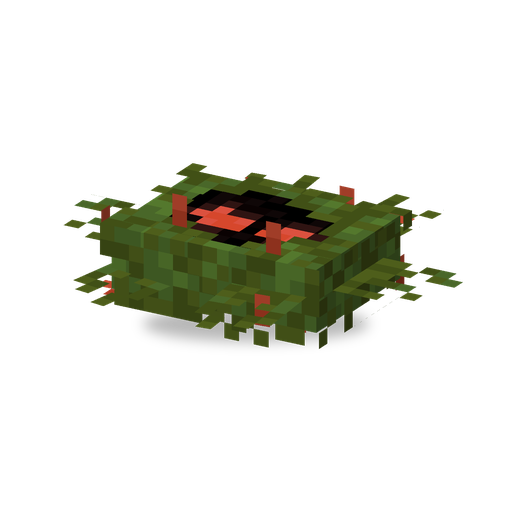 | [Tangle Kelp](tanglekelp.md) | aquatic trapper | 25 | A water plant that bites a nearby enemy, roots it in place and drags it towards itself. |
|  | [Wall Nut](wallnut.md) | wall | 50 | A sturdy living wall: it does not attack, but blocks the way and keeps zombies busy chewing on it. |
|  | [Winter Melon](winter_melon.md) | catapult | 35 | A frost version of the Melon Pult that lobs frozen melons and chills everything around the impact. |

## Zombies (20)

| | Character | Role | Health | What it does |
|---|---|---|---|---|
| 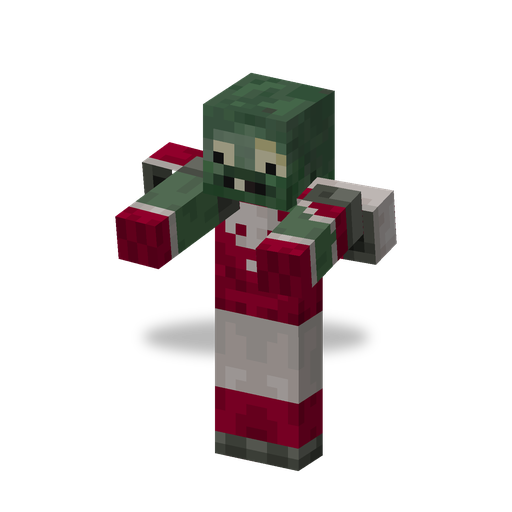 | [All Star](all_star.md) | charger | 55 | An armoured football player in a Football Helmet. |
|  | [Backup Dancer](backup_dancer.md) | minion | 12 | A fast, fragile dancer that the Disco Zombie summons in groups of up to three. |
| 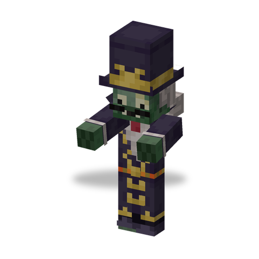 | [Baron Von Bats](baron_von_bats.md) | vampire boss | 450 | A vampire lord that appears only as a raid boss. |
| 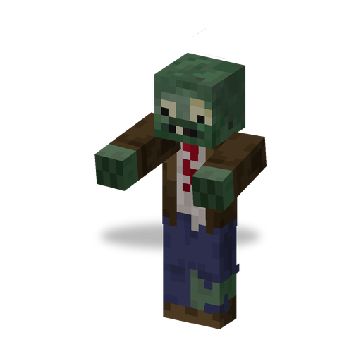 | [Browncoat](browncoat.md) | basic | 20 | The most common zombie of the mod and the backbone of every raid. |
| 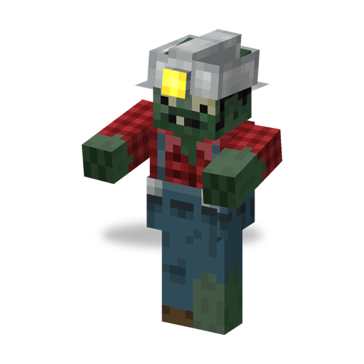 | [Digger Zombie](digger_zombie.md) | tunneller | 35 | A miner with an iron pickaxe that lives deep underground. |
| 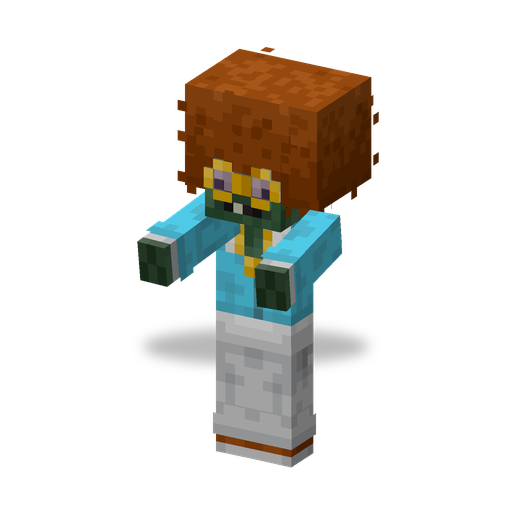 | [Disco Zombie](disco_zombie.md) | summoner | 60 | A dancing zombie that calls a troupe of Backup Dancers out of the ground around itself, again and again. |
|  | [Electric Slide](electric_slide.md) | electric | 120 | A disco zombie on roller skates that zaps its targets with electricity. |
| 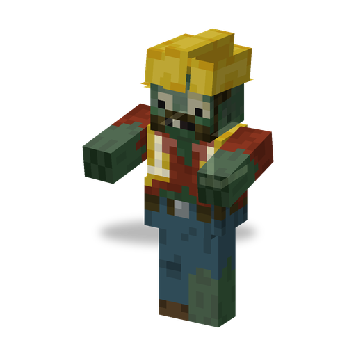 | [Engineer Zombie](engineer_zombie.md) | builder | 35 | A zombie with a blueprint instead of a weapon. |
| 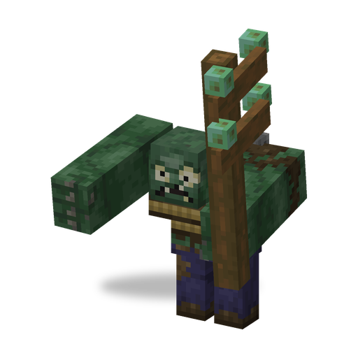 | [Gargantuar](gargantuar.md) | giant | 600 | A huge zombie that appears only as a raid boss. |
| 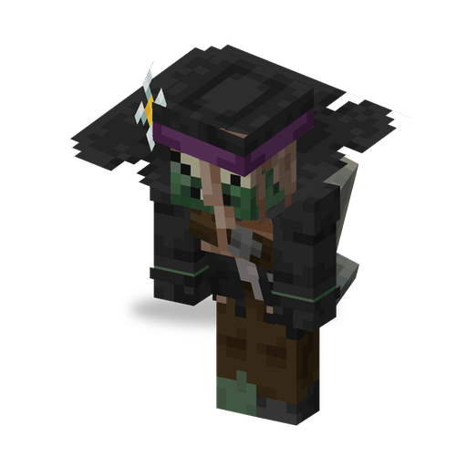 | [Grave Digger](grave_digger.md) | gravestone thrower | 30 | A zombie with a shovel that digs up Gravestones and hurls them at its target. |
|  | [Imp](imp.md) | small | 20 | A small, quick zombie with a toxic bite. |
| 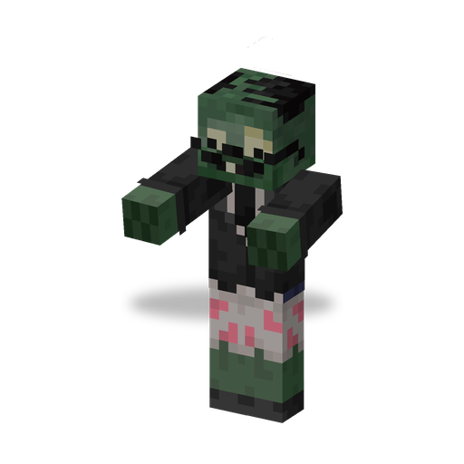 | [Newspaper Zombie](newspaper_zombie.md) | shielded | 25 | A zombie that hides behind a Newspaper. |
|  | [Pirate Captain](pirate_captain.md) | shooter | 80 | The commander of the Pirate Invasion: a sturdy zombie with a crossbow that fires firework rockets. |
| 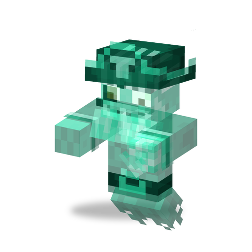 | [Pirate Captain Ghost](pirate_captain_ghost.md) | ghost | 50 | The second life of the Pirate Captain: a flying ghost with a sword that passes through walls. |
|  | [Robo-Zombie](robo_zombie.md) | machine | 128 | A heavily armoured war robot. |
| 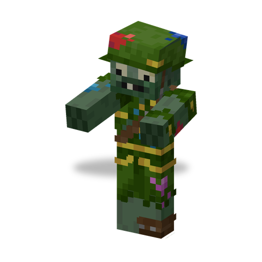 | [Soldier Zombie](soldier_zombie.md) | shooter | 35 | An armoured ranged zombie with a Dye Blaster. |
| 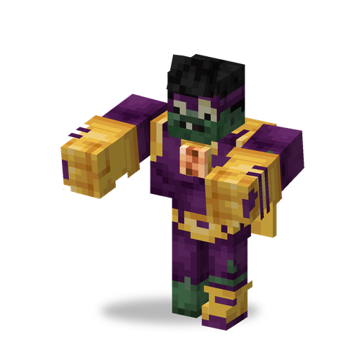 | [Super Brainz](super_brainz.md) | superhero | 160 | A zombie superhero in heavy armour. |
| 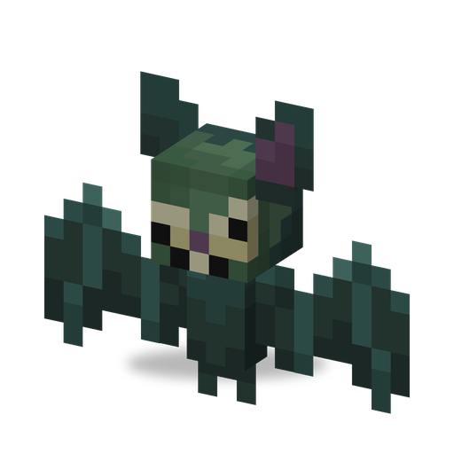 | [Zombat](zombat.md) | flyer | 20 | A zombie bat that flies and heals itself with every bite. |
| 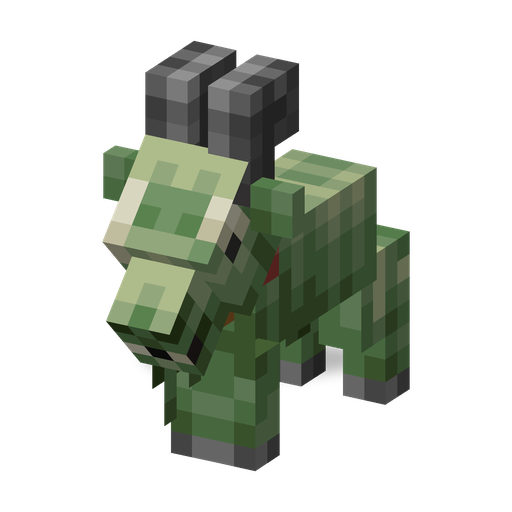 | [Zombie Goat](zombie_goat.md) | mount | 14 | A small undead mountain goat. |
| 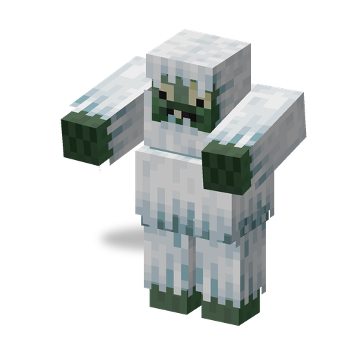 | [Zombie Yeti](zombie_yeti.md) | heavy | 120 | A big furry zombie of the snowy lands. |

## Machines (4)

| | Character | Role | Health | What it does |
|---|---|---|---|---|
|  | [Electro Turret](electro_turret.md) | electric | 8 | A stationary turret that strikes nearby targets with an electric arc and leaves them Electrified. |
| 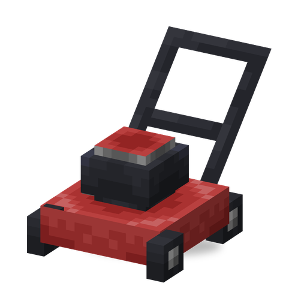 | [Lawn Mower](lawn_mower.md) | last line of defence | 20 (breaks from a single player hit) | A one-shot last line of defence, as in the original game. |
| 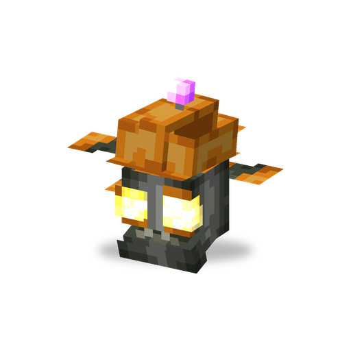 | [Zombie Drone](zombie_drone.md) | flying melee | 8 | A small flying robot that strikes its target in melee. |
| 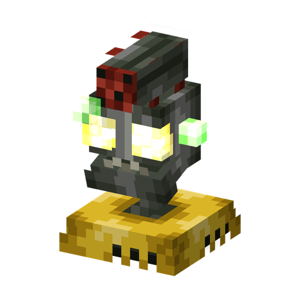 | [Zombie Turret](zombie_turret.md) | shooter | 8 | A stationary laser gun. |

## Other creatures (1)

| | Character | Role | Health | What it does |
|---|---|---|---|---|
| 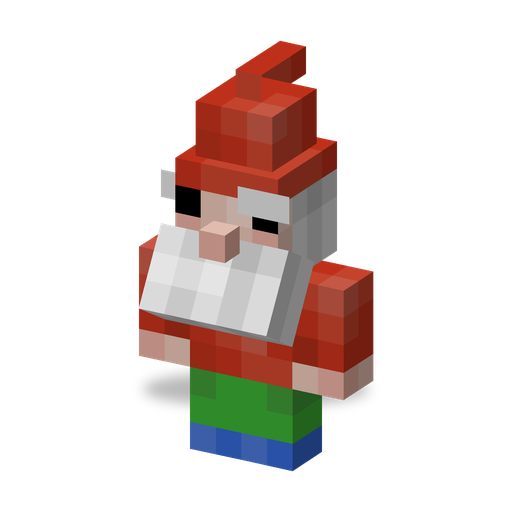 | [Garden Gnome](gnome.md) | hostile gnome | 18 | A small hopping gnome that fights for no side. |

## Card template for a new own character

Copy it to `docs/en/characters/<id>.md` and write the Russian card `docs/ru/characters/<id>.md` too; render its picture with `python3 tools/docs/render_character.py <id>`, then rebuild this index with `python3 tools/docs/build_character_index.py`. Statuses: `idea` → `model` → `in code` → `done`.

```markdown
# <Name>

<p align="center">.png" alt="<Name>" width="320"></p>

**Plant · <role>** · Sprout Squad

One or two sentences: what it is for.

| | |
|---|---|
| Id | `sproutsquad:<id>` |
| Health | |
| Sun cost | |
| Size | |
| Attack | |
| At night | |
| How to get | recipe / loot / trade / seed mutation |

## Abilities

- …

## Card

| | |
|---|---|
| Idea | |
| Sketch | `art/<id>/sketch.png` |
| Status | idea |
```
