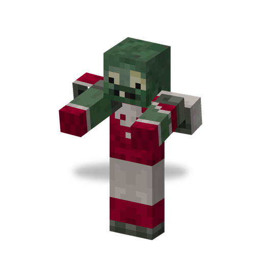
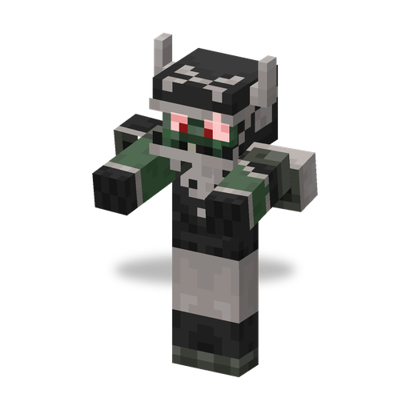

# All Star

**Zombie · charger** · Plants & Zombies (original)

An armoured football player in a Football Helmet. It keeps charging at its target and bowls over everything in its way.

| | |
|---|---|
| Id | `sproutsquad:all_star` |
| Health | 55 |
| Armor | 8 (plus the Football Helmet) |
| Damage | 7 |
| Speed | 0.23; about 8 blocks per second while charging |
| Knockback resistance | 0.2; cannot be knocked back while charging |
| Size | 0.6 × 1.95 blocks |
| Spawns | in the dark in `#sproutsquad:zombie/has_all_star` (the [Browncoat](browncoat.md) biomes): weight 12, alone; in the Graveyard also by day; out of Gravestones (1 of 53 spawns) |
| Raids | regular waves from wave 6; Half-Time Showdown (waves 2–6, 2–10 per wave) |
| Leader / boss | raid boss as the Giga-Football Zombie in waves 1–7 of any wave type, one per three wave numbers (at least one) |
| Drops | 2 %: Football Helmet at 40–90 % durability, if killed by a player or a plant |
| Variants | All Star, Giga-Football Zombie |

## Abilities

- Charge: while fighting and more than 1.5 blocks from its target, every 6–9 s it whistles and dashes straight ahead for 2 s.
- During a charge it cannot be knocked back, its hits knock back much harder, and whatever it bumps into is thrown aside: other zombies a little, players and other creatures far.
- Steps up full blocks; wears a Football Helmet that it never drops from the slot (the helmet wears as it stops projectiles from above and can break); does not pick up items; breaks doors.
- Shares the [traits of all mod zombies](browncoat.md#traits-of-all-mod-zombies).

## Variants

| | Variant | Difference |
|---|---|---|
|  | All Star | default |
|  | Giga-Football Zombie (`giga`) | raid boss form: no helmet, +4 armour, scale +0.33, health ×3.25 (about 179), damage ×2.5 (17.5); a spawn egg with this variant gives the boss stats too |

## Interactions

- The Football Helmet it drops lets a player charge into enemies while sprinting.
- As a raid boss it takes only 40 damage from a player's [Lawn Mower](lawn_mower.md) instead of being mowed down (Sprout Squad).
- Advancement "The Three Zombieteers": defeat an All Star, a [Disco Zombie](disco_zombie.md) and a [Zombie Yeti](zombie_yeti.md).
