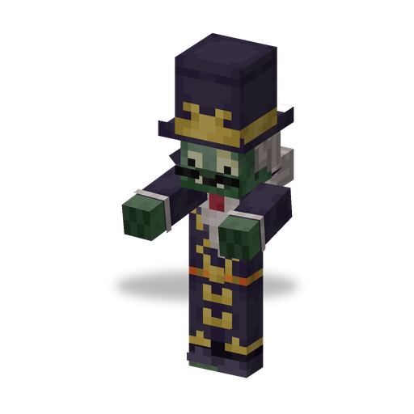

# Baron Von Bats

**Zombie · vampire boss** · Plants & Zombies (original)

A vampire lord that appears only as a raid boss. It keeps its distance, shoots a staff beam, calls Vampire Zombies, teleports away and dissolves into a swarm of Zombats.

| | |
|---|---|
| Id | `sproutsquad:baron_von_bats` |
| Health | 450 |
| Armor | 10 |
| Damage | staff beam 7; no melee attack |
| Speed | 0.21 (×1.5 while it moves to keep its distance) |
| Knockback resistance | 0.3 |
| Size | 0.6 × 1.95 blocks |
| Spawns | no natural spawns |
| Raids | not part of the wave lists |
| Leader / boss | raid boss in waves 6–18 of regular and Zomboween waves, one per seven wave numbers (at least one) |
| Drops | 8.5 %: Baron's Staff at 60–90 % durability, if killed by a player or a plant |

## Abilities

- Staff beam: about every 11 s, at targets within 14 blocks, it stops and fires its Baron's Staff — a thin beam that deals 7 damage to every creature along it and stops at blocks.
- Vampire Zombies: every 13–15 s it summons up to 3 Vampire [Browncoats](browncoat.md) around itself (20 % of them in a Coffin); at most 3 of its own alive, and none while 7 or more Browncoats are within 16 blocks. They join the raid but ignore the flag.
- Teleport: when its target comes within 10 blocks, it teleports 16–24 blocks away from it (at most once per 9.5–14.5 s).
- Bat swarm: every 30–50 s it turns into 6–7 [Zombats](zombat.md) for up to 10 s. Meanwhile it is invisible and cannot be hurt; its health is split among the bats. The bat that carries it bears its name and passes damage on to it; the bats' bites heal it. It returns when the time is up or all bats are dead, and the remaining bats vanish.
- Keeps about 7 blocks from its target and always faces it.
- Cannot be hypnotized; too big for a [Chomper](chomper.md) to swallow (over 100 health).
- Gives 100 experience.
- Shares the [traits of all mod zombies](browncoat.md#traits-of-all-mod-zombies).

## Interactions

- As a raid boss it takes only 40 damage from a player's [Lawn Mower](lawn_mower.md) instead of being mowed down (Sprout Squad).
- Advancement "Head Honchos": defeat a Baron Von Bats, an [Electric Slide](electric_slide.md) (Electric Boogaloo) and a [Gargantuar](gargantuar.md).
