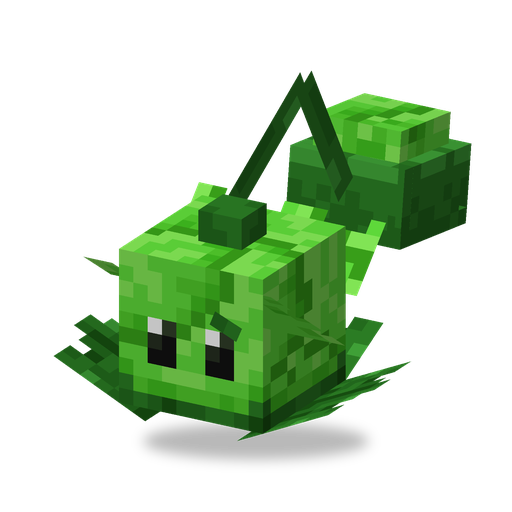

# Cabbage Pult

**Plant · catapult** · Plants & Zombies (original)

A catapult that lobs cabbages over walls and fences at enemies it does not even need to see.

| | |
|---|---|
| Id | `sproutsquad:cabbagepult` |
| Health | 20 |
| Sun cost | 5 |
| Size | 0.9 × 0.8 blocks |
| Attack | a cabbage about every 2 s, 2 damage, small splash |
| Range | 22 blocks, no line of sight needed |
| At night | stays awake |
| Limit | 30 within 32 blocks |
| How to get | grows wild in plains, sunflower plains, flower forests and forests (alone); village house chests |

## Abilities

- Throws in a high arc, so it hits enemies behind walls and fences that would block a straight shot. Aims ahead of moving targets.
- On impact the cabbage also pushes back creatures right around the hit point and slightly hurts them; plants are not affected.
- Targets zombies of any kind; a tamed Cabbage Pult also other monsters, but never creepers. Fights back against whoever hurts it.

## Interactions

- Other catapults: [Kernel Pult](kernelpult.md) (its butter holds the target in place) and [Melon Pult](melonpult.md) (strong splash damage).
- A wild one is tamed by feeding it sun: about 36% chance per sun.
