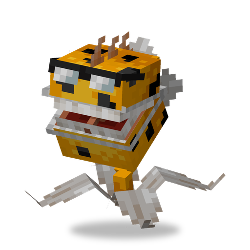

# Chomper

**Plant · melee** · Plants & Zombies (original)

A carnivorous plant that swallows a nearby zombie in one bite, then spends a long time chewing.

| | |
|---|---|
| Id | `sproutsquad:chomper` |
| Health | 25 |
| Sun cost | 7 |
| Size | 0.6 × 1.5 blocks |
| Attack | a bite, 10 damage; most targets are swallowed whole |
| Range | notices targets within 4.75 blocks, bites within 2.25 |
| Chewing | about 35 s after each kill |
| At night | stays awake |
| Limit | 30 within 32 blocks |
| How to get | grows wild in swamps, mangrove swamps and jungles (alone) |

## Abilities

- Hunts zombies, fish and chickens. A tamed Chomper also bites other monsters; a wild one bites players too.
- A bite kills any creature with at most 100 max health on the spot and swallows it.
- Large creatures take only the plain 10 damage: players, bosses, wardens, ravagers, iron golems, hoglins, zoglins, ghasts, camels, the [Zombie Yeti](zombie_yeti.md), [Robo-Zombie](robo_zombie.md), [Super Brainz](super_brainz.md), [Gargantuar](gargantuar.md), and anything with more than 100 max health.
- After a kill it chews for about 35 s and cannot bite meanwhile. Between bites that do not kill, it waits about 3.5 s.

## Interactions

- Best paired with shooters that cover it while it chews, and with a [Wall Nut](wallnut.md) that holds zombies within reach.
- A wild one is tamed by feeding it sun: about 24% chance per sun.
- Named `chester` with a name tag, it gets a different look.

<!-- pictures: chomper_chester -->

