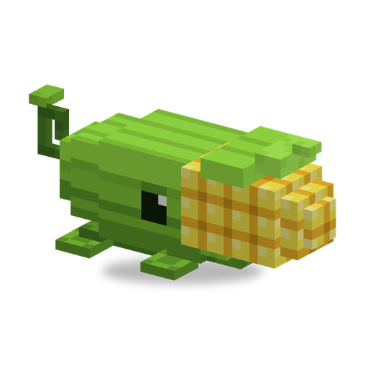

# Corn Cannon

**Plant · artillery** · Sprout Squad

A long corn husk lying on a rosette of leaves, with an eye on each side, a curly tendril at the back and a big corn cob sticking out of the front. It lifts its nose and launches the cob like a rocket in a high arc; the cob blows up where it lands and the cannon grows a new one in 3 seconds.

| | |
|---|---|
| Id | `sproutsquad:corn_cannon` |
| Health | 90 |
| Sun cost | 14 |
| Size | 1.2 × 0.9 blocks (the model is about 1.8 blocks long) |
| Attack | a corn cob every 3.5 s; it explodes on impact: 8 damage at the centre, down to 4 at the edge, radius 2.5 blocks |
| Range | 5 to 40 blocks, no line of sight needed |
| At night | does not sleep |
| Limit | 10 within 32 blocks |
| How to get | crafting: a [Kernel Pult](kernelpult.md) seed packet in the middle and 8 sun around it → Corn Cannon seed packet; does not grow wild |

## Abilities

- Targets zombies of any kind; a tamed Corn Cannon also other monsters, but never creepers.
- It does not see zombies within 5 blocks: it does not aim at one that close, and lets go of a target that comes within 5 blocks.
- A shot: the nose lifts and the eyes squint, the cob leaves about half a second later, and the husk kicks back. The empty husk is dark inside until the new cob has grown back out of it.
- The cob flies in a high arc, over walls and fences, and aims ahead of moving targets. It has the same cone at both ends and leaves no flame or smoke.
- The blast hurts only what the cannon shoots at. Players, pets, villagers and plants are not hurt, and the cob flies through them. It breaks no blocks and sets no fire. Popcorn flies out of the blast.

## Notes

- Under a roof the cob hits the ceiling: the cannon needs open sky above it, like the [Melon Pult](melonpult.md).
- About twice as strong as the [Melon Pult](melonpult.md), as its author wanted; the price is the Kernel Pult and 8 sun in the recipe, 14 sun to plant and the limit of 10.
- The [Poppy Rattle](poppy_rattle.md) never hands it out.
- Uses the original mod's sounds for now: a low shot and the missile's explosion.

## Interactions

- The seed packet recipe in a crafting table:

  | | | |
  |---|---|---|
  | Sun | Sun | Sun |
  | Sun | Kernel Pult seed packet | Sun |
  | Sun | Sun | Sun |

- Zombies held by butter from a [Kernel Pult](kernelpult.md) are easy targets for its slow cob.

## Card

| | |
|---|---|
| Idea | the idea's author: a corn cannon that fires its cob like a rocket, 90 health, 14 sun, 8 damage, a 3-second reload, crafted from a Kernel Pult and sun |
| Sketch | `art/corn_cannon/sketch.jpg`; textures are drawn by `art/corn_cannon/draw_corn_cannon.py` |
| Status | in code |
