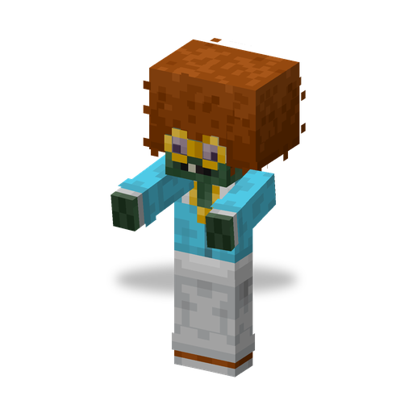

# Disco Zombie

**Zombie · summoner** · Plants & Zombies (original)

A dancing zombie that calls a troupe of [Backup Dancers](backup_dancer.md) out of the ground around itself, again and again.

| | |
|---|---|
| Id | `sproutsquad:disco_zombie` |
| Health | 60 |
| Armor | 0 |
| Damage | 6 |
| Speed | 0.235 |
| Knockback resistance | 0.2 |
| Size | 0.64 × 1.96 blocks |
| Spawns | in the dark in `#sproutsquad:zombie/has_disco_zombie` (the [Browncoat](browncoat.md) biomes): weight 12, alone; in the Graveyard also by day; out of Gravestones (2 of 53 spawns) |
| Raids | regular waves from wave 6; Disco of the Undead (waves 4–15) |
| Leader / boss | no |
| Drops | 4 %: [Hypno Shroom](hypnoshroom.md) seed packet, if killed by a player or a plant; the music disc "Grassy Groove" (`sproutsquad:music_disc_grassy_groove`) if killed by a Backup Dancer |

## Abilities

- Summoning: when it has a living target, it stops, dances for about 2 s and raises up to 3 [Backup Dancers](backup_dancer.md) in a ring 2 blocks around itself. It repeats this every 13–15 s.
- It keeps at most 3 of its own dancers alive and does not summon while 7 or more dancers are within 16 blocks.
- Its dancers ignore the raid flag and do not join the raid; if the Disco Zombie is hypnotized, its new dancers are hypnotized too.
- Melee hits of 6 damage; breaks doors.
- Shares the [traits of all mod zombies](browncoat.md#traits-of-all-mod-zombies).

## Interactions

- The music disc drops only when a Backup Dancer lands the killing blow — in practice a dancer turned by a [Hypno Shroom](hypnoshroom.md).
- A name tag "MJ" gives it a special texture.
- Advancement "The Three Zombieteers": defeat an [All Star](all_star.md), a Disco Zombie and a [Zombie Yeti](zombie_yeti.md).
