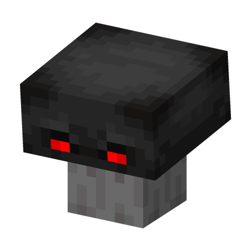

# Doom Shroom

**Plant · explosive** · Plants & Zombies (original)

The strongest explosive plant: one huge blast that also tears a crater into the ground.

| | |
|---|---|
| Id | `sproutsquad:doomshroom` |
| Health | 28 |
| Sun cost | 14 |
| Size | 0.6 × 0.8 blocks |
| Attack | a single explosion of power 7; it also destroys blocks within ~3.5 blocks |
| Trigger | a target within 4 blocks; fuse ~2.4 s |
| At night | awake; sleeps while it sees the daytime sky |
| Limit | 20 within 32 blocks (most plants: 30) |
| How to get | bastion chests (35%); raid rewards in the Mailbox (regular waves, from the 9th reward on); grows wild in the Basalt Deltas (Nether); a wild one is tamed with sun (~5% per sun) |

## Abilities

- Single use: the Doom Shroom is gone after the blast.
- The blast hurts every creature in range except plants, players included.
- Breaking blocks follows the `mobGriefing` game rule.
- Targets zombies (mod and vanilla); a tamed one also hostile mobs; a wild one also players.
- Survives on gravel and basalt as well as on soil.
- Sleeps while the sun is visible to it (daytime and open sky); in the Nether there is no sky light, so it never sleeps there.

## Interactions

- Also grows on netherrack: it spawns there in the Nether and no longer dries out on it (Sprout Squad).
- Flint and steel lights it while it is idle and awake: it swells up and goes off; the lighter wears out, and someone else's tamed plant follows the usual ownership rules (`coopPlanting`). Sprout Squad fixed this; in the original the lighter never worked.
- If it wore a [Pumpkin](pumpkin.md), the Pumpkin is left standing after the blast.
- A [Coffee Bean](coffeebean.md) keeps it awake by day for 40 minutes.
- The [Ice Shroom](iceshroom.md) uses the same fuse, but freezes instead of exploding and is not used up.
