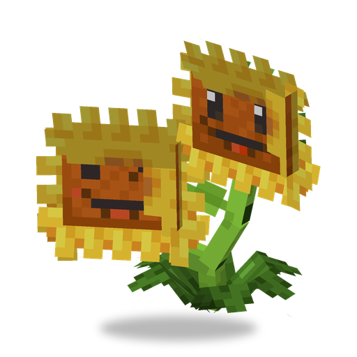

# Double Sunflower

**Plant · sun producer** · Sprout Squad

A Sunflower with two stems and a flower on each: a tall one at the back with the Sunflower's face and a short one in front that winks. Each head drops its own sun, so it makes twice the sun of a [Sunflower](sunflower.md) in the same time.

| | |
|---|---|
| Id | `sproutsquad:double_sunflower` |
| Health | 30 |
| Sun cost | 8 |
| Size | 0.9 × 1.5 blocks |
| Sun | 2 sun (one from each head) about every 45 s while awake |
| Attack | none |
| At night | sleeps |
| Limit | 30 within 32 blocks |
| How to get | [Sunflower](sunflower.md) seeds grown on farmland turn into it 10% of the time; crafting: 2 Sunflower seed packets in the middle column (centre and bottom) and 7 sun in the other slots → Double Sunflower seed packet; does not grow in the wild |

## Abilities

- About every 45 s each head drops a sun, 2 in all. Both heads start to glow shortly before. A baby Double Sunflower drops one.
- Sleeps whenever it cannot see the sun, at night and underground; while it sleeps no sun is made. Asleep, both heads hang down.
- At rest its two heads sway in turn, one to the left while the other goes right.
- Does not attack.

## Interactions

- A [Coffee Bean](coffeebean.md) wakes it up, and an awake one keeps making sun through the night, like a Sunflower.
- The seed packet recipe in a crafting table:

  | | | |
  |---|---|---|
  | Sun | Sun | Sun |
  | Sun | Sunflower seed packet | Sun |
  | Sun | Sunflower seed packet | Sun |

- Grown on farmland its own seeds stay Double Sunflower seeds.

## Card

| | |
|---|---|
| Idea | the idea's author: a sunflower with two stems and a flower on each, about half as strong again, two sun in a Sunflower's time |
| Sketch | the Sunflower's model and texture; textures are drawn by `art/double_sunflower/draw_double_sunflower.py` |
| Status | in code |
