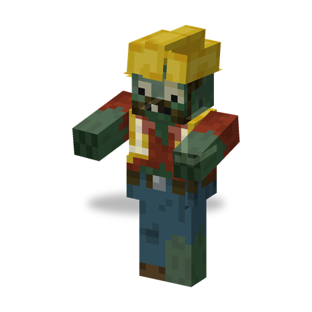

# Engineer Zombie

**Zombie · builder** · Plants & Zombies (original)

A zombie with a blueprint instead of a weapon. It does not fight itself, but keeps building hostile battle machines next to it while it has a target.

| | |
|---|---|
| Id | `sproutsquad:engineer_zombie` |
| Health | 35 |
| Armor | 0 |
| Damage | none: it has no melee attack |
| Speed | 0.24 |
| Knockback resistance | 0.2 |
| Size | 0.63 × 1.95 blocks |
| Spawns | in the dark at the [Robo Junkyard](../STRUCTURES.md#robo-junkyard) only: weight 3 of the junkyard's 7, alone |
| Raids | regular waves from wave 8; Robo Army (waves 10–16, only after the raid starter has seen the end credits) |
| Leader / boss | no |
| Drops | 30 %: 1–2 Brainz Alloy (any death); 8.5 %: a blueprint of the [Zombie Turret](zombie_turret.md), [Electro Turret](electro_turret.md) or [Zombie Drone](zombie_drone.md), if killed by a player or a plant |

## Abilities

- Building: while it has a living target and fewer than two hostile machines within 16 blocks, it stops, works for about 3 s and assembles a random machine one block in front of itself: a [Zombie Turret](zombie_turret.md), an [Electro Turret](electro_turret.md) or a [Zombie Drone](zombie_drone.md). The next build starts about 5–7 s later.
- The spot must be free of blocks, water and other machines; otherwise it waits until it is.
- Its machines join a nearby raid but do not add to the raid's health bar.
- Backs away from players and plants that come within 2 blocks.
- Holds a Machine Blueprint in the off hand (never dropped); breaks doors.
- Shares the [traits of all mod zombies](browncoat.md#traits-of-all-mod-zombies).

## Interactions

- Kill it first: every machine it builds keeps fighting after it dies.
- Sprout Squad: machines that players build from blueprints are not counted towards its limit of two; the machines it builds itself stay hostile.
- Its Brainz Alloy and blueprints are what a player needs to build own machines.
