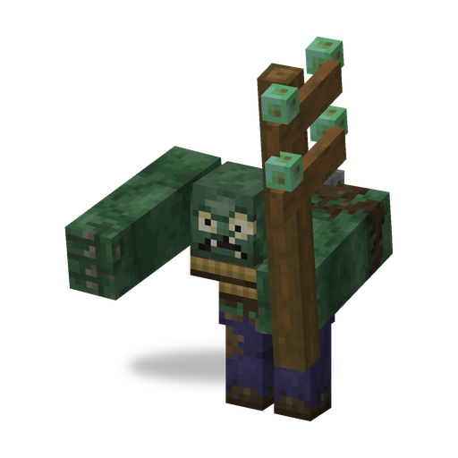
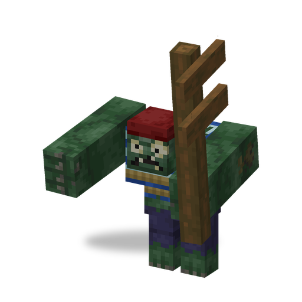

# Gargantuar

**Zombie · giant** · Plants & Zombies (original)

A huge zombie that appears only as a raid boss. It smashes the ground, punches, tramples everything in its way and throws the Imp riding on its back.

| | |
|---|---|
| Id | `sproutsquad:gargantuar` |
| Health | 600 |
| Armor | 10 (toughness 2) |
| Damage | 7 |
| Speed | 0.21 |
| Knockback resistance | 1.0 (cannot be knocked back) |
| Size | 1.7 × 3.2 blocks, scale ×1.33 |
| Spawns | no natural spawns; always climbs out of the ground first (about 4 s) |
| Raids | not part of the wave lists |
| Leader / boss | raid boss in waves 9–20 of regular and Pirate Invasion waves, one per seven wave numbers (at least one) |
| Drops | 18–25 Brainz Alloy, always (any death) |
| Variants | Gargantuar, Pirate Gargantuar |

## Abilities

- Punch: 7 damage, reach 2 blocks.
- Ground smash: about every 9.5 s, when its target is in reach, it slams the ground about 3.5 blocks ahead — a blast of power 3 that hurts and throws back creatures but breaks no blocks.
- Imp throw: it carries an [Imp](imp.md) on its back. Once it is down to 75 % health and its target is more than 4.5 blocks away, it throws the Imp at the target (only once). The thrown Imp joins the raid.
- Trampling: non-zombie creatures in its way take 2.5 damage and are pushed aside.
- Cannot be hypnotized; too big for a [Chomper](chomper.md) to swallow; no balloons, no Ducky Tube; does not pick up items.
- Gives 120 experience.
- Shares the [traits of all mod zombies](browncoat.md#traits-of-all-mod-zombies): its smash and trampling do not hurt zombies.

## Variants

| | Variant | Difference |
|---|---|---|
|  | Gargantuar | default |
|  | Pirate Gargantuar (`pirate`) | the boss of a Pirate Invasion wave; the Imp it throws is a Pirate Imp with a powder barrel |

## Interactions

- As a raid boss it takes only 40 damage from a player's [Lawn Mower](lawn_mower.md) instead of being mowed down (Sprout Squad).
- Advancement "Head Honchos": defeat a [Baron Von Bats](baron_von_bats.md), an [Electric Slide](electric_slide.md) (Electric Boogaloo) and a Gargantuar.
