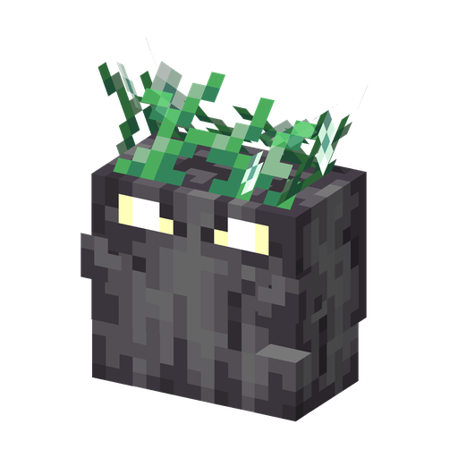

# Grave Buster

**Plant · grave remover** · Plants & Zombies (original)

Eats gravestones: planted on one, it chews it up, drops the grave's treasure and disappears.

| | |
|---|---|
| Id | `sproutsquad:grave_buster` |
| Health | 6 |
| Sun cost | 3 |
| Size | 1.0 × 1.0 blocks |
| Effect | destroys the gravestone under it in ~3 s and drops its loot (single use) |
| Attack | none |
| At night | stays awake |
| Limit | none (most plants: 30 within 32 blocks) |
| How to get | raid rewards in the Mailbox ("Zomboween!" waves; regular waves from the 9th reward on); Graveyard mausoleum chests; dropped by the [Grave Digger](grave_digger.md) (10%) and the [Zombat](zombat.md) (3%) when killed by a player or a plant; grows wild in the Graveyard, Pale Garden, Dark Forest and Deep Dark (groups of 1–3); a wild one is tamed with sun (~55% per sun) |

## Abilities

- Use the seed packet on a gravestone: the Grave Buster sits on top of it, facing the same way.
- After about 3 s of chewing it breaks the gravestone (the block itself does not drop), drops loot from `sproutsquad:chests/gravestone_treasure` and disappears.
- Only a tamed Grave Buster (planted by a player) eats gravestones; wild ones just sit.
- Zombies do not pick it as a target.
- Survives on gravestones as well as on soil.

## Interactions

- Gravestones keep spawning zombies while a player is within 24 blocks (server setting `graveStoneActivationRange`), in the dark or in spooky biomes at any time; a Grave Buster removes one for good.
- Busting a grave gives the advancement "Grave Buster".
