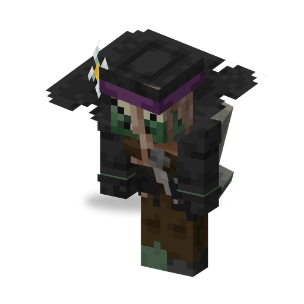

# Grave Digger

**Zombie · gravestone thrower** · Plants & Zombies (original)

A zombie with a shovel that digs up Gravestones and hurls them at its target. Every Gravestone it leaves behind keeps raising new zombies in the dark.

| | |
|---|---|
| Id | `sproutsquad:grave_digger` |
| Health | 30 |
| Armor | 0 |
| Damage | 2.5 (base) |
| Speed | 0.22 |
| Knockback resistance | 0.2 |
| Size | 0.63 × 1.95 blocks |
| Spawns | in the dark in `#sproutsquad:zombie/has_grave_digger` (the [Browncoat](browncoat.md) biomes): weight 15, alone; in the Graveyard also by day |
| Raids | from wave 5, a 17.5 % chance of one in regular, Half-Time Showdown, Winter Wonderland and Pirate Invasion waves; at least one in every Zomboween wave |
| Leader / boss | no |
| Drops | 10 %: [Grave Buster](grave_buster.md) seed packet; 5 %: Brainz Flag (`sproutsquad:brainz_flag`); both only if killed by a player or a plant |

## Abilities

- Digging: when a player is within 14 blocks and its target is closer than 14 blocks, it stops, digs for about 4 s and throws a Gravestone in a high arc towards the target.
- A falling Gravestone hurts whatever it lands on: 2.5 damage per block fallen, up to 10.
- It digs 2–5 Gravestones in its life, one every 13–21 s; about 3 s after the last one it burrows into the ground and disappears without drops.
- Digging needs the `mobGriefing` game rule and a shovel in hand (it spawns with a stone shovel that it never drops).
- Also fights in melee; breaks doors.
- Shares the [traits of all mod zombies](browncoat.md#traits-of-all-mod-zombies).

## Interactions

- A Gravestone (`sproutsquad:gravestone`) spawns a zombie every 20–30 s while it is night or the stone gets sky light below 7 (in the Graveyard at any time), a player is within 24 blocks, fewer than 2 of its zombies are alive and fewer than 3 zombies are around. It raises a [Browncoat](browncoat.md) (40 of 53), [Newspaper Zombie](newspaper_zombie.md) (8), [Digger Zombie](digger_zombie.md) (2), [Disco Zombie](disco_zombie.md) (2) or [All Star](all_star.md) (1).
- [Grave Buster](grave_buster.md) eats Gravestones; kill the Grave Digger early to stop the stones.
