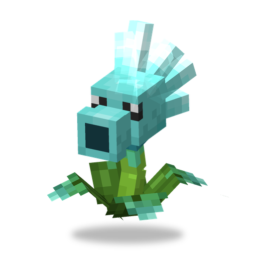

# Snow Pea

**Plant · shooter** · Plants & Zombies (original)

A Peashooter from snowy lands whose frozen peas slow enemies down.

| | |
|---|---|
| Id | `sproutsquad:ice_peashooter` |
| Health | 20 |
| Sun cost | 7 |
| Size | 0.6 × 1.0 blocks |
| Attack | an ice pea about every 1.2 s, 1 damage + Chilled for 5 s |
| Range | 14 blocks, needs line of sight |
| At night | stays awake |
| Limit | 30 within 32 blocks |
| How to get | grows wild in snowy biomes — snowy plains, snowy taiga, groves, ice spikes, frozen peaks, snowy slopes, frozen ocean (groups of 1–2); 6% drop from a [Zombie Yeti](zombie_yeti.md) killed by a player or a plant; raid rewards for the Winter Wonderland wave |

## Abilities

- Chilled: −10% movement speed and −5% attack damage for 5 s.
- Picks targets like the [Peashooter](peashooter.md): zombies of any kind; a tamed Snow Pea also other monsters, but never creepers. Aims ahead of moving targets.
- Shoots back at whoever hurts it.
- Besides soil, it can be planted on snow.

## Interactions

- A wild one is tamed by feeding it sun: about 24% chance per sun.
- Other pea plants: [Peashooter](peashooter.md), [Repeater](repeater.md), [Fire Peashooter](fire_peashooter.md), [Electric Peashooter](electric_peashooter.md).
