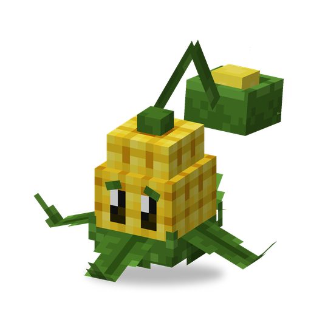

# Kernel Pult

**Plant · catapult** · Plants & Zombies (original)

A catapult that lobs corn kernels and, now and then, a pat of butter that sticks the target in place.

| | |
|---|---|
| Id | `sproutsquad:kernelpult` |
| Health | 20 |
| Sun cost | 6 |
| Size | 0.9 × 0.8 blocks |
| Attack | a kernel about every 1.9 s, 1.5 damage; about one shot in four is butter instead: 3.5 damage + Buttered for 5 s |
| Range | 26 blocks, no line of sight needed |
| At night | stays awake |
| Limit | 30 within 32 blocks |
| How to get | grows wild in plains, sunflower plains and savannas (alone); village house chests |

## Abilities

- Buttered: the target cannot move, jump or attack for 5 s.
- Butter also knocks back and slightly hurts creatures right around the hit point; plants are not affected. Kernels knock the target back.
- After every shot there is a 25% chance that the next one is butter; when it is, the butter is visible on the plant before it fires.
- Throws in a high arc, so it hits enemies behind walls and fences that would block a straight shot. Aims ahead of moving targets.
- Targets zombies of any kind; a tamed Kernel Pult also other monsters, but never creepers. Fights back against whoever hurts it.

## Interactions

- Butter holds a zombie still for the [Melon Pult](melonpult.md), the [Chomper](chomper.md) or a [Cherry Bomb](cherrybomb.md).
- A wild one is tamed by feeding it sun: about 30% chance per sun.
