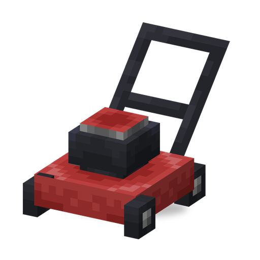

# Lawn Mower

**Machine · last line of defence** · Sprout Squad (the entity and model come from Plants & Zombies, where it did nothing; the fork added the run)

A one-shot last line of defence, as in the original game. It waits until a monster walks right up to its front, then drives straight ahead and mows down every monster in its way.

| | |
|---|---|
| Id | `sproutsquad:lawn_mower` |
| Health | 20 (breaks from a single player hit) |
| Size | 0.8 × 0.6 blocks |
| Run | 0.4 blocks per tick (8 blocks/s), at most 40 blocks or 10 s |
| Damage | 1000 to every monster it touches (40 to bosses) |
| Blueprint cost | 14 Brainz Alloy |
| How to get a blueprint | only from the treasure in the hero mail for a Robo Army raid wave; Engineers never build or drop it, and there is no spawn egg |

## Abilities

- Built from a `sproutsquad:blueprint` for the Lawn Mower (14 `sproutsquad:brainz_alloy` in the inventory, none in Creative; one of the blueprint's 20 uses). It is placed with its handle towards the player, so it will drive in the direction the player was looking.
- Waiting: every quarter of a second it checks the spot right in front of it. A monster coming from behind or from the side does not start it.
- The run: it drives straight ahead, hits each monster on its path once, and disappears in a puff of smoke when it reaches a wall, 40 blocks or 10 seconds. It is used up after one run.
- Hits only monsters hostile to players. Players, plants, pets and other animals, creepers, neutral mobs (endermen, zombified piglins), hypnotized zombies and player-built machines are neither hit nor make it start.
- Cannot be pushed, so it holds its spot while waiting and keeps its line while driving.
- Only damage that comes from a player breaks it, whatever the amount; monsters, fire and other damage do nothing (`/kill` and the void still remove it). A broken mower drops nothing.
- The run is not saved: a mower unloaded in the middle of a run is back to waiting after a reload.

## Two kinds

Unlike the other machines, the lawn mower has no hostile version: Engineer zombies build only the [Zombie Turret](zombie_turret.md), the [Electro Turret](electro_turret.md) and the [Zombie Drone](zombie_drone.md). Any mower placed from a blueprint fights for the players.

## Interactions

- Hostile Engineer machines and [Garden Gnomes](gnome.md) count as monsters and get mowed down.
- Bosses (the Ender Dragon, the Wither, raid bosses) take 40 damage instead of being killed outright.
- Brainz Alloy: shapeless recipe, 1 Brainzium + 4 copper ingots + 4 iron ingots → 16 alloy.
