# Marigold

**Plant · treasure producer** · Plants & Zombies (original)

A farming plant: instead of a seed packet, its harvest is gold ingots, emeralds and diamonds.

| | |
|---|---|
| Id | `sproutsquad:marigold` |
| Health | 16 |
| Sun cost | 5 |
| Size | 0.6 × 0.94 blocks |
| Attack | none |
| At night | stays awake |
| Limit | 30 within 32 blocks |
| How to get | raid rewards from the Mailbox (harder waves); does not grow in the wild |

## Abilities

- Does not attack, makes no sun and does not fight back.
- Its whole value is the harvest. Like other plants, a tamed Marigold on farmland or in a Zen Plant Pot grows seeds: water it, let it rest, then feed it sun one at a time.
- It needs about 32 sun for one harvest, much more than other plants. The harvest is 4–6 drops of gold ingots, emeralds or diamonds (diamonds are the rarest), plus a 1% chance of a Golden Garden Gnome.
- While it is being fed, sparkles around it grow with the amount of sun received.

## Interactions

- Right-click your own (tamed) Marigold with any dye to recolour its flowers (16 colours; with `coopPlanting`, any player's tamed one). A name tag "Rainbow" gives it the rainbow look, "Flowey" another special one. Added by Sprout Squad: the textures were in the original, unused.
- A large water source (a water bucket, a watering can) halves the sun other plants need for seeds, but not the Marigold's: its 32 sun are fixed.
- Sun comes from [Sunflowers](sunflower.md) and other sun producers.
- Named `flowey` with a name tag, it gets a different look.

<!-- pictures 64: marigold_* -->

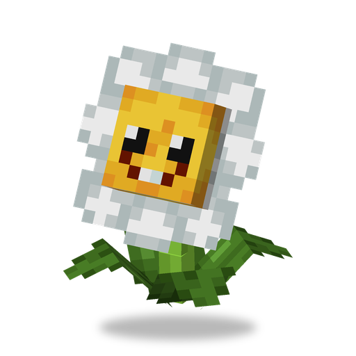 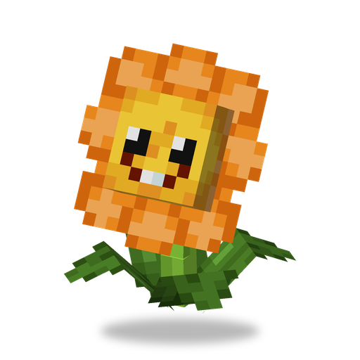 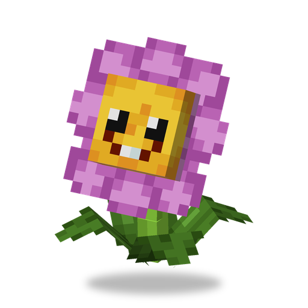 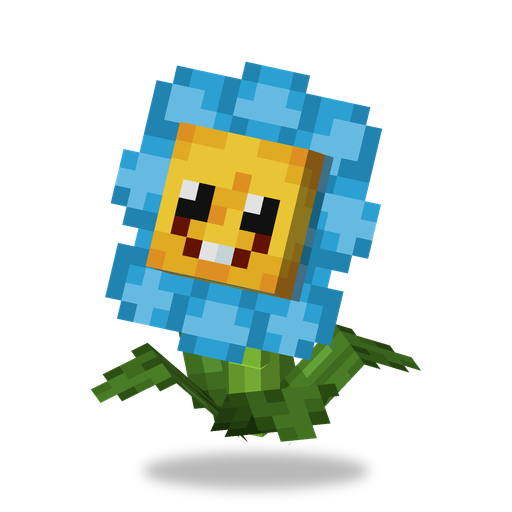 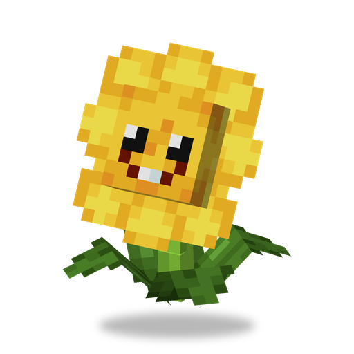 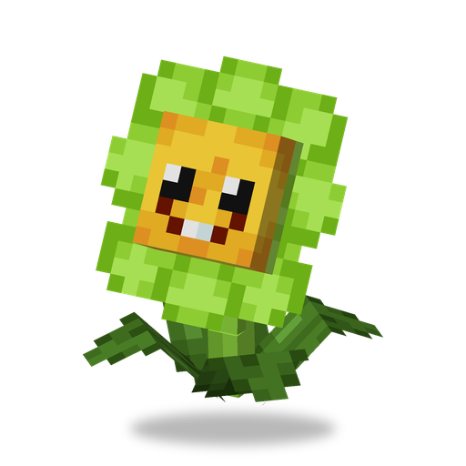  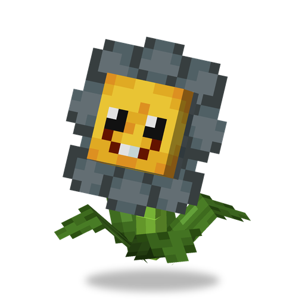 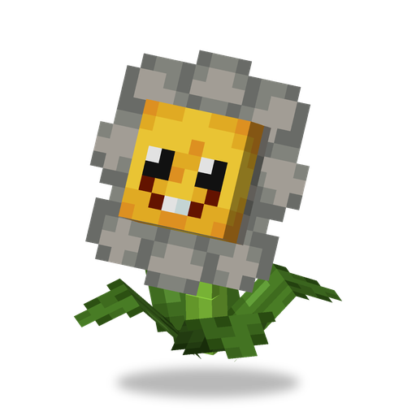 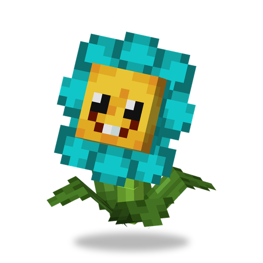 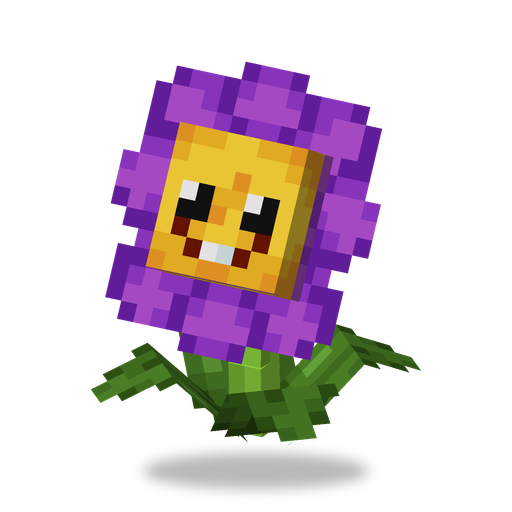 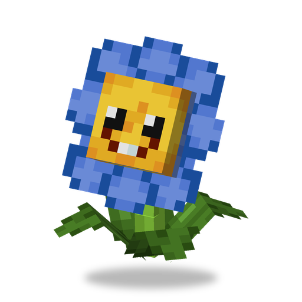 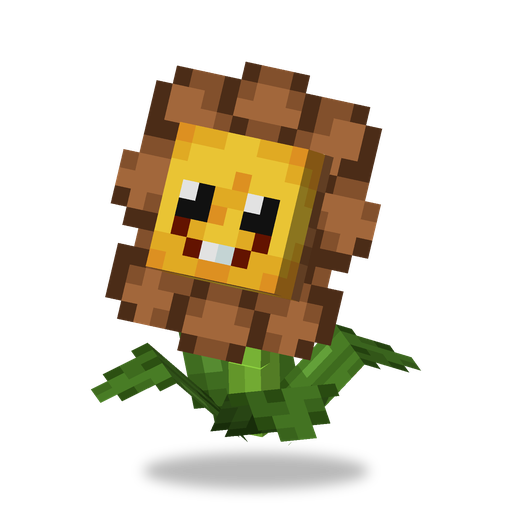  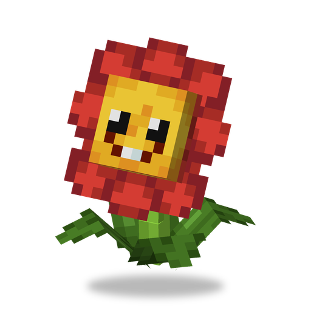 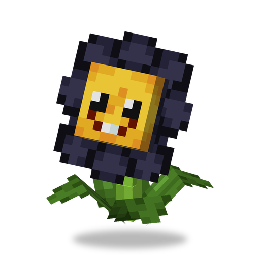 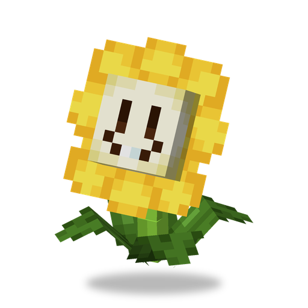 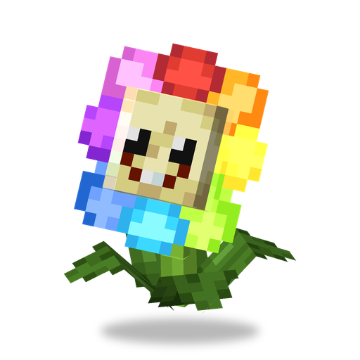

