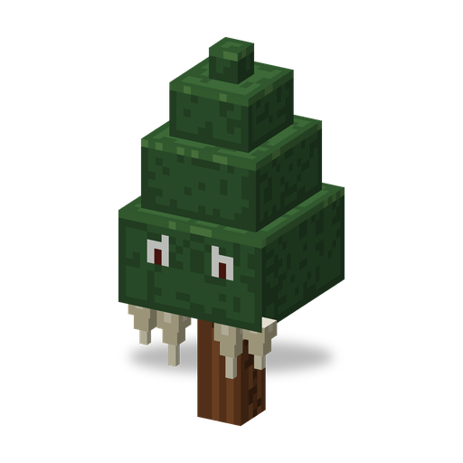
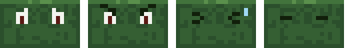

# Needle Spruce

**Plant · shooter** · Sprout Squad

A three-block mountain spruce with two eyes on its bottom tier and four sharp fangs hanging under its front. It stands straight; when it sees an enemy within 20 blocks it bends forward like a catapult and fires three needles at once, one from each tier. While it shoots it strains and squeezes its eyes shut.

| | |
|---|---|
| Id | `sproutsquad:needle_spruce` |
| Health | 40 |
| Sun cost | 7 |
| Size | 0.9 × 2.9 blocks |
| Attack | 3 needles per volley, 1 damage each; a needle pierces up to 4 targets |
| Volley | every 3.5 s |
| Range | 20 blocks, needs line of sight |
| At night | does not sleep |
| How to get | grows wild on snowy slopes and in groves; shapeless recipe: spruce sapling + 7 sun → Needle Spruce seed packet |

## Abilities

- Targets zombies; a tamed spruce also fights other hostile mobs except creepers.
- A volley: the trunk winds back, whips forward (it bends in two places, the crown leans almost 45°), three needles leave together, and the tree springs back with a little overshoot.
- Its face shows what it is doing: plain eyes with nothing around, angry eyes with frowning brows while it has a target, squeezed-shut eyes and a drop of sweat during the whip.

 Plain · angry (has a target) · straining (the whip) · dying

## When it dies

- The trunk snaps at the bend. The crown falls back and sheds its needles; the lower trunk stays as a **Needle Spruce Stump** block with roots, rings and a small green shoot.
- Breaking the stump (by hand or with an axe) gives a spruce sapling and one or two sticks, and the sapling goes into a new Needle Spruce seed packet.
- The stump appears only in an empty spot on solid ground (a snow layer or grass is replaced). In water, on a slab or when the spruce is worn on a head, the sapling and sticks drop as items.
- Killed by a player, it drops 4 sun (other plants drop half their price).

## Card

| | |
|---|---|
| Idea | the idea's author: an original drawing of a needle-shooting spruce |
| Sketch | `art/needle_spruce/sketch.jpg`; textures are drawn by `art/needle_spruce/draw_needle_spruce.py` |
| Status | in code |
