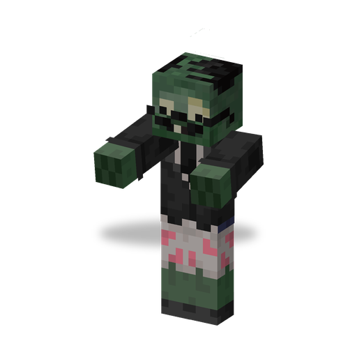

# Newspaper Zombie

**Zombie · shielded** · Plants & Zombies (original)

A zombie that hides behind a Newspaper. The paper soaks up hits from the front; once it is torn, the zombie gets angry, faster and harder-hitting.

| | |
|---|---|
| Id | `sproutsquad:newspaper_zombie` |
| Health | 25 |
| Armor | 0 |
| Damage | 2; 4 when angry |
| Speed | 0.22; 0.33 when angry |
| Knockback resistance | 0.2 |
| Size | 0.6 × 1.95 blocks |
| Spawns | in the dark in `#sproutsquad:zombie/has_newspaper_zombie` (the [Browncoat](browncoat.md) biomes): weight 25, alone; in the Graveyard also by day; near the surface of rivers and oceans (`#sproutsquad:zombie/water_spawns`): weight 4; out of Gravestones (8 of 53 spawns) |
| Raids | regular waves from wave 1 (about one per two wave numbers); Bucket Brigade (65 % with a bucket on the head, often in armour) |
| Leader / boss | can be a leader (`can_be_leader`); never a boss |
| Drops | 5 %: Newspaper (`sproutsquad:newspaper`), if killed by a player or a plant |

## Abilities

- Holds the Newspaper raised in the off hand: a hit from the front loses 90 % of its damage. Damage that bypasses shields is not blocked.
- Every blocked hit has an 8 % chance to tear the Newspaper.
- Without the Newspaper it is angry: speed +0.11, damage +2, and it breaks doors. While it still reads, it does not break doors.
- A leader holds the Brainz Flag in the off hand instead of the paper, so it is angry from the start.
- Shares the [traits of all mod zombies](browncoat.md#traits-of-all-mod-zombies).

## Interactions

- Attack it from the side or from behind, or with damage that ignores shields, to skip the paper.
- A dropped Newspaper works for players as a flimsy shield that blocks 90 % of a frontal hit and also tears with an 8 % chance per block.
- [Hypno Shroom](hypnoshroom.md) can turn it to the player's side.
