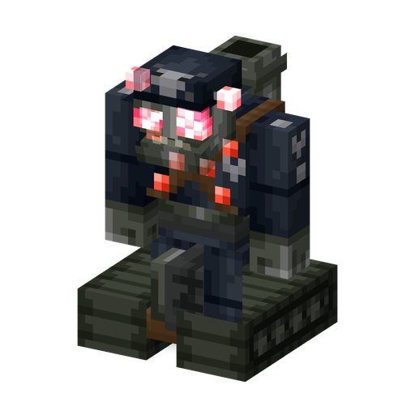

# Robo-Zombie

**Zombie · machine** · Plants & Zombies (original)

A heavily armoured war robot. It bashes up close, fires missiles from afar and turns into a wall-climbing tank when badly damaged.

| | |
|---|---|
| Id | `sproutsquad:robo_zombie` |
| Health | 128 |
| Armor | 22 (toughness 9) |
| Damage | 11 |
| Speed | 0.215; +0.15 as a tank |
| Knockback resistance | 0.85 |
| Size | 1.4 × 1.95 blocks |
| Spawns | in the dark at the [Robo Junkyard](../STRUCTURES.md#robo-junkyard) only: weight 1 of the junkyard's 7, alone |
| Raids | regular waves from wave 17 (in 60 % of them, up to 2); Robo Army (waves 10–16, only after the raid starter has seen the end credits; up to 4) |
| Leader / boss | raid boss as the Robo-General in waves 10–20 of regular and Robo Army waves, one per seven wave numbers (at least one) |
| Drops | 90 %: 2–5 Brainz Alloy (any death) |
| Variants | Robo-Zombie, Robo-General |

## Abilities

- Melee bash of 11 damage.
- Missile: about every 17 s, at targets within 30 blocks, it stops and fires a missile that explodes in a 2.5-block blast without breaking blocks.
- Tank form: at half health or below it transforms for good — faster, climbs walls, keeps 3 blocks from its target and always faces it.
- Cannot be hypnotized and is too big for a [Chomper](chomper.md) to swallow; no balloons, no Ducky Tube; does not pick up items; breaks doors.
- Shares the [traits of all mod zombies](browncoat.md#traits-of-all-mod-zombies): its missiles do not hurt zombies.

## Variants

| | Variant | Difference |
|---|---|---|
|  | Robo-Zombie | default |
|  | Robo-General (`general`) | raid boss form: starts as a tank, scale +0.33, health ×3.25 (416), damage ×2.5 (27.5); a spawn egg with this variant gives the boss stats too |

## Interactions

- In Robo Army a third of the Robo-Zombies carry a [Soldier Zombie](soldier_zombie.md) and start as tanks.
- As a raid boss it takes only 40 damage from a player's [Lawn Mower](lawn_mower.md) instead of being mowed down (Sprout Squad).
- Advancement "Graveyard Warfare": defeat a Robo-Zombie, a [Pirate Captain](pirate_captain.md) and a [Super Brainz](super_brainz.md).
