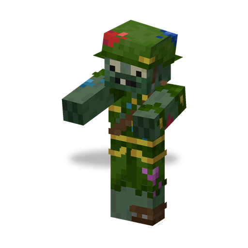

# Soldier Zombie

**Zombie · shooter** · Plants & Zombies (original)

An armoured ranged zombie with a Dye Blaster. It keeps its distance and peppers its target with paint balls.

| | |
|---|---|
| Id | `sproutsquad:soldier_zombie` |
| Health | 35 |
| Armor | 6 |
| Damage | paint ball 1; no melee attack |
| Speed | 0.237 |
| Knockback resistance | 0.2 |
| Size | 0.6 × 1.95 blocks |
| Spawns | no natural spawns |
| Raids | regular waves from wave 11 and Robo Army (waves 10–16), both only after the raid starter has seen the end credits; in Robo Army a third of the [Robo-Zombies](robo_zombie.md) carry one on top |
| Leader / boss | can be a leader (`can_be_leader`), but as it never spawns naturally it never calls a group; never a boss |
| Drops | 2 %: Dye Blaster at 60–90 % durability, if killed by a player or a plant |

## Abilities

- Shoots a paint ball about every 2 s at targets up to 50 blocks away.
- Keeps about 7 blocks from its target and always faces it.
- Every hit paints the target in the soldier's colour (Painted, 11 s, stacks with more hits; only visual, washes off in water).
- Its colour is random: green, purple, orange or blue.
- Breaks doors.
- Shares the [traits of all mod zombies](browncoat.md#traits-of-all-mod-zombies).

## Interactions

- In a Robo Army wave it may ride a [Robo-Zombie](robo_zombie.md); such a Robo-Zombie starts already in tank form.
- The Dye Blaster it drops lets a player shoot paint balls too.
