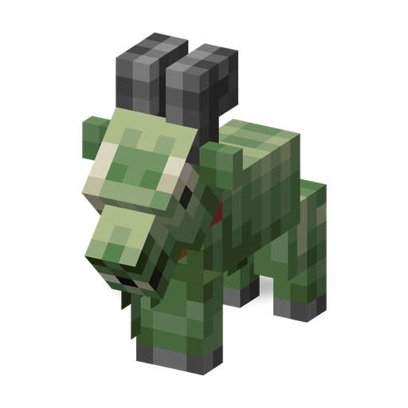

# Zombie Goat

**Zombie · mount** · Plants & Zombies (original); Sprout Squad added natural spawns and the Imp rider

A small undead mountain goat. Weak on its own, it often carries an [Imp](imp.md) on its back.

| | |
|---|---|
| Id | `sproutsquad:zombie_goat` |
| Health | 14 |
| Armor | 0 |
| Damage | 1 |
| Speed | 0.23 |
| Knockback resistance | 0.2 |
| Size | 0.68 × 0.84 blocks |
| Spawns | in the dark in `#sproutsquad:zombie/has_zombie_goat` (snowy slopes, frozen, jagged and stony peaks, grove, windswept hills, windswept gravelly hills, windswept forest): weight 12, groups of 1–2 (Sprout Squad; in the original it comes only from a spawn egg) |
| Raids | not part of any wave |
| Leader / boss | no |
| Drops | 5 %: a goat horn (one of the regular goat horns), if killed by a player or a plant |

## Abilities

- Melee attacks of 1 damage; goat sounds.
- Always ignores the raid flag.
- Cannot hold items, break doors, carry balloons or a Ducky Tube; gives no experience and no random spawn bonuses.
- Shares the [traits of all mod zombies](browncoat.md#traits-of-all-mod-zombies).

## Interactions

- Imp rider (Sprout Squad): a goat that spawns naturally, at world generation, from a spawner or in a structure gets an [Imp](imp.md) on its back with a 40 % chance, if there is room above. Goats from spawn eggs and commands come alone.
- The Imp does not steer: the goat keeps moving by its own AI.
