# Возможности Sprout Squad

Sprout Squad — мод для Minecraft 26.3 на NeoForge, который приносит в игру растения и зомби. Растения — это мобы: их сажают из пачек семян и оплачивают солнцем. Они стреляют, кидают снаряды навесом, взрываются, держат оборону, дают солнце, спят, без воды не дают новых семян и даже умеют сидеть у игрока на голове. По миру бродят зомби самых разных видов, а «Флаг цветкоф» позволяет устроить рейд зомби: волна за волной, с особыми волнами, боссами, многослойной музыкой и наградами, которые приходят по почте. По чертежам собираются боевые машины, воюющие на вашей стороне, а сплав мозгания, добытый у зомби, идёт на технические блоки и предметы. Мод — форк Plants & Zombies от joshxviii; Sprout Squad чинит то, что в оригинале нельзя было получить или использовать, и добавляет собственных персонажей ([список исправлений](UPSTREAM.md)).

Содержание: [Быстрый старт](#быстрый-старт) · [Растения](#растения) · [Зомби](#зомби) · [Рейды](#рейды) · [Боевые машины и чертежи](#боевые-машины-и-чертежи) · [Предметы и блоки](#предметы-и-блоки) · [Мир](#мир) · [Команды и настройки](#команды-и-настройки) · [Персонажи](#персонажи) · [Недоступно в выживании](#недоступно-в-выживании)

## Быстрый старт

1. Найдите дикие Подсолнухи (равнины, цветочные леса). Днём они роняют солнце; подойдите поближе — и оно само прилетит к вам.
2. Щёлкните ПКМ по дикому растению с солнцем в руке, чтобы попробовать его приручить. Приручённое растение — ваше: выкопайте его лопатой и получите пачку его семян.
3. Сажайте семена на траву или землю. Каждая посадка стоит солнца.
4. Чтобы получить новые семена, поставьте растения на вспаханную землю или в «Горшок дзен», полейте их и подкормите солнцем, когда они проснутся.
5. Добудьте «Флаг мозгоф», скрафтите из него и 8 солнц «Флаг цветкоф», поставьте его и выпейте рядом зловещую бутылочку — начнётся рейд зомби.

## Растения

### Пачки семян и посадка

- В пачке семян («Семена растения (Горохострел)» и т. п.) — одно растение. Чтобы посадить, щёлкните ПКМ по верхней грани блока. Водные растения (Морегриб, Водоросль) сажаются на поверхность воды.
- Посадка стоит солнца, цена указана в подсказке к пачке. Солнце берётся из предметов «Солнце» в инвентаре и из Солнечных батарей, которые вы носите с собой. В творческом режиме посадка бесплатна и без ограничений.
- Блок под растением должен ему подходить. Любое растение растёт на земле, траве, грязи, мху, глине, почве душ, нилии, тропинке, цветочном горшке, кувшинке, вспаханной земле и в горшках. Некоторым подходит и другое: Кактусу — песок и песок душ, Картофельной Мине — песок и гравий, Ледяному Горохострелу и Ледогрибу — снег, Грибу Судьбы — гравий и базальт, Могилоеду — могила, Вишнёвой Бомбе и Кофейному Бобу — любой твёрдый блок, Кабачку и Тыкве — что угодно.
- На одном блоке — одно растение. Растение на неподходящей почве или наложенное на другое постепенно засыхает и получает урон.
- Посаженное растение смотрит на вас, а в горшке — туда же, куда повёрнут горшок.
- Посаженное вами растение сразу приручено вами.
- Раздатчик сажает семена, если к нему прикреплена Солнечная батарея с достаточным запасом солнца: солнце берётся из батареи, а растение достаётся ближайшему игроку в пределах 64 блоков.

### Солнце

Солнце — валюта растений.

| | Источник | Что даёт |
|---|---|---|
|  | [Подсолнух](characters/sunflower.md) | 1 солнце примерно раз в 45 с, пока видно солнце; ночью спит |
|  | [Горшочек](characters/potling.md) | 1 солнце примерно раз в 60 с, пока видно солнце; ночью спит |
|  | [Солнцегриб](characters/sunshroom.md) | 1 солнце примерно раз в 65 с, 2 — когда подрастёт; это гриб, поэтому работает ночью и под землёй |
|  | Убить растение самому | половина его цены в солнце |
|  | Пузырёк солнца | бросьте — выпустит 8 солнц, или скрафтите обратно в 8 солнц |
|  | Награды за рейды | пузырьки солнца во многих таблицах наград |

- Солнце лежит на земле около 37 секунд. В радиусе 8 блоков оно летит к ближайшему игроку, у которого есть для него место, к раненому растению (и лечит его) или к поставленной Солнечной батарее.
- Другие применения: работает на посевах как костная мука; ненадолго горит в печи; Фермер 1-го уровня даёт изумруд за 32 солнца; лечит и приручает растения; входит в рецепты (Горшок, Пузырёк солнца, «Флаг цветкоф», Горшочек).
- **Пузырёк солнца**: 8 солнц вокруг стеклянной бутылочки. Им можно стрелять из раздатчика.
- **Солнечная батарея**: 4 сплава мозгания, блок усиленного сплава мозгания, датчик дневного света и 2 стекла. Хранит до 512 солнц. В инвентаре положите на неё солнце, чтобы зарядить, или щёлкните по ней ПКМ пустым курсором, чтобы забрать до целого стака. Подобранное солнце сначала идёт в батарею, а посадка, приручение и подкормка тратят её заряд. Вприсядку с ПКМ батарея ставится на любую грань блока: поставленная батарея притягивает солнце в радиусе 8 блоков, светится тем ярче, чем полнее, выдаёт сигнал компаратору, принимает солнце по ПКМ, питает прикреплённый раздатчик и [Машину времени](#машина-времени).
- Настройка клиента «Информация о солнце» показывает на экране ваш запас солнца и цену пачки семян в руке.

### Растения и стоимость в солнце

Цены — значения по умолчанию (настройка сервера `sunCosts`). Имена ведут на карточки растений.

| | Растение | Солнце | Что делает | Где взять |
|---|---|---|---|---|
|  | [Подсолнух](characters/sunflower.md) | 5 | Даёт солнце днём | Равнины, цветочные леса, дубовые и берёзовые леса; выпадает из Обычного Зомби (1 %) |
|  | [Бархатцы](characters/marigold.md) | 5 | Не сражается; когда «вырастает», вместо семян даёт сокровища (см. ниже) | Награды за поздние волны рейда |
|  | [Горшочек](characters/potling.md) | 3 | Маскот Sprout Squad: дешёвый источник солнца | Крафт: цветочный горшок, семена пшеницы, 3 солнца |
|  | [Солнцегриб](characters/sunshroom.md) | 6 | Гриб, дающий солнце | Пышные пещеры, тёмные леса, искажённые и багровые леса, грибные поля; изредка равнины |
|  | [Горохострел](characters/peashooter.md) | 5 | Стреляет горошинами | Равнины, цветочные и дубовые леса; выпадает из Обычного Зомби (1 %) |
| 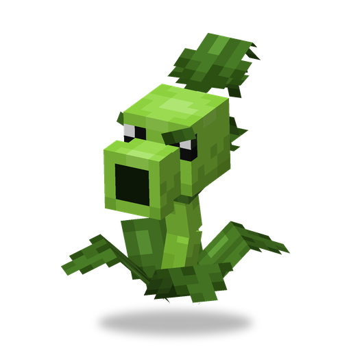 | [Повторитель](characters/repeater.md) | 7 | Стреляет двумя горошинами | Мутация семян Горохострела; награды за ранние волны |
| 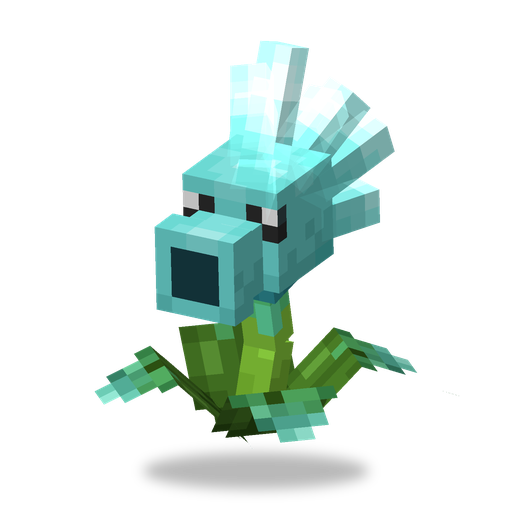 | [Ледяной Горохострел](characters/ice_peashooter.md) | 7 | Ледяные горошины, накладывают «Прохладу» | Снежные и ледяные биомы; выпадает из Зомби-Йети (6 %); награды «Зимней Страны Чудес» |
| 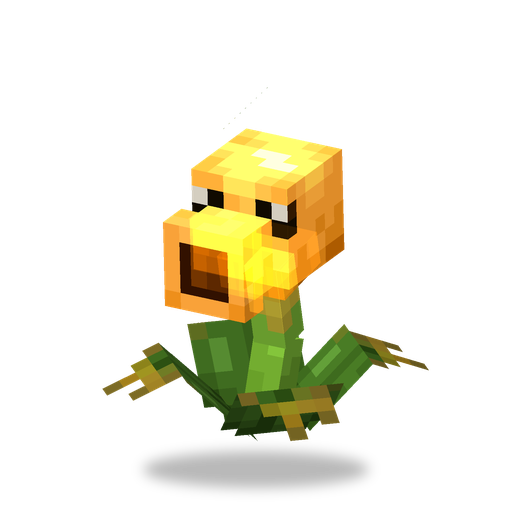 | [Огненный Горохострел](characters/fire_peashooter.md) | 7 | Огненные горошины | Багровый лес; мутация Горохострела там же |
|  | [Электрический Горохострел](characters/electric_peashooter.md) | 8 | Электрические горошины («Электризация») | В него превращается Горохострел, в которого ударила молния; мутация в грозу; награды за поздние волны |
|  | [Кактус](characters/cactus.md) | 6 | Стреляет иголками | Пустыни, пустоши |
| 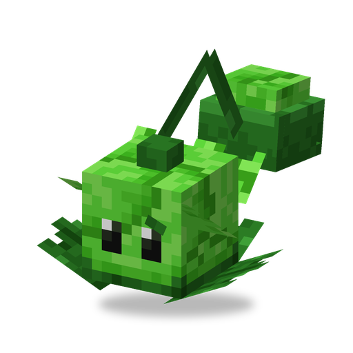 | [Капустопульта](characters/cabbagepult.md) | 5 | Кидает капусту навесом через препятствия | Равнины, леса; сундуки в деревнях |
| 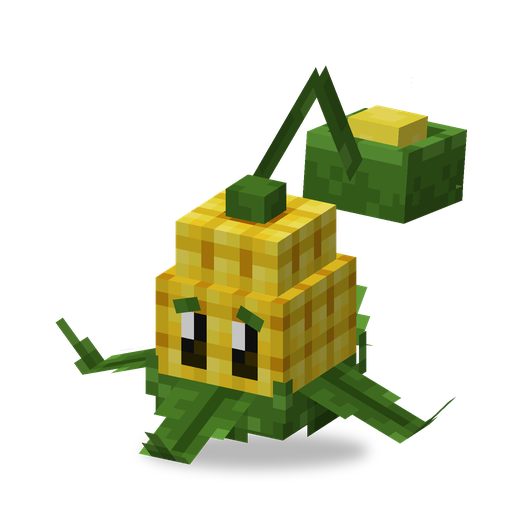 | [Зернопульта](characters/kernelpult.md) | 6 | Кидает зёрна, примерно каждый четвёртый выстрел — масло («В масле») | Равнины, саванны; сундуки в деревнях |
| 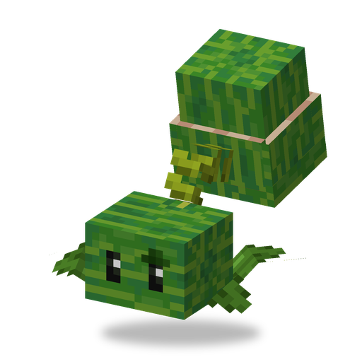 | [Арбузопульта](characters/melonpult.md) | 10 | Кидает тяжёлые арбузы | Джунгли |
|  | [Ледяная Арбузопульта](characters/winter_melon.md) | 12 | Кидает ледяные арбузы («Прохлада») | Мутация Арбузопульты в холодных биомах; награды «Зимней Страны Чудес» |
|  | [Стенорех](characters/wallnut.md) | 5 | Держит зомби, отбивает стрелы, трезубцы, заряды ветра и фейерверки; его можно катить | Равнины, леса; выпадает из Обычного Зомби (1 %) |
| 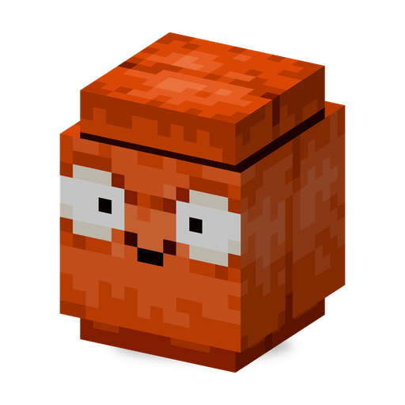 | [Взрыворех](characters/explode_o_nut.md) | 5 | Стенорех, который взрывается, когда вкатывается в моба или погибает от удара | Мутация Стенореха |
|  | [Чомпер](characters/chomper.md) | 7 | Проглатывает моба целиком и долго жуёт (крупным мобам не страшен) | Болота, джунгли |
| 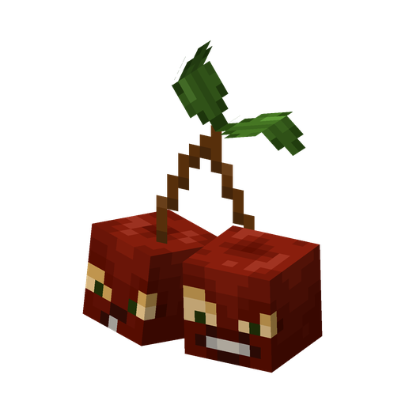 | [Вишнёвая Бомба](characters/cherrybomb.md) | 7 | Взрывается | Базальтовые дельты; сундуки бастионов и деревень; Фермер; выпадает из Зомби-Шахтёра (8 %) |
| 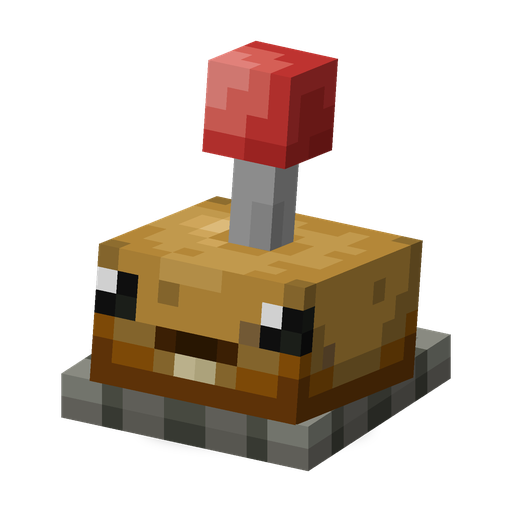 | [Картофельная Мина](characters/potatomine.md) | 3 | Взводится примерно за 10 с и взрывается при касании; зомби её не выбирают целью | Фермер; сундуки в деревнях; выпадает из Чертёнка (5 %); награды за ранние волны |
|  | [Кабачок](characters/squash.md) | 4 | Прыгает на зомби в пределах 3 блоков и расплющивает его, после чего исчезает (одноразовый) | Равнины, саванны |
| 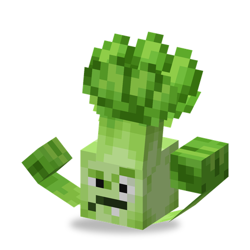 | [Бонк Чой](characters/bonkchoy.md) | 4 | Бьёт кулаками вблизи | Бамбуковые джунгли, саванны; награды за ранние волны |
| 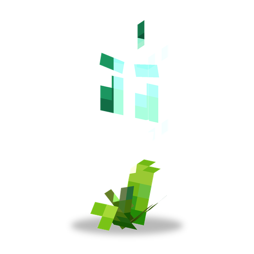 | [Тростник-молния](characters/lightning_reed.md) | 8 | Бьёт током («Электризация») | Болота, реки |
| 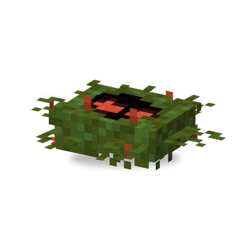 | [Водоросль](characters/tanglekelp.md) | 2 | Водное растение: хватает моба и держит его («Запутан»); зомби её не выбирают целью | Болота, мангровые болота |
| 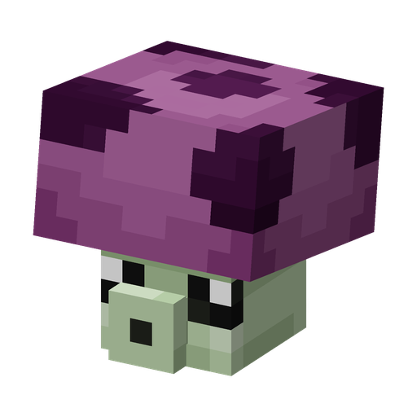 | [Пуффгриб](characters/puffshroom.md) | 0 | Споры на короткой дистанции | Тёмные леса, тайга, грибные поля, пещеры |
| 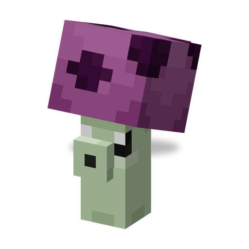 | [Трусогриб](characters/scaredyshroom.md) | 3 | Споры на дальней дистанции; прячется, когда враги подходят близко | Там же, где Пуффгриб |
| 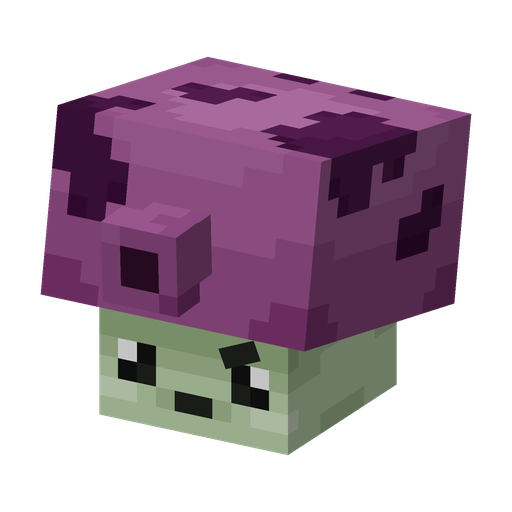 | [Дымогриб](characters/fumeshroom.md) | 6 | Струя ядовитого дыма («Токсичность») | Там же, где Пуффгриб; сундуки мавзолея |
| 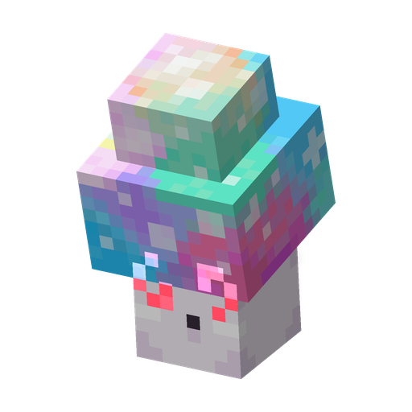 | [Гипногриб](characters/hypnoshroom.md) | 7 | Тот, кто его ударит, попадает под «Гипноз»; умирая, выпускает облако гипноза | Пышные пещеры, тёмные и искажённые леса, грибные поля; выпадает из Зомби-Танцора (4 %); награды за ранние волны |
| 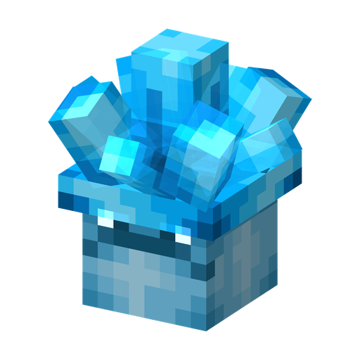 | [Ледогриб](characters/iceshroom.md) | 5 | Замораживает всё вокруг («Заморозка») | Заснеженная тайга, рощи, ледяные пики, заснеженные вершины и замёрзший океан |
| 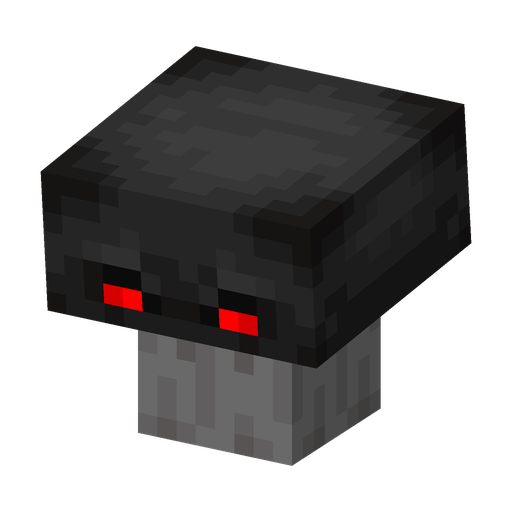 | [Гриб Судьбы](characters/doomshroom.md) | 14 | Огромный взрыв | Базальтовые дельты; сундуки бастионов; награды за поздние волны |
| 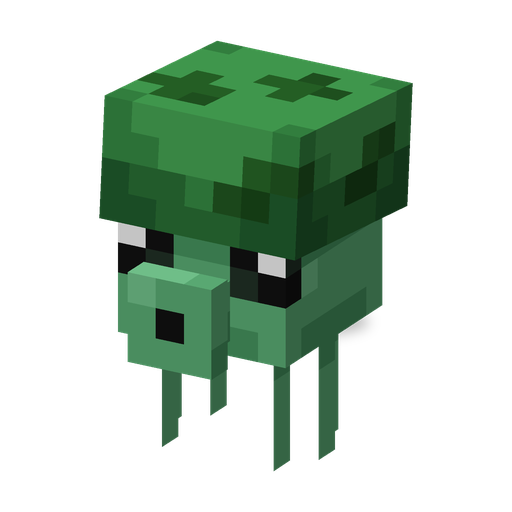 | [Морегриб](characters/seashroom.md) | 0 | Водное растение: водяные споры | Реки, глубокие океаны; рыбалка; выпадает из Призрака Капитана Пиратов (3 %) |
| 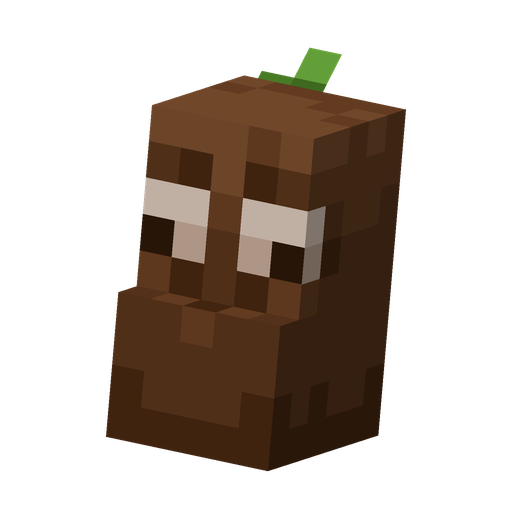 | [Кофейный Боб](characters/coffeebean.md) | 2 | Будит спящее растение | Джунгли; награды «Зимней Страны Чудес» |
|  | [Могилоед](characters/grave_buster.md) | 3 | Посаженный на могилу, съедает её и оставляет могильную добычу; зомби его не выбирают целью | Кладбище, Бледный сад; выпадает из Могильщика (10 %) и Зомбимыши (3 %); награды за рейды; сундуки мавзолея |
|  | [Тыква](characters/pumpkin.md) | 6 | Броня для другого растения | Вырезание тыкв (5,5 %); награды «Зомбиуина» |

О диких растениях:

- Они появляются как фоновые мобы — по одному или небольшими группами, далеко от других растений (примерно в 42 блоках), и никогда рядом с идущим рейдом.
- Большинство диких атакующих растений сражается только с зомби. Осторожно: дикие Вишнёвые Бомбы, Грибы Судьбы, Ледогрибы, Чомперы, Бонк Чои, Тростники-молнии, Водоросли, Огненные и Электрические Горохострелы нападают и на игроков, а дикие Трусогрибы прячутся от игроков.
- Приручённые атакующие растения сражаются и с другими враждебными мобами. Некоторые из них (горохострелы, пульты, Кактус) не трогают криперов.

**Тыквенная броня.** Используйте пачку семян Тыквы на своём растении (это стоит 6 солнц, цена Тыквы): растение получает тыквенную оболочку, которая поглощает 35 урона, прежде чем сломаться. Можно и наоборот — использовать пачку другого растения на посаженной Тыкве, чтобы посадить его внутрь. Ножницы снимают оболочку и возвращают пачку семян Тыквы.

**Усиление от флага.** Растения в пределах 5 блоков от [«Флага цветкоф»](#флаги) действуют на 20 % быстрее.

### Сон, грибы и кофе

- Подсолнухи и Горшочки спят ночью, то есть всегда, когда солнца не видно.
- Грибы (Пуффгриб, Трусогриб, Дымогриб, Солнцегриб, Гипногриб, Ледогриб, Гриб Судьбы и Морегриб) спят, пока видно солнце: днём под открытым небом. Ночью, в пещерах или под крышей они бодрствуют.
- Спящее растение не атакует и не даёт солнце.
- Кофейный Боб, посаженный рядом, будит ближайшее спящее растение и пропадает. Можно и сразу использовать пачку Кофейного Боба на спящем растении (2 солнца). Разбуженное так растение не спит 40 минут.
- Растение, которое выращивает семена, тоже спит, и кофе его не будит.

### Как вырастить семена

1. Поставьте своё растение на **вспаханную землю** или в **Горшок дзен**.
2. Полейте его: бутылочкой воды, ведром воды, лейкой — или дождём.
3. Растение засыпает, пока растут семена: 10 минут плюс 2 минуты за каждое солнце его цены (настройки сервера `seedGrowTime` и `extraGrowTimePerSun`); Горшок дзен сокращает ожидание на 25 %.
4. Когда оно проснётся (над ним висит значок солнца), щёлкайте по нему ПКМ с солнцем, по одному. Нужно примерно вдвое больше солнца, чем стоит растение, но не меньше 4. Если его полили из ведра или лейки, хватит половины.
5. Растение выбрасывает пачку семян — возможно, другого растения (см. мутации). Полейте снова, чтобы начать заново.

Важно: приручённое растение на вспаханной земле или в Горшке дзен всё время занято выращиванием семян. Оно не атакует и не даёт солнце, поэтому базу защищайте растениями на обычной почве или в простых Горшках.

Бархатцы — особый случай: им нужно 32 солнца, а вместо семян они дают сокровища (4–6 бросков из алмазов, изумрудов и золота и 1 % шанс на Золотого садового гнома).

**Мутации семян.** Правила проверяются сверху вниз; срабатывает первое подходящее.

| Растение | Во что могут превратиться его семена |
|---|---|
| Горохострел | в грозу — Электрический Горохострел (50 %); в багровом лесу — Огненный Горохострел (50 %); иначе — Повторитель (10 %) |
| Электрический Горохострел | в грозу — всегда он сам; иначе — Горохострел (15 %) |
| Огненный Горохострел | в багровом лесу — всегда он сам; иначе — Горохострел (15 %) |
| Стенорех | Взрыворех (8 %) |
| Взрыворех | Стенорех (20 %) |
| Арбузопульта | Ледяная Арбузопульта (33,3 %) в снежных и ледяных биомах |
| Ледяная Арбузопульта | в этих биомах — всегда она сама; иначе — Арбузопульта (15 %) |

Датапаки могут менять эти правила в `data/<namespace>/seed_mutation/<растение>.json`.

### Горшки и полив

| Предмет | Рецепт | Что делает |
|---|---|---|
| Горшок | 3 кирпича, земля, солнце | Растение в нём получает от монстров на 50 % меньше урона; зомби не проходят сквозь горшки. Зомби-Шахтёр может разбить простой горшок |
| Горшок дзен | Горшок, 2 бамбука, бамбуковая плита | Та же защита, и для выращивания семян он считается вспаханной землёй (на 25 % быстрее) |
| Вагонетка с горшком | Горшок + вагонетка | Посаженное в неё растение катается по рельсам |
| Лейка | Фермер 2-го уровня, сундуки в деревнях, сокровища рыбалки, награды за рейды | Вмещает 32 воды. Наполняется у воды или вприсядку из котла с водой. Каждое действие тратит 2 воды: полить растение (засчитывается как обильный полив), увлажнить вспаханную землю, превратить землю в грязь, потушить огонь, наполнить котёл, превратить лаву в обсидиан. Вприсядку ставится как украшение |

### Приручение и владение

- Щёлкните ПКМ по дикому растению с солнцем (или с Солнечной батареей, в которой есть солнце), чтобы попробовать его приручить. Каждая попытка стоит 1 солнце. Дешёвые растения приручаются легко, дорогие — трудно (настройка сервера `sunCostTamingThreshold`):

| Цена в солнце | 0 | 2 | 3 | 5 | 7 | 10 | 14 |
|---|---|---|---|---|---|---|---|
| Шанс за попытку | 100 % | 67 % | 55 % | 36 % | 24 % | 12,5 % | 5 % |

- Щёлкните ПКМ с солнцем по своему раненому растению — каждое солнце лечит 4 единицы здоровья.
- Выкопайте своё растение любой лопатой, чтобы вернуть пачку его семян (растение с именем сохранит имя). Выкопать можно только приручённое растение.
- Ваши растения никогда не ранят вас, защищают от тех, кто на вас нападает, и атакуют ваши цели.

### Совместная посадка

Настройка сервера `coopPlanting` (по умолчанию включена): любой игрок может выкапывать, подкармливать и собирать семена с чужих растений, приручённые растения считают друзьями всех игроков и приручённых питомцев, а [лимит растений](#лимиты-растений) считает растения всех игроков. Если настройка выключена, всё это может только владелец («Вы не владеете этим растением!»).

### Растения на голове

**Шлем-горшок** (награды за поздние волны рейда и фермер 4-го уровня; чинится кирпичами, зачаровывается). Наденьте его, затем вприсядку щёлкните ПКМ пустой рукой по своему растению: оно сядет вам на голову и продолжит работать, получая от монстров на 50 % меньше урона. Чтобы поставить его обратно, щёлкните вприсядку ПКМ по верхней грани блока пустой рукой или Садоводской перчаткой. Если снять шлем, растение выпадет пачкой семян.

**Садоводская перчатка** (Фермер 3-го уровня, награды за поздние волны; прочность 325, чинится кожей):

- ПКМ по своему растению — погладить его;
- вприсядку ПКМ — подобрать растение со всеми его данными, затем ПКМ по блоку — поставить его, не тратя солнце повторно;
- ПКМ по созревшему посеву — собрать урожай, и посев пересадится, если у вас есть его семена;
- удар по Стенореху — покатить его;
- +1,5 блока досягаемости до мобов;
- чары **«Навесной бросок»** (I–II, например на зачарованных книгах из наград за рейды) позволяют бросить растение, которое вы держите.

### Лимиты растений

В пределах 32 блоков может быть не больше 30 растений одного вида (при совместной посадке считаются растения всех игроков). Для Арбузопульты, Ледяной Арбузопульты и Гриба Судьбы лимит 20, для Кофейного Боба и Могилоеда лимита нет. В творческом режиме лимит не действует. Настройки сервера `defaultPlantEntityLimit` и `customPlantEntityLimits`.

## Зомби

### Естественное появление

Зомби появляются в темноте, как обычные монстры, и никогда — на мирной сложности. На Кладбище большинство из них появляется при любом освещении. Обычные Зомби и Зомби с Газетой появляются и в воде (в дождь чаще), а зомби, появившийся в воде, носит Надувную утку. «Обычные биомы» — это леса, равнины, тайга, джунгли, саванны, пляжи, болота, пустыни, ледяные биомы, горные вершины и Кладбище (тег `#sproutsquad:zombie/common_spawns`).

| | Зомби | Где | Особенности |
|---|---|---|---|
| 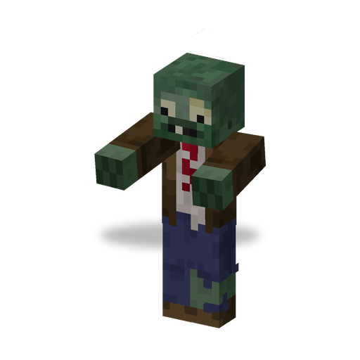 | [Обычный Зомби](characters/browncoat.md) | Обычные биомы, реки, океаны | Самый частый зомби; внешний вид зависит от биома |
| 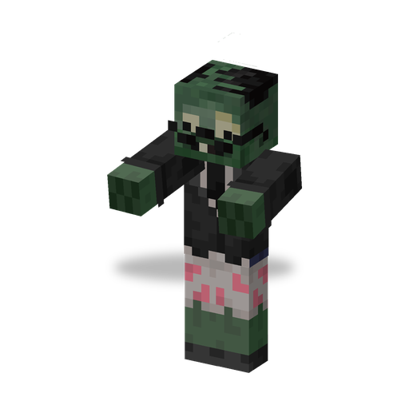 | [Зомби с Газетой](characters/newspaper_zombie.md) | Обычные биомы, вода | Звереет, когда теряет газету |
| 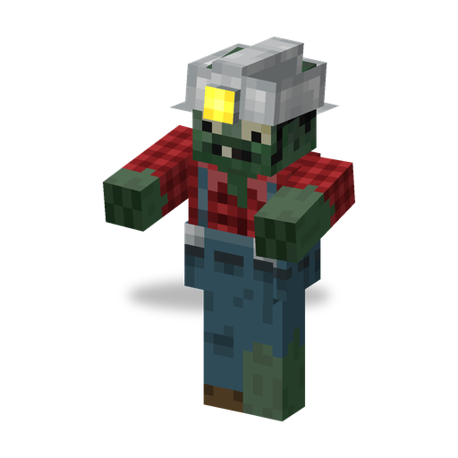 | [Зомби-Шахтёр](characters/digger_zombie.md) | Обычные биомы, подземелья | Роет тоннель к цели, прокапывает блоки на пути |
| 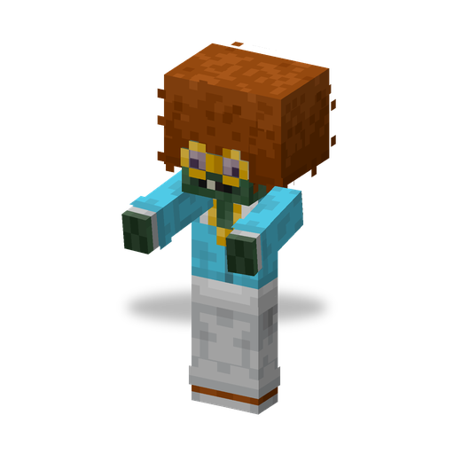 | [Зомби-Танцор](characters/disco_zombie.md) | Обычные биомы | Призывает Подтанцовщиков |
| 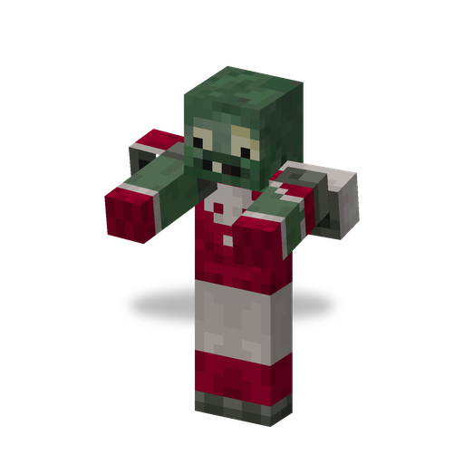 | [Футболист](characters/all_star.md) | Обычные биомы | Разгоняется и сбивает с ног |
| 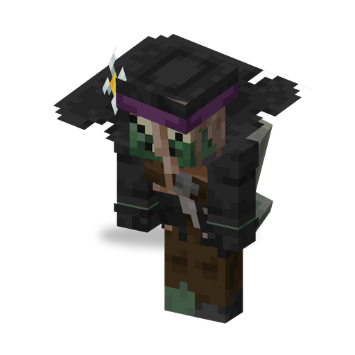 | [Могильщик](characters/grave_digger.md) | Обычные биомы | Выкапывает могилы, пока гонится за вами, а потом отступает |
|  | [Чертёнок](characters/imp.md) | Обычные биомы | Маленький и шустрый, укус может отравить («Токсичность») |
| 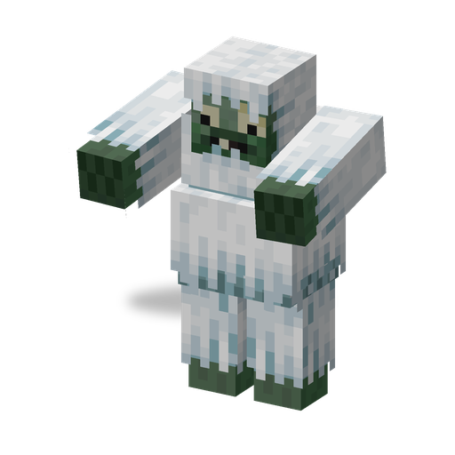 | [Зомби-Йети](characters/zombie_yeti.md) | Снежные и холодные биомы, ледяные вершины | Кидается рыхлым снегом («Прохлада») |
| 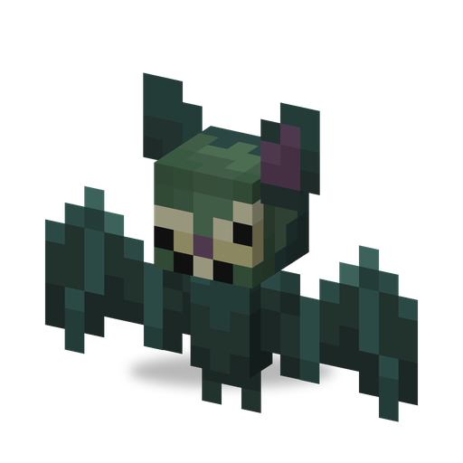 | [Зомбимышь](characters/zombat.md) | Кладбище, даже днём | Летает, лечится, когда ранит моба |
| 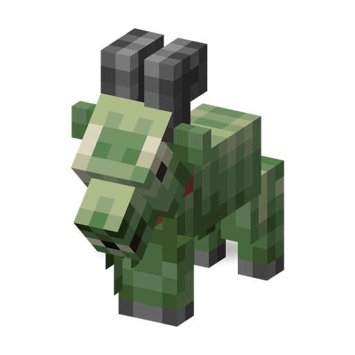 | [Зомби-Козёл](characters/zombie_goat.md) | Заснеженные склоны, вершины, рощи, ветреные холмы — ночью | В 40 % случаев на нём едет Чертёнок (Sprout Squad) |

Только в рейдах (или из яиц призыва):

| | Зомби | Особенности |
|---|---|---|
|  | [Подтанцовщик](characters/backup_dancer.md) | Его призывает Зомби-Танцор |
| 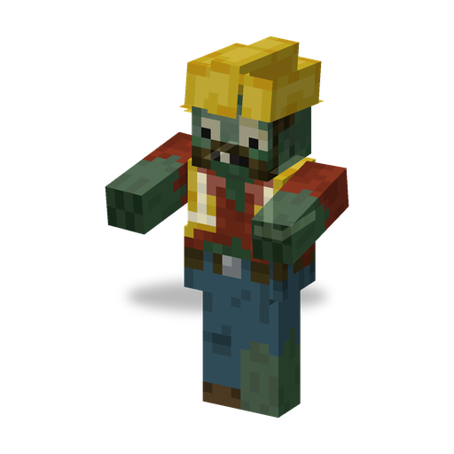 | [Зомби-Инженер](characters/engineer_zombie.md) | Избегает игроков и растений и строит враждебные машины |
| 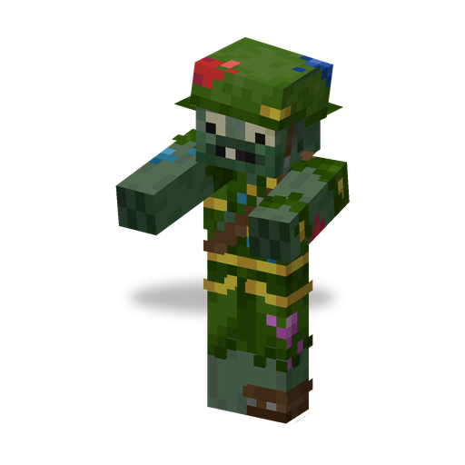 | [Зомби-Солдат](characters/soldier_zombie.md) | Стреляет из Пейнтбольного маркера |
|  | [Робо-Зомби](characters/robo_zombie.md) | Трансформируется, стреляет ракетами |
|  | [Капитан Пиратов](characters/pirate_captain.md) | Стреляет фейерверками; после смерти возвращается [Призраком Капитана Пиратов](characters/pirate_captain_ghost.md) |
| 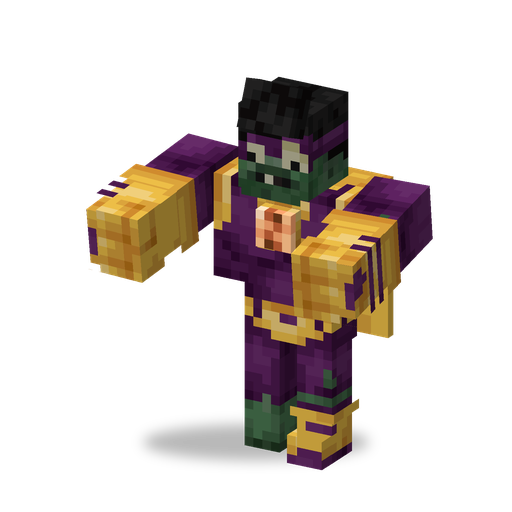 | [Супермозг](characters/super_brainz.md) | Энергетические лучи и удары кулаками |
| 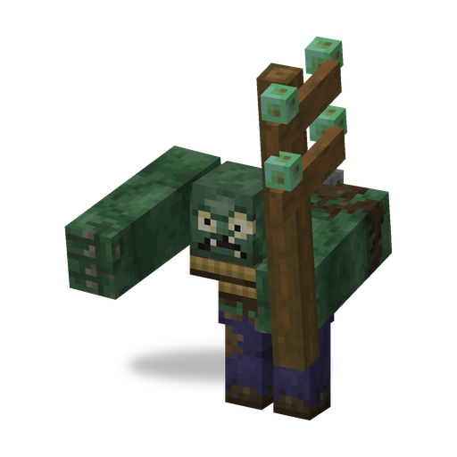 | [Гаргантюа](characters/gargantuar.md) | Огромный, крушит и метает Чертят |
| 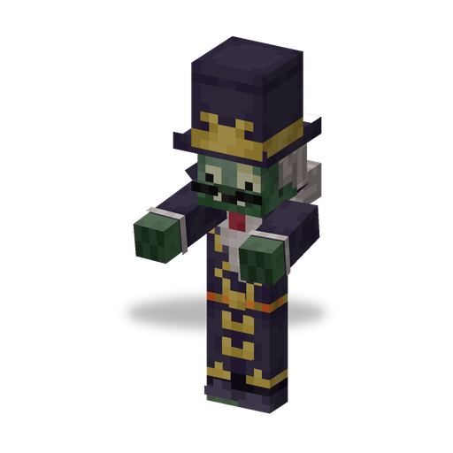 | [Барон фон Бэтс](characters/baron_von_bats.md) | Босс: призывает Зомбимышей, превращается |
|  | [Электро-Слайд](characters/electric_slide.md) | Роллер с электрическими атаками |

### Разновидности

| Зомби | Разновидность | Когда |
|---|---|---|
| Обычный Зомби | Снежный Зомби | снежные биомы (75 %), «Зимняя Страна Чудес» |
| Обычный Зомби | Пустынный Зомби | пустыни и пустоши (75 %) |
| Обычный Зомби | Буканьер | затонувшие корабли, пляжи (60 %), «Пиратское Нашествие» |
| Обычный Зомби | Зомби-Вампир | сезон Хэллоуина (8 %), «Зомбиуин» |
| Обычный Зомби | Зомби на Шаре | летит на воздушных шарах; роняет шары |
| Чертёнок | Чертёнок-Йети | снежные биомы, «Зимняя Страна Чудес»; укус накладывает «Прохладу» |
| Чертёнок | Чертёнок-Пират | «Пиратское Нашествие»; прибывает во взрывоопасной бочке |
| Гаргантюа | Гаргантюа-Пират | босс-Гаргантюа в «Пиратском Нашествии» |
| Супермозг | Токсичный, Электро | «Лига Великолепия»; Токсичный — ещё и в «Зомбиуине» |
| Футболист | Гига-Футболист | босс |
| Электро-Слайд | Электро-Буги | босс |
| Робо-Зомби | Робо-Генерал | босс |

Сезон Хэллоуина длится с 14 дней до 31 октября по 1 день после (по реальной дате).

### Снаряжение

- Обычные Зомби могут появиться с **Конусом**, **Ведром**, **Щитом-дверью** или **Гробом**; чем выше локальная сложность, тем чаще. В рейдах снаряжение становится лучше с каждой волной.
- Конусы и вёдра защищают только от ударов сверху: снаряды, летящие навесом, отскакивают, а прямые выстрелы проходят. Они могут сломаться. Щит-дверь и газета защищают спереди, гроб — со всех сторон.
- Футболисты носят Футбольный шлем; в особых волнах зомби надевают праздничные колпаки, тыквы или железную броню.
- Всё это можно надеть и самому, см. [шлемы и броню](#шлемы-броня-и-снаряжение).

### На кого нападают зомби

- На игроков, жителей, железных големов, маленьких черепах и растения. Это касается и обычных ванильных зомби, кадавров и утопленников (но не зомбифицированных пиглинов). Жители убегают от зомби мода.
- Картофельную Мину, Водоросль и Могилоеда зомби не выбирают целью. Стенорех, Взрыворех и Гипногриб зомби атакуют, когда натыкаются на них.
- Зомби рейда идут к «Флагу цветкоф» и атакуют его.

### Вожаки

Редкий зомби-вожак (зомби, кадавр, утопленник, Обычный Зомби, Зомби с Газетой, Зомби-Солдат, Чертёнок) держит во второй руке «Флаг мозгоф», приходит минимум с тремя сородичами и роняет флаг, если его убьёт игрок. В рейде вожак — первый зомби каждой волны; его флаг не выпадает.

### Могилы

Могила поднимает зомби раз в 20–30 секунд, если темно и в пределах 24 блоков есть игрок (настройка сервера `graveStoneActivationRange`); на Кладбище она работает и днём. Своих живых зомби у неё не больше двух, а если рядом уже трое зомби, она ждёт. Подобрать её можно только с «Шёлковым касанием». Посадите на неё Могилоеда, чтобы убрать её и получить могильную добычу: зловещие бутылочки, конусы, газеты, Надувные утки, сплав мозгания, слитки и изумруды.

## Рейды

### Флаги

| Флаг | Как получить | Что делает |
|---|---|---|
| «Флаг мозгоф» | Вожаки зомби, Могильщик (5 %), Странствующий торговец (12 изумрудов), сундук мавзолея на Кладбище (всегда) | Украшение; ингредиент «Флага цветкоф» |
| «Флаг цветкоф» | «Флаг мозгоф» + 8 солнц | Центр рейда; растения в пределах 5 блоков действуют на 20 % быстрее; в руке — +20 % к скорости передвижения и атаки |

- Оба флага ставятся вприсядку.
- У «Флага цветкоф» 40 единиц здоровья, во время рейда — 500; если его долго не бьют, он понемногу восстанавливается. Уничтоженный флаг превращается в «Флаг мозгоф».
- Во время рейда флаг издалека виден по лучу, как у маяка.

### Как начинается рейд

1. Поставьте «Флаг цветкоф».
2. Получите эффект «Дурное знамение», например из зловещей бутылочки (они попадаются в могильной добыче и в сундуках мавзолея).
3. Подойдите к флагу ближе чем на 24 блока: «Дурное знамение» превратится в **«Знамение зомби»** того же уровня на 30 секунд.
4. Когда «Знамение зомби» закончится и в пределах 64 блоков будет «Флаг цветкоф», у этого флага начнётся рейд.

Нужно, чтобы правило игры `raids` было включено, а сложность не была мирной. К рейду присоединяются игроки в пределах 160 блоков. Дикие растения в этом радиусе исчезают, и новые там не появляются до конца рейда. «Знамение зомби», поглощённое во время рейда (до последней волны), добавляет волны.

### Сколько волн

2 + сложность (лёгкая — 1, нормальная — 2, сложная — 3) + 2 за каждый уровень «Знамения зомби» + 2, если игрок, начавший рейд, видел финальные титры Края; не больше 20. Например, нормальная сложность и «Дурное знамение» I дают 6 волн, а сложная сложность, «Дурное знамение» V и просмотренные титры — 17.

После титров («Зомби вернутся с новыми силами...») волны примерно на 20 % больше, с 11-й волны в обычных волнах появляются Зомби-Солдаты, а также становятся возможны волны «Робо-Армия» и «Лига Великолепия».

### Волны

- Зомби вылезают из-под земли примерно в 88 блоках от флага и идут к нему.
- Волна длится 2,5 минуты, волна с боссом — 3,75 минуты, последняя волна — 5 минут. Если перебить всех зомби, следующая волна придёт через 5 секунд; если время обычной волны вышло, следующая начнётся всё равно.
- На последней волне или пока жив босс истечение времени уничтожает флаг, и рейд проигран. Последние 10 секунд идёт обратный отсчёт; за 30 секунд до конца зомби, далёкие от флага, телепортируются поближе к нему, а музыка ускоряется.
- Обычная волна растёт с номером: Обычные Зомби и Зомби с Газетой — с самого начала, Зомби-Шахтёры — с 4-й волны, Чертята — с 5-й, Футболисты и Зомби-Танцоры — с 6-й, Зомби-Инженеры — с 8-й, Зомби-Солдаты — с 11-й (после титров), Супермозги — с 16-й или Робо-Зомби — с 17-й. С 5-й волны с шансом 17,5 % приходит Могильщик; с 3-й волны часть зомби прилетает на воздушных шарах.

### Особые волны

| Волна (`wave_type`) | Волны | Кто приходит |
|---|---|---|
| «Ведерная Бригада» (`bucket_brigade`) | 1–4 | Обычные Зомби и Зомби с Газетой в вёдрах, железной броне и с железными щитами-дверями |
| «Стычка в Перерыве» (`halftime_showdown`) | 2–6 | Футболисты, Чертята в футбольных шлемах, Обычные Зомби на шарах |
| «Дискотека Нежити» (`disco_party`) | 4–15 | Зомби-Танцоры, праздничные колпаки, шары; с 8-й волны — Электро-Слайд |
| «Зомбиуин» (`zomboween`) | 4–11 | Только в сезон Хэллоуина: Зомби-Вампиры, тыквы на головах, Зомбимыши, Могильщики, позже Токсичные Супермозги или Призраки Капитана Пиратов |
| «Зимняя Страна Чудес» (`winter_wonderland`) | 5–9 | Снежные Зомби в сапогах с «Ледоходом», Чертята-Йети, Зомби-Йети |
| «Пиратское Нашествие» (`pirate_invasion`) | 9–15 | Буканьеры с мечами, Чертята-Пираты, Капитаны Пиратов |
| «Робо-Армия» (`robo_army`) | 10–16 | После титров: Зомби-Дроны, Зомби-Инженеры, Зомби-Солдаты, Робо-Зомби (на некоторых едут Солдаты) |
| «Лига Великолепия» (`league_of_awesome`) | 12–20 | После титров: Супермозги всех видов |

### Вожаки и боссы

- В каждой волне есть вожак с «Флагом мозгоф».
- **Шанс босса** показан на экране рейда между волнами и пока зажата клавиша списка игроков (Tab). Он растёт с каждой волной без босса, после пяти таких волн достигает 100 % и сбрасывается, когда босс появляется.
- В волне с боссом показывается полоса здоровья босса. Если босс жив, когда время волны вышло, рейд проигран.

| Босс (`boss_type`) | Волны | Типы волн | Примечание |
|---|---|---|---|
| Гига-Футболист (`giga_all_star`) | 1–7 | любые | на каждые 3 волны — ещё по одному |
| Барон фон Бэтс (`baron_von_bats`) | 6–18 | обычная, «Зомбиуин» | роняет Посох Барона (8,5 %) |
| Электро-Буги (`electric_boogaloo`) | 6–18 | обычная, «Дискотека Нежити» | |
| Гаргантюа (`gargantuar`) | 9–20 | обычная, «Пиратское Нашествие» (как Гаргантюа-Пират) | |
| Робо-Генерал (`robo_general`) | 10–20 | обычная, «Робо-Армия» | |

Гига-Футболист, Электро-Буги и Робо-Генерал — увеличенные версии с гораздо большим здоровьем и уроном.

### Победа, поражение и награды

- **Победа**: когда погибает последний зомби последней волны, гремит салют, и каждый участник рейда получает эффект **«Герой лужайки»** на 60 минут.
- **Поражение**: если флаг уничтожен, оставшиеся зомби исчезают, а наград нет.
- **Как забрать награду**: пока на вас «Герой лужайки», щёлкните ПКМ по любому Почтовому ящику. Он выбросит по награде за каждую пройденную волну — в зависимости от её типа — и бонус за каждую волну, в которой был босс. После этого эффект пропадает.

| Награды за | Что обычно внутри |
|---|---|
| Обычные волны 1–8 | Еда, железо, золото, изумруды; пузырьки солнца; семена Картофельной Мины, Бонк Чоя, Повторителя и Гипногриба; инструменты, пузырьки опыта, сплав мозгания, конусы, Надувная утка |
| Обычные волны с 9-й | Золотые яблоки, сплав мозгания, изумруды, алмазы; семена Бархатцев, Могилоеда, Гриба Судьбы и Электрического Горохострела; алмазные инструменты, зелья, книги «Небесная кара» и «Навесной бросок», Лейка, Садоводская перчатка, Шлем-горшок |
| «Ведерная Бригада» | Вёдра, конусы, сплав мозгания, Надувная утка |
| «Стычка в Перерыве» | Футбольный шлем, воздушные шары |
| «Дискотека Нежити» | Праздничный колпак, шары, фейерверки, проигрыватель, пластинка |
| «Зомбиуин» | Семена Тыквы и Могилоеда, светильники Джека, свечи, тыквенный пирог |
| «Зимняя Страна Чудес» | Семена Кофейного Боба, Ледяного Горохострела и Ледяной Арбузопульты; рыхлый снег, синий лёд, книги «Ледоход» |
| «Пиратское Нашествие» | Золото, динамит, книги «Защита», «Добыча» и «Удача», карты сокровищ, трезубец, арбалет, зачарованные золотые яблоки, алмазы |
| «Робо-Армия» | Незеритовый лом, алмазы, золотые блоки; мозганий, Пейнтбольный маркер, чертежи всех четырёх машин |
| «Лига Великолепия» | Зачарованные золотые яблоки, алмазы, золотые блоки; мозганий, шары |
| Бонус за босса | 12–24 тако, шары, садовые гномы или Пластиковый фламинго; мозганий (25 %) |

### Экран рейда и музыка

- Экран рейда показывает волны, оставшееся здоровье зомби, здоровье флага и шанс босса. Настройка клиента `showRaidUi` его скрывает.
- У рейда своя многослойная музыка — «Loon Griefers» от Patrika: слои спокойнее или напряжённее в зависимости от волны, своя тема для каждой особой волны и ускорение в последнюю минуту последней волны или волны с боссом. Громкость — ползунок «Музыка».

## Боевые машины и чертежи

Чертёж собирает машину. Щёлкните им ПКМ по блоку: машина появится лицом к вам, а её цена в сплаве мозгания спишется из инвентаря. Чертежа хватает на 20 сборок.

| | Машина | Сплав мозгания | Что делает |
|---|---|---|---|
| 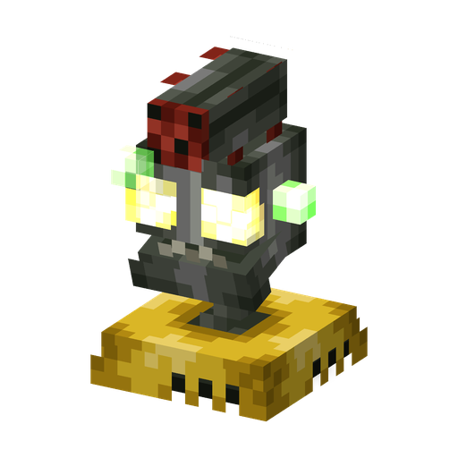 | [Зомби-Турель](characters/zombie_turret.md) | 12 | Стреляет лазерными зарядами |
|  | [Электрическая Турель](characters/electro_turret.md) | 10 | Бьёт током мобов в радиусе около 8 блоков и накладывает «Электризацию» |
| 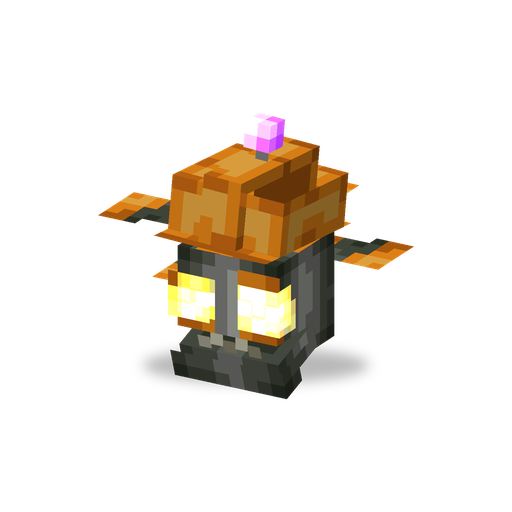 | [Зомби-Дрон](characters/zombie_drone.md) | 8 | Летает и атакует |
| 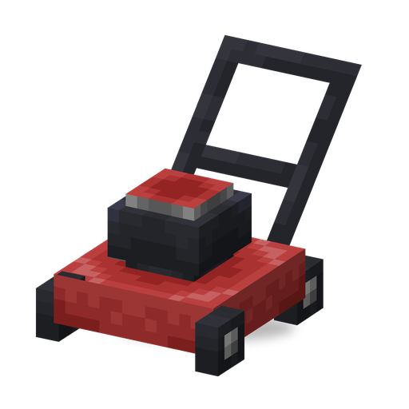 | [Газонокосилка](characters/lawn_mower.md) | 14 | Последний рубеж: ждёт, пока монстр подойдёт вплотную спереди, затем едет вперёд до 40 блоков (или до стены) и скашивает всех монстров на пути; боссы получают 40 урона. Одноразовая, ставится ручкой к вам, сломать её может только игрок |

- Чертежи: выпадают из Зомби-Инженера (8,5 %, одна из трёх его машин) и попадаются в сокровищах «Робо-Армии» (все четыре машины, Газонокосилка — редко). Цены задаёт настройка сервера `alloyCosts`.
- В Sprout Squad собранная вами машина — **ваша**: она атакует только враждебных мобов (не криперов и не нейтральных мобов вроде эндерменов), никогда не ранит игроков, растения и машины других игроков, не трогает флаг рейда и никогда не исчезает, даже на мирной сложности. Атака, убивающая с одного удара, наносит боссам 40 урона вместо мгновенной смерти. Машины, построенные Зомби-Инженерами, остаются враждебными.

**Сплав мозгания** добывают у зомби: Гаргантюа всегда роняет 18–25 штук, Робо-Зомби — 2–5 (90 %), Супермозг — 1–3 (70 %), Зомби-Инженер — 1–2 (30 %). Он есть в могильной добыче, сундуках мавзолея и наградах за рейды, а из 1 мозгания, 4 медных и 4 железных слитков получается 16 штук. Сплав нужен для сборки машин, ремонта Пейнтбольного маркера и для блоков из сплава мозгания (блок, ступени, плита, гладкий, рифлёный, усиленный, забор, дверь, люк), Солнечной батареи, Ящика для сбора писем и Машины времени.

**Мозганий** — редкий сияющий материал: 25 % в бонусе за босса и в сокровищах «Робо-Армии» и «Лиги Великолепия». Из него делают сплав мозгания и Машину времени.

## Предметы и блоки

### Зелья и эффекты

Зелья варятся из «Грубого зелья»; порох превращает их во взрывные, драконье дыхание — в оседающие, а из оседающих делают стрелы с эффектом.

| Зелье | Ингредиент | Эффект и длительность |
|---|---|---|
| Зелье гипноза | Красный гриб | «Гипноз», 3:00 |
| Зелье масла | Пчелиные соты | «В масле», 0:05 |
| Зелье электричества | Громоотвод (любой) | «Электризация», 0:10 |

| Эффект | Что делает | Откуда берётся |
|---|---|---|
| «Гипноз» | Моб нападает на своих сородичей и других монстров и никогда не атакует растения и игроков. Не действует на Гаргантюа, Электро-Слайда, Барона фон Бэтса, Робо-Зомби, машины, растения и боссов | Гипногриб, зелье |
| «В масле» | Нельзя двигаться, прыгать и атаковать | Масло Зернопульты, зелье |
| «Электризация» | Электрический урон перескакивает на ближайшего моба той же стороны; в воде бьёт током | Тростник-молния, Электрический Горохострел, Электрическая Турель, Электро-Слайд, Супермозг, молния, зелье |
| «Токсичность» | Урон со временем, тем сильнее, чем больше здоровья | Дымогриб, споры Пуффгриба и Трусогриба, Чертята |
| «Прохлада» | Медленнее, чуть слабее, иней по краям экрана | Ледяной Горохострел, Ледяная Арбузопульта, Зомби-Йети, Чертёнок-Йети |
| «Заморозка» | Полностью сковывает на месте | Ледогриб |
| «Запутан» | Нельзя двигаться и атаковать | Водоросль |
| «Покрашен» (16 цветов) | Краска заливает экран; вода её смывает | Пейнтбольный маркер, Зомби-Солдат |
| «Знамение зомби» | Когда заканчивается, начинается рейд | «Дурное знамение» рядом с «Флагом цветкоф» |
| «Герой лужайки» | Награды за рейд из Почтового ящика | Победа в рейде |

### Воздушные шары

- 16 белых шаров — из фантомной мембраны, заряда ветра и нити; 8 шаров + краситель дают 8 цветных. Шары роняют Зомби на Шаре, и они есть во многих наградах за рейды.
- Щёлкните шаром ПКМ по блоку, чтобы надуть его: он будет привязан к вам на поводке; ПКМ по забору — привязать к забору. Раздатчик выпускает шары и привязывает их к мобу, стоящему перед ним.
- Каждый шар делает вас легче: несколько смягчают падение, больше — поднимают в воздух. Sprout Squad следит, чтобы сервер не выкидывал вас за полёт, пока шар действительно вас поднимает.
- Шар лопается от удара, на слишком большой высоте или через 2 минуты после того, как его отпустили.

### Шлемы, броня и снаряжение

| Предмет | Как получить | Что делает |
|---|---|---|
| Конус | Зомби, могильная добыча, награды за рейды | Шлем (8 брони) от ударов сверху; можно поставить и как блок |
| Ведро | Обычное ведро | Его можно надеть: 15 брони от ударов сверху |
| Футбольный шлем | Футболист (2 %), награды «Стычки в Перерыве» | На бегу: быстрее, отбрасывает мобов перед вами |
| Праздничный колпак | Подтанцовщик (8 %), награды «Дискотеки Нежити» | Нарядная шапка, 1 броня |
| Шлем-горшок | Награды за поздние волны, фермер 4-го уровня | Растение на голове ([см. выше](#растения-на-голове)) |
| Гроб | 3 деревянных люка + 3 деревянные плиты | Надевается на грудь и блокирует прямые атаки со всех сторон |
| Щит-дверь | Любая дверь + щит | Щит в виде этой двери |
| Газета | Зомби с Газетой (5 %), могильная добыча | Защищает спереди, как хлипкий щит; нужна для Почтового ящика |
| Надувная утка | Сокровища рыбалки, могильная добыча, награды за рейды | Надевается как поножи, держит на воде |
| Роликовые коньки | Электро-Слайд (2 %) | Сильно ускоряют, а на бегу — ещё больше |
| Пейнтбольный маркер | Зомби-Солдат (2 %), награды «Робо-Армии» | Удерживайте ПКМ, чтобы стрелять шариками с краской; патроны — красители из инвентаря, с шансом 40 % за выстрел заряженный краситель расходуется; накладывает «Покрашен» |
| Посох Барона | Барон фон Бэтс (8,5 %) | Выпускает энергетический луч (7 урона, 14 блоков) |

Тако — еда (9 единиц сытости). Рецепт: хлеб, жареная говядина, свёкла, морковь; есть и второй рецепт для фермерских модов. Бонус за босса даёт сразу 12–24 штуки.

### Почта

- **Почтовый ящик**: 4 железных слитка, железный люк и газета; любым красителем ящик перекрашивается (16 цветов). В нём 5 ячеек. Через его экран содержимое отправляется в любой другой почтовый ящик в том же измерении: список отсортирован по расстоянию, по нему есть поиск. Над ящиком с почтой появляется значок; щёлкните по нему ПКМ, чтобы забрать письма.
- **Ящик для сбора писем**: 5 сплава мозгания, газета, 2 красной пыли и почтовый ящик. Выберите в нём ящик-получатель; сигнал красного камня отправит туда содержимое.
- В Почтовом ящике же забирают награды за рейды.

### Украшения и другие блоки

- **Садовые гномы** (синий, зелёный, красный, жёлтый и редкий золотой): из бонусов за боссов и от Бархатцев; ПКМ меняет позу.
- **Пластиковый фламинго**: украшение из бонусов за боссов.
- **Могила**: см. [Могилы](#могилы).
- **Блоки из сплава мозгания**: блок, ступени, плита, гладкий (печь или камнерез), рифлёный, усиленный (почти не боится взрывов), забор, дверь, люк.
- **Пластинка** «Grassy Groove» от joshxviii: выпадает из Зомби-Танцора, которого убил Подтанцовщик, а ещё есть в наградах «Дискотеки Нежити».
- У мода свои достижения: от «Получите солнце!» до победы в самом тяжёлом рейде и 30 побеждённых боссов.

### Машина времени

Рецепт: 2 сплава мозгания, осколок аметиста, 2 красной пыли, мозганий и 3 усиленного сплава мозгания. Щёлкните по машине ПКМ заряженной Солнечной батареей и подайте сигнал красного камня: в двух блоках над ней откроется портал в измерение эпох (см. [Мир](#мир)), а на той стороне на том же месте будет такая же машина. Пока машина активна, она тратит 1 солнце примерно раз в 2 секунды. В измерении эпох машину нельзя сломать, а спать и ставить точку возрождения там нельзя.

Путешествия во времени работают только с включённой настройкой сервера `enableExperimentalFeatures`; без неё машина никогда не включается.

## Мир

### Биомы

| Биом | Где | Чем особенный |
|---|---|---|
| Кладбище | Верхний мир (с TerraBlender и без него) | Мрачный туман, могилы, мёртвые деревья, мавзолеи и ограды; монстры не горят днём; зомби появляются при любом освещении; Зомбимыши и Могилоеды |
| Древний Египет | Измерение эпох | Жарко и сухо: кадавры, `parched`, верблюды, кролики, колодцы, окаменелости |
| Юрский период | Измерение эпох | Папоротники, попугаи, панды, оцелоты, окаменелости |
| Тёмные века | Измерение эпох | Домашние животные и множество монстров |
| Далёкое будущее | Измерение эпох | Только эндермены, кристальные шипы, парящие частицы |
| Гномий космос | Измерение «Гномий космос» | В игре туда не попасть, только командами (`/execute in sproutsquad:gnome_space …`) |

Измерение эпох (`sproutsquad:time_space`) состоит из четырёх биомов-эпох, и попасть туда можно только через [Машину времени](#машина-времени).

### Постройки

- **Мавзолей** (Кладбище). В сундуке с сокровищами всегда лежит «Флаг мозгоф», а также гробы, лопаты, зловещие бутылочки, кости, семена Могилоеда и Дымогриба и сплав мозгания; в горшках — кости, гнилая плоть, свёкла, стрелы и изумруды.
- **Ограды кладбища**: небольшие постройки из заборов на Кладбище.

### Добыча в обычных сундуках, рыбалка и торговля

| Где | Что |
|---|---|
| Дома в деревнях (пустынных, равнинных, саванновых, снежных, таёжных) | 40 %: Лейка или семена Картофельной Мины, Капустопульты, Зернопульты или Вишнёвой Бомбы |
| Сундуки бастионов | 35 %: семена Вишнёвой Бомбы или Гриба Судьбы |
| Рыбалка | Семена Морегриба (7,5 % улова рыбы); сокровища: Надувная утка или Лейка (30 %) |
| Вырезание тыквы | Семена Тыквы (5,5 %) |
| Фермер, 1-й уровень | Покупает 32 солнца за изумруд |
| Фермер, 2-й уровень | Лейка (изумруды + солнце), семена Картофельной Мины |
| Фермер, 3-й уровень | Садоводская перчатка (изумруды + солнце), семена Вишнёвой Бомбы |
| Странствующий торговец | «Флаг мозгоф» за 12 изумрудов (редко) |

Добыча с зомби (пачки семян, сплав мозгания, снаряжение) выпадает, только если их убил игрок или растение.

## Команды и настройки

### Команды

| Команда | Кому | Что делает |
|---|---|---|
| `/pz help` | всем | Ссылка на трекер ошибок |
| `/pz options` | всем | Открывает экран настроек клиента |
| `/pz raid start [wave_count]` | операторам (уровень 2) | Начинает рейд у «Флага цветкоф» в пределах 64 блоков; `wave_count` — от 1 до 99 |
| `/pz raid stop` | операторам | Останавливает рейд поблизости |
| `/pz raid wave_start [wave_type] [boss_type]` | операторам | Сразу начинает следующую волну, можно задать её тип и босса (имена — как в таблицах выше) |
| `/pz gallery [labels]` | операторам | Выставляет перед вами в ряд все растения, зомби (со всеми разновидностями и наборами снаряжения) и других мобов мода — замороженными и неуязвимыми; `false` прячет подписи, для скриншотов |
| `/pz gallery clear` | операторам | Убирает галерею (подставки остаются) |

### Настройки сервера (`config/sproutsquad/server.json`)

| Настройка | По умолчанию | Что значит |
|---|---|---|
| `coopPlanting` | `true` | Игроки могут пользоваться растениями друг друга |
| `playerCreditForPlantKills` | `false` | Мобы, убитые вашими растениями, считаются убитыми вами (опыт, добыча «только от игрока») |
| `seedGrowTime` | `12000` | Базовое ожидание семян, в тиках |
| `extraGrowTimePerSun` | `2400` | Добавка к ожиданию за каждую единицу цены в солнце |
| `zenPotTimeReduction` | `0.25` | На какую долю Горшок дзен сокращает ожидание |
| `hydrationSunReduction` | `0.5` | На какую долю полив из ведра или лейки снижает солнце, нужное для семян |
| `plantPotDamageReduction` | `0.5` | Доля урона от монстров, которую гасят горшки и Шлем-горшок |
| `poweredUpCooldownReduction` | `0.2` | Ускорение растений рядом с «Флагом цветкоф» |
| `coffeeBuffDuration` | `48000` | Сколько растение не спит после кофе, в тиках |
| `pumpkinArmorAmount` | `35` | Прочность тыквенной брони |
| `sunCostTamingThreshold` | `30` | Цена в солнце, при которой шанс приручения минимален (2 %) |
| `plantCooldownEnabled` | `false` | Задержка перед следующей посадкой того же растения из пачки семян (`plantCooldownTime` `4.0` с + `plantCooldownTimePerSun` `2.5` с за солнце) |
| `solarBatteryMax` | `512` | Ёмкость Солнечной батареи |
| `defaultPlantEntityLimit` | `30` | Растений одного вида в пределах 32 блоков |
| `customPlantEntityLimits` | Арбузопульта, Ледяная Арбузопульта, Гриб Судьбы — `20`; Кофейный Боб, Могилоед — `-1` | Лимиты для отдельных растений, `-1` — без лимита |
| `alloyCosts` | Зомби-Турель `12`, Зомби-Дрон `8`, Электрическая Турель `10`, Газонокосилка `14` | Цена машин в сплаве мозгания |
| `sunCosts` | см. [таблицу растений](#растения-и-стоимость-в-солнце) | Цена каждого растения в солнце |
| `graveStoneActivationRange` | `24.0` | На каком расстоянии от игрока работают могилы |
| `enableExperimentalFeatures` | `false` | Путешествия во времени и незаконченное содержимое во вкладках творческого режима |

Числа в файле настроек записываются с точкой.

### Настройки клиента (`config/sproutsquad/client.json`)

| Настройка | По умолчанию | Что значит |
|---|---|---|
| `showSunInfo` | `false` | «Информация о солнце»: ваш запас солнца и цена пачки семян в руке |
| `showRaidUi` | `true` | Экран рейда |
| `splitItemTabs` | `false` | Отдельные вкладки творческого режима для семян и зомби, а также яйца для всех разновидностей и наборов снаряжения, чертежи и яйца машин |
| `showDebugInfo` | `false` | Отладочные подписи над растениями, зомби и флагами |

Первые три меняются прямо в игре командой `/pz options`.

## Персонажи

У каждого растения, зомби и машины есть своя карточка с характеристиками, способностями и тем, где их найти: [список персонажей](characters/README.md). Например: [Горохострел](characters/peashooter.md), [Стенорех](characters/wallnut.md), [Обычный Зомби](characters/browncoat.md), [Зомби-Йети](characters/zombie_yeti.md), [Гаргантюа](characters/gargantuar.md), [Газонокосилка](characters/lawn_mower.md). Собственные персонажи Sprout Squad начинаются с маскота — [Горшочка](characters/potling.md).

## Недоступно в выживании

- **Путешествия во времени** требуют `enableExperimentalFeatures`.
- В **Гномий космос** нет входа.
- **Zomboss**: такая волна и такой босс есть в списках команд, но зомби в них нет, и сами они никогда не выпадают.
- **[Садовый Гном](characters/gnome.md)** (моб) не появляется сам; его яйцо призыва видно только с `splitItemTabs`.
- **[Королевский Подсолнух](characters/royal_sunflower.md)**, **[Цитрон](characters/citron.md)** и **Записка** появляются во вкладках творческого режима только с `enableExperimentalFeatures`.
