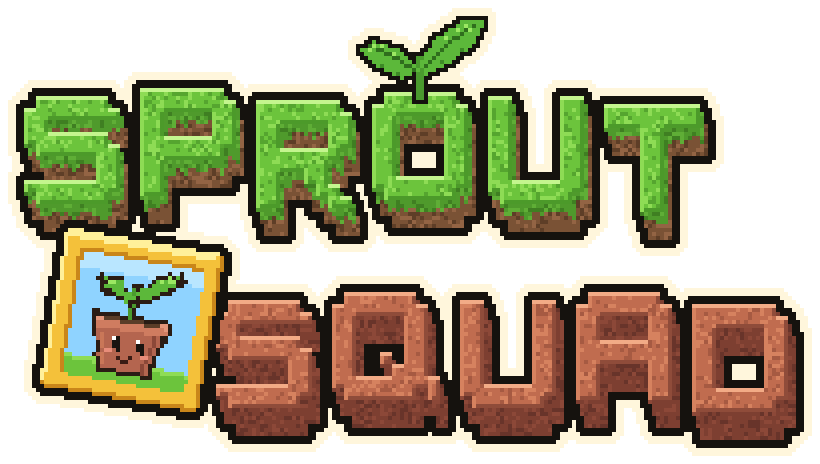

<p align="center">
  
</p>

<p align="center">Мод для Minecraft 26.3 на <b>NeoForge</b>: растения защищают базу от зомби, а отряд пополняется собственными персонажами.</p>

<p align="center"><a href="../../README.md">English</a> · <b>Русский</b></p>

> Неофициальный форк мода [Plants & Zombies](https://github.com/joshxviii/plants-and-zombies) от **joshxviii**, перенесённый с Fabric на NeoForge.
> Unofficial NeoForge fork of Plants & Zombies by joshxviii, licensed under MPL-2.0.

## Статус

Перенос на NeoForge и переименование в Sprout Squad выполнены, идёт проверка в игре.

## Что позволяет мод

- **Вырастить сад защитников.** Больше 30 растений — стрелки, катапульты, стены, бомбы, грибы для ночи — сажаются из пакетов семян за солнце.
- **Собирать солнце** с подсолнухов, солнцегрибов и других растений; хранить его в пузырьках солнца и солнечных батареях.
- **Сражаться с зомби.** 20 видов зомби с вариантами: одни бродят ночью по Верхнему миру, самые сильные — вплоть до гаргантюа и боссов — приходят с рейдами.
- **Устраивать рейды.** «Флаг цветкоф» крафтится из «Флага мозгоф»; поставьте его и приходите с Дурным знамением — волны зомби с вожаками и боссами нападут на флаг, а награды придут по почте.
- **Строить боевые машины.** Турели, дрон и газонокосилка из чертежей и сплава мозгов воюют на вашей стороне.
- **Пользоваться снаряжением.** Зелья гипноза и другие, воздушные шарики, шлемы, статуи садовых гномов, горшки для растений и лейка.
- **Исследовать Кладбище.** Мрачный биом с надгробиями, из которых встают зомби, и мавзолеями с сокровищами. С включёнными экспериментальными функциями машина времени открывает биомы эпох: Древний Египет, Тёмные века, Далёкое будущее, Юрский период.

Полное описание — в [FEATURES](FEATURES.md); у каждого растения, зомби и машины есть своя карточка в разделе [персонажи](characters/README.md).

Что форк добавляет к оригиналу:

- **Починка того, что нельзя было получить или использовать**: боевые машины из чертежей воюют за игрока, газонокосилка работает как последний рубеж, Squash атакует, зелья варятся, у рейдов и мобов есть лут, зомби-козёл появляется в горах, за полёт на шариках больше не кикает ([полный список](UPSTREAM.md)).
- **Собственные персонажи**, первый — растение-маскот [Горшочек](characters/potling.md).
- **Новые постройки**: [Огородная сторожка](STRUCTURES.md#огородная-сторожка) — брошенный огород с дикими растениями, которых можно приручить, и [Свалка роботов](STRUCTURES.md#свалка-роботов) — двор с ломом под охраной турелей и чертежами в мастерской.

| | |
|---|---|
| Minecraft | 26.3 |
| Загрузчик | NeoForge 26.3.x |
| Зависимости | Kotlin for Forge; опционально TerraBlender, Iris |
| Java | 25 |

## Установка

Скачайте `sprout-squad-<версия>.jar` со страницы [Releases](https://github.com/efureev/plants-and-zombies/releases) и положите в папку `mods` установки NeoForge 26.3 вместе с [Kotlin for Forge](https://modrinth.com/mod/kotlin-for-forge). По шагам — для официального лаунчера, Prism Launcher и сервера: [INSTALL](INSTALL.md).

## Сборка

```bash
./gradlew build              # jar появится в build/libs/ (sprout-squad-<версия>.jar)
./gradlew runClient          # запуск клиента для проверки
./gradlew runServer          # запуск выделенного сервера
./gradlew runGameTestServer  # загрузка мода и его GameTest-ы, потом выход
```

Нужен JDK 25.

Отладка (оператор сервера, уровень 2):

```text
/pz gallery           # выставить всех растений, зомби и их варианты в ряд перед собой (с подписями)
/pz gallery false     # то же без подписей — для скриншотов
/pz gallery clear     # убрать галерею (подставки остаются)
```

## Документация

Основная версия документации — английская ([English](../../README.md#documentation)); здесь — русская.

- [INSTALL](INSTALL.md) — как установить мод, играть на сервере, обновлять
- [FEATURES](FEATURES.md) — полное описание: что позволяет мод
- [Персонажи](characters/README.md) — карточка каждого растения, зомби и машины
- [WORKSHOP](WORKSHOP.md) — как добавить персонажа, гайд по стилю
- [STRUCTURES](STRUCTURES.md) — постройки: что есть в мире, задуманные с эскизами, как сделать новую
- [UPSTREAM](UPSTREAM.md) — изменения из оригинала и исправленные в нём ошибки

## Лицензия и авторство

Код основан на [Plants & Zombies](https://github.com/joshxviii/plants-and-zombies) (© joshxviii) и распространяется под лицензией [Mozilla Public License 2.0](../../LICENSE). Файлы оригинала, изменённые в этом форке, остаются под MPL-2.0.

Plants vs. Zombies — товарный знак PopCap Games / Electronic Arts. Этот проект с ними не связан.
