# Постройки

Что можно найти в мире Sprout Squad, какие постройки задуманы и как постройка делается. English version: [docs/en/STRUCTURES.md](../en/STRUCTURES.md).

- [Что есть в моде сейчас](#что-есть-в-моде-сейчас)
- [Задуманные постройки](#задуманные-постройки)
- [Как делается постройка](#как-делается-постройка)

## Что есть в моде сейчас

Мавзолей и ограды — из оригинального мода и встречаются только в биоме «Кладбище»; Огородная сторожка — своя постройка форка. Что в них лежит, описано и в [FEATURES](FEATURES.md#постройки).

<!-- pictures 240: structure:graveyard_mausoleum -->
<p>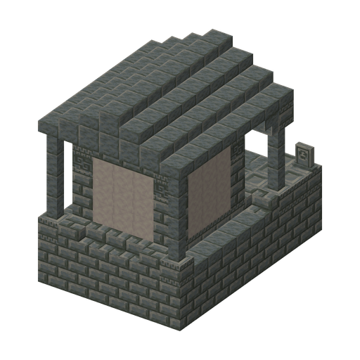</p>

<!-- pictures 160: structure:graveyard_fence* -->
<p>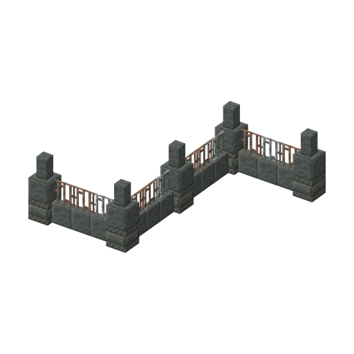 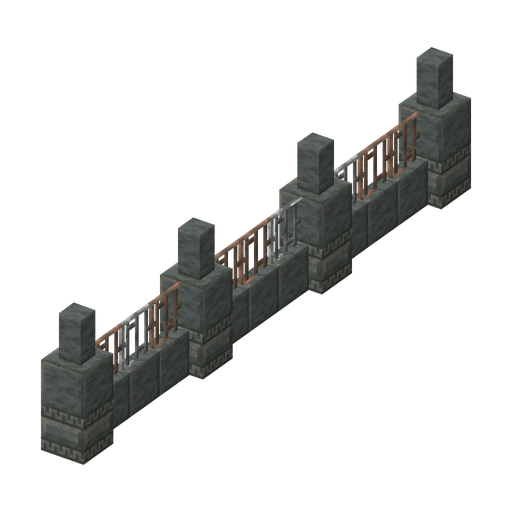 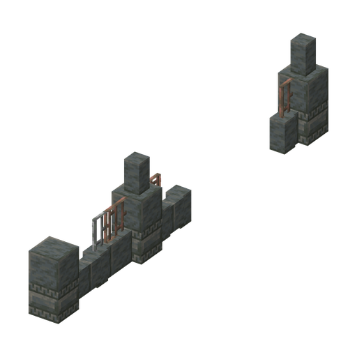 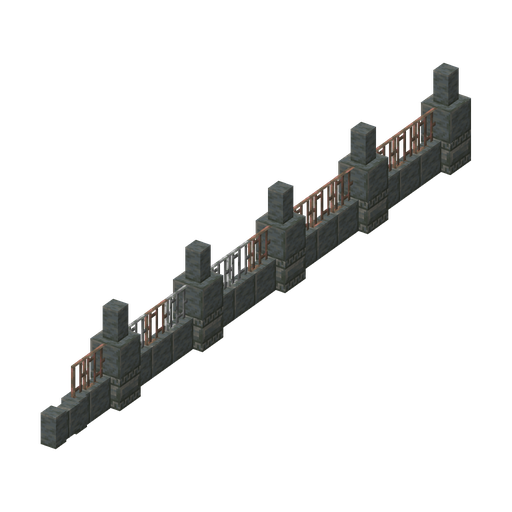 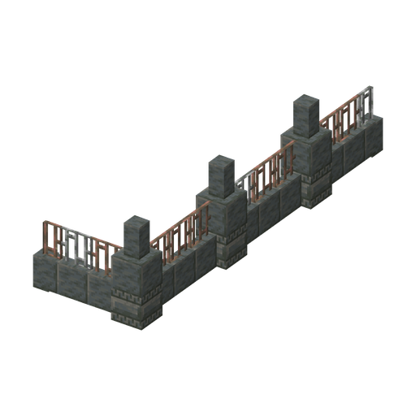 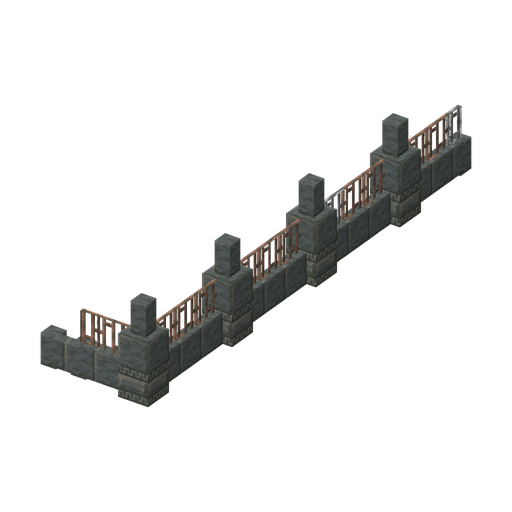</p>

- **Мавзолей**: небольшая гробница на поверхности со склепом внизу; в сундуке с сокровищами всегда лежит «Флаг мозгоф». На картинке — надземная часть.
- **Ограды кладбища**: шесть небольших оград из туфа и железных решёток вокруг Кладбища.

### Огородная сторожка

`sproutsquad:garden_shack`

<!-- pictures 240: structure:garden_shack_* -->
<p>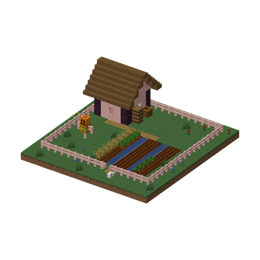 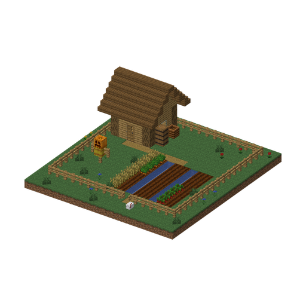 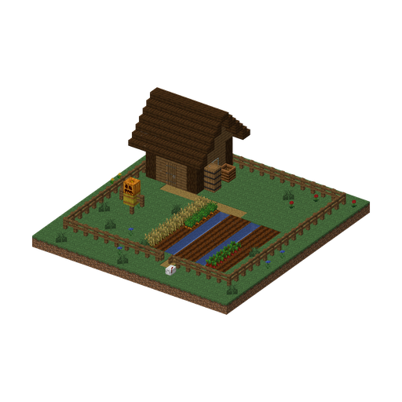</p>

Брошенный огород с сарайчиком: здесь кто-то растил растения-бойцов, а потом ушёл. Часто первая находка в новом мире; учит приручать растения.

- **Где:** равнины, подсолнечниковые равнины, луга, цветочные леса, вишнёвые рощи; встречается примерно как деревня и никогда не стоит вплотную к ней.
- **Облик:** 19×20 блоков. Огород за забором с калиткой, грядки с водой между ними, сарай 5×5 из дуба, ели или вишни (игра выбирает сама), пугало, компостер, бочки, почтовый ящик у калитки.
- **Жители:** дикие Подсолнух, Горохострел, Стенорех и Горшочек на грядках, их можно приручить солнцем; когда их не станет, огород зарастает новыми. Ночью приходят Обычные Зомби.
- **Внутри:** в сундуке сарая — 2–3 пачки семян, 8–16 солнц, горшки, костная мука или семена, иногда лейка (20 %) или садоводская перчатка (5 %); в бочках — картофель, морковь, свёкла и семена. В почтовом ящике — «Письмо садовника», книга с подсказкой, как приручать растения: щёлкните по ящику ПКМ, и письмо выпадет.
- **Как найти:** картограф 1-го уровня может продавать «Карту огородной сторожки» (6 изумрудов и компас); за первое посещение — достижение «Чужой огород».

## Задуманные постройки

> **Замысел, а не готовая постройка.** Картинки — эскизы из настоящих блоков игры (как они сделаны — [ниже](#картинки)). Размеры, комнаты, жители и добыча будут меняться по ходу работы. Мобов и предметов с пометкой *(в планах)* пока нет; на эскизах их изображают похожие существующие персонажи. Подземные постройки показаны в разрезе.

<p align="center">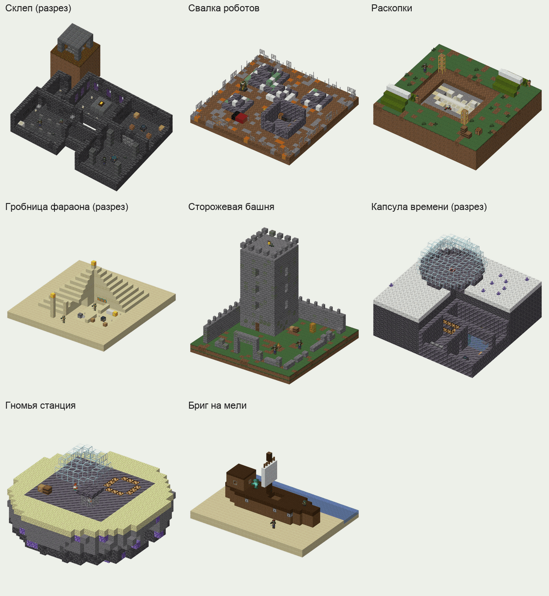</p>

| Постройка | Где | Изюминка | Главная добыча |
|---|---|---|---|
| [Склеп](#склеп) | Кладбище, под землёй | Испытание, которое даёт Ключ от склепа, и хранилище | Диск «The Great Pumpkin», «Флаг мозгоф», блоки склепа, семена |
| [Свалка роботов](#свалка-роботов) | обычный мир: бесплодные земли, саванны, редко равнины | Мастерская Инженера под охраной вражеских турелей | Чертежи, сплав мозгания, редко мозганий |
| [Раскопки](#раскопки) | Юрский период | Скелет Рекса в земле, подозрительный гравий под кисточку | Янтарь, семена эпохи |
| [Гробница фараона](#гробница-фараона) | Древний Египет | Загадка Сфинкса: повернуть три рамки так, как нарисовано на иероглифах | Щит «Каменная крышка», золото, плитки с иероглифами |
| [Сторожевая башня](#сторожевая-башня) | Тёмные века | «Осада»: во дворе встают Жестяные Рыцари | Старинные монеты, броня, семена эпохи |
| [Капсула времени](#капсула-времени) | Далёкое будущее | Запертая лаборатория, хранилище по Ключ-карте | Хроно-кристаллы, мозганий |
| [Гномья станция](#гномья-станция) | Гномий космос | Гном-садовник в клетке, посадочная площадка тарелки-босса | Мозганий, союзник |
| [Бриг на мели](#бриг-на-мели) | обычный мир: пляжи | Ночью на палубе — Призрак Капитана Пиратов | Карта сокровищ, пиратская шляпа |

### Что у них общего

- **Одна изюминка.** У каждой постройки есть место или событие, которое запоминается (хранилище с ключом, загадка, скелет динозавра), а не просто коробка с сундуком.
- **Награда каждому игроку.** Главная награда лежит в ванильном хранилище: каждый игрок открывает его своим ключом и получает свою добычу, поэтому двум игрокам не приходится делить один сундук. В сундуках — мелочь.
- **Не смертельно.** Никакой лавы, TNT, стрел, падающего песка и ям глубже трёх блоков без воды. Ловушки смешные: паутина, блоки мёда, заряды ветра и снежки из раздатчиков, «В масле» и «Запутан». Дорогу освещают свечи.
- **Источник, а не склад.** Постройка — второй способ получить что-то важное из своего набора: семена, материал эпохи, ключ, диск. Мозганий — только редко.
- **Данные, а не код.** Постройка — это шаблоны (`.nbt`), JSON генерации мира, процессоры, таблицы добычи, настройки испытательных спавнеров и хранилищ. Код нужен только для новых предметов-ключей и нескольких событий.
- **Собрана из комнат.** Каждая комната — свой шаблон с jigsaw-блоками на стыках, поэтому игра каждый раз собирает постройку немного по-другому.
- **Населена мобами мода.** Появление внутри границ постройки (`spawn_overrides`), Могилы (каждая держит не больше двух своих зомби) и испытательные спавнеры с настройками в JSON.

### Склеп

`sproutsquad:graveyard_crypt` (задуманный id)

<p align="center">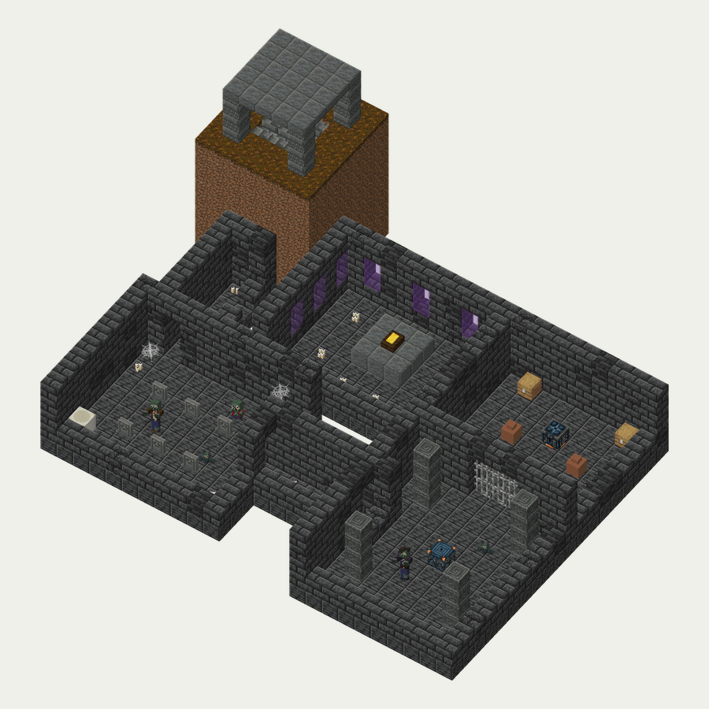</p>

Подземелье под Кладбищем: коридоры при свечах, зал надгробий, испытание и хранилище в конце. Мавзолей оригинала остаётся маленькой постройкой на поверхности, склеп — большой и под землёй.

- **Где:** Кладбище; на поверхности видна только каменная беседка с лестницей вниз.
- **Комнаты:** вход, коридоры (прямой, поворот, развилка), костница (костяные блоки, полки с расписными горшками), часовня (витражи, гроб на постаменте), зал надгробий, зал испытания, хранилище. Туф и глубинносланцевый кирпич, блоки склепа *(в планах)*, паутина, свечи, бледный мох.
- **Жители:** Могилы мода в зале поднимают Обычных Зомби, Чертят и Зомбимышей; испытательный спавнер выпускает Зомби-Простыней *(в планах)* и Зомбимышей; по коридорам ходят Фонарщики *(в планах)*.
- **Изюминка:** пройти испытание, получить Ключ от склепа *(в планах)*, открыть хранилище — каждый игрок получает свою награду.
- **Добыча:** в хранилище — диск «The Great Pumpkin» *(в планах)*, «Флаг мозгоф», семена Глазоцвета-Дозорного, Светлячкового Куста *(оба в планах)* или Могилоеда, гроб, блоки склепа, редко мозганий. В сундуках коридоров — свечи, кости, конусы, зловещие бутылочки, зелье гипноза, солнце.

### Свалка роботов

`sproutsquad:robo_junkyard` (задуманный id)

<p align="center">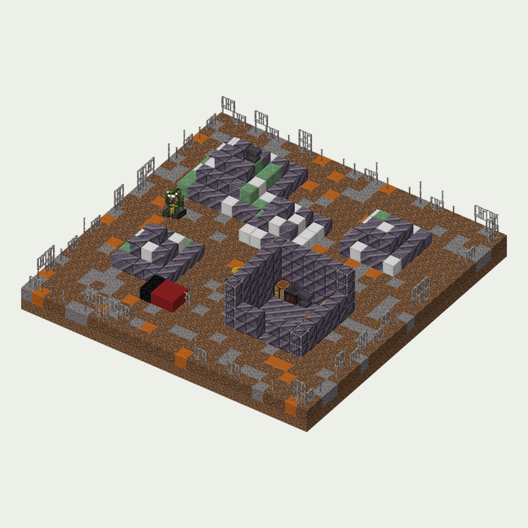</p>

Двор, где Зомби-Инженеры собирают машины: кучи лома, мастерская, недостроенные турели. Способ получить чертежи и сплав мозгания, не охотясь за редким Инженером.

- **Где:** бесплодные земли и саванны, редко равнины; редкая постройка.
- **Облик:** около 24×24 блоков. Ограда из сплава мозгания и железных решёток, кучи лома (блоки сплава, железо, окисленная медь, наковальни), разбитая газонокосилка, мастерская 7×7 с верстаком, наковальней и сундуком.
- **Жители:** 1–2 вражеские Зомби-Турели и Электрические Турели, поставленные вместе с постройкой; вокруг появляются Зомби-Инженеры, Зомби-Солдаты и изредка Робо-Зомби.
- **Изюминка:** турели охраняют мастерскую — их надо обезвредить растениями или сломать.
- **Добыча:** в сундуке мастерской — чертёж (одна из машин, газонокосилка — редко), сплав мозгания, железо, медь, редстоун, редко мозганий; в бочках с ломом — железные самородки, медь и немного сплава.

### Раскопки

`sproutsquad:dig_site` (задуманный id)

<p align="center">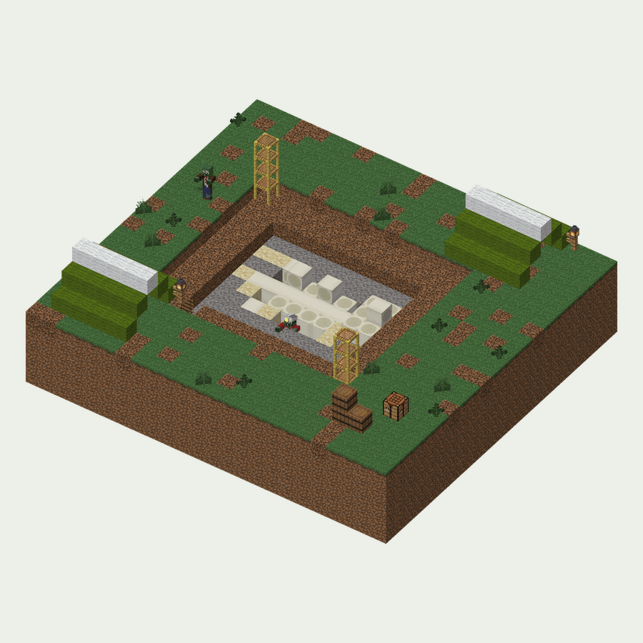</p>

Лагерь палеонтологов в Юрском периоде: палатки, строительные леса и раскоп с подозрительным гравием и песком. Кисточкой достаются янтарь, кости и семена древних растений; на дне раскопа лежит скелет Рекса.

- **Где:** Юрский период (измерение эпох машины времени).
- **Облик:** раскоп уступами глубиной 3–5 блоков, лестницы и леса, две палатки, скелет из костяных блоков длиной около 15 блоков, бочки, фонари, папоротники.
- **Жители:** Зомби в скорлупе и Птерозомби; вокруг — Листозавры, дикие Янтароцветы и Хвощи-Копейщики *(все в планах)*. Изредка ночью — босс Ископаемый Рекс *(в планах)*.
- **Внутри:** подозрительный гравий и песок дают янтарь, «жука в янтаре», кости, семена растений эпохи, ванильные черепки, редко диск. В сундуке палатки — кисточка, карта, факелы и еда.

### Гробница фараона

`sproutsquad:pharaoh_tomb` (задуманный id)

<p align="center">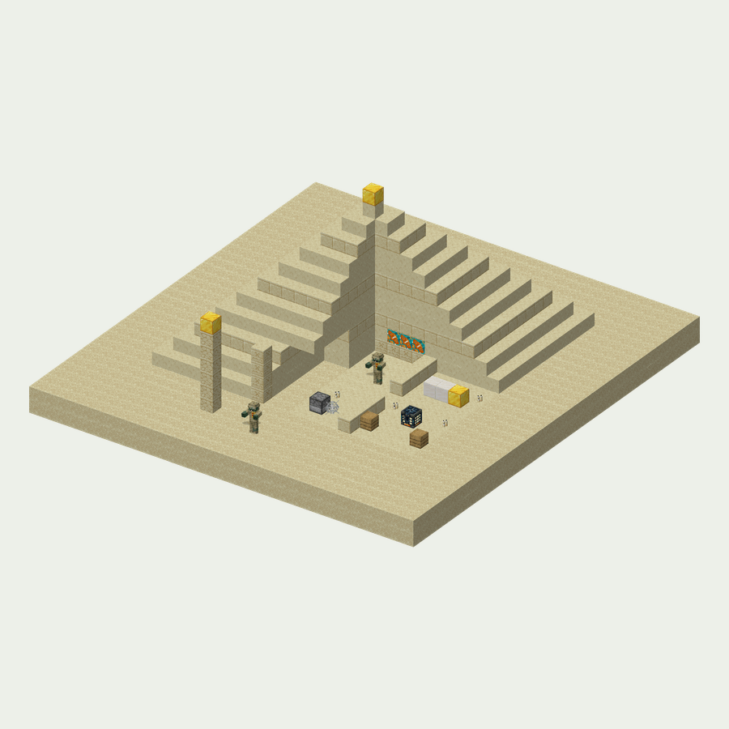</p>

Пирамида в Древнем Египте с безобидными ловушками и загадкой; в погребальной камере — саркофаг и хранилище.

- **Комнаты:** вход между обелисками, галерея со стенами из плиток с иероглифами *(в планах)*, 2–3 комнаты-ловушки, зал загадки, погребальная камера. Песчаник, терракота, немного золота, свечи.
- **Ловушки:** нажимная плита — и раздатчик стреляет зарядами ветра (отбрасывают) или зельем «В масле» (5 секунд нельзя двигаться); паутина в узком проходе.
- **Загадка Сфинкса:** на стене три рамки, в каждой предмет. Если повернуть каждый так, как нарисовано на иероглифах в галерее, компараторы и поршни открывают проход в погребальную камеру. Всё сделано на редстоуне внутри постройки; подсказка всегда в той же постройке.
- **Жители:** Бинтовые Бегуны, Носильщики Крышки и Песчаные Скарабеи *(в планах)*; в погребальной камере — испытательный спавнер с ними же.
- **Добыча:** хранилище открывается Золотым скарабеем *(в планах, материал эпохи)*, в нём — щит «Каменная крышка» *(в планах)*, золото, семена Финикомёта и Лотоса-Миража *(в планах)*, плитки с иероглифами и диск. В сундуках ловушек — Золотые скарабеи, песчаник и кости.

### Сторожевая башня

`sproutsquad:watchtower` (задуманный id)

<p align="center">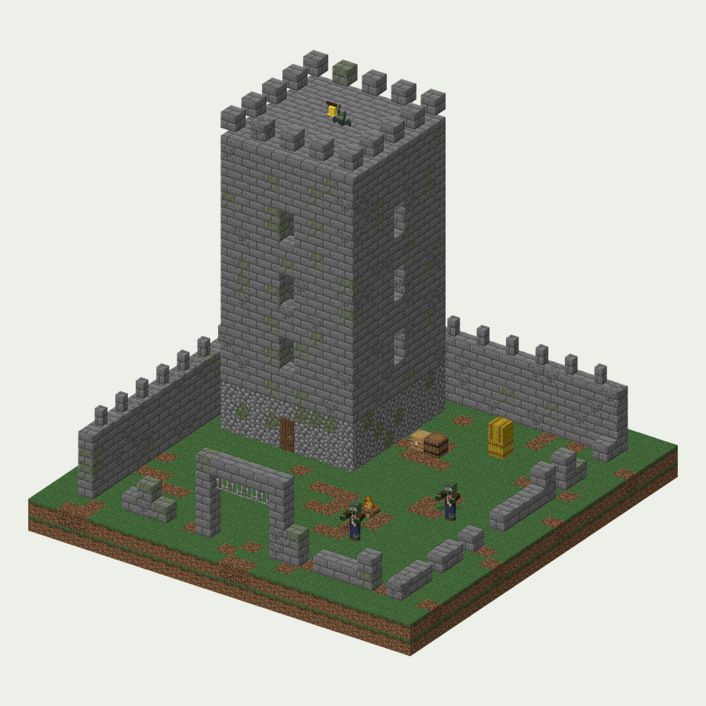</p>

Полуразрушенная башня замка на холме в Тёмных веках: внизу оружейная, наверху колокол. Стоит войти во двор — со стен поднимаются Жестяные Рыцари: «Осада».

- **Облик:** башня 9×9 в пять этажей с лестницей вдоль стены, разрушенная зубчатая стена вокруг двора 20×20, ворота с решёткой, колокол на вершине, костёр, знамёна.
- **Жители:** Жестяные Рыцари, Звонари и ночью Зомбидракончики *(все в планах)*.
- **«Осада»:** 3–4 испытательных спавнера во дворе и на стенах выпускают Жестяных Рыцарей и Звонарей, когда игрок входит во двор; за победу — ключ к хранилищу на вершине. Позже колокол может запускать мини-рейд из трёх волн.
- **Добыча:** в оружейной — старинные монеты *(в планах)*, железная броня, вёдра (шлемы рыцарей), щит, стрелы, семена Лопуха-Щитоносца и Шиповника-Копейщика *(в планах)*; в хранилище на вершине — монеты, трофей, диск и изредка мозганий.

### Капсула времени

`sproutsquad:time_capsule` (задуманный id)

<p align="center">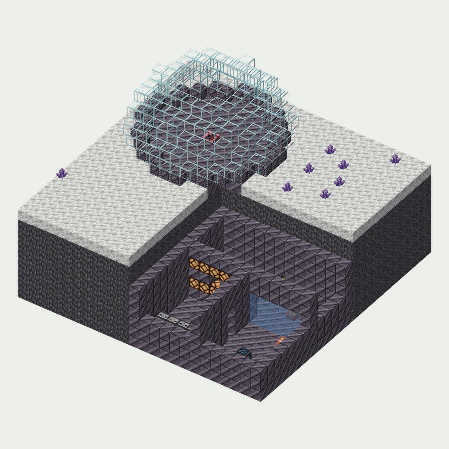</p>

Лаборатория из Далёкого будущего, запечатанная во времени: на поверхности — стеклянный купол среди хроно-кристаллов, под ним — коридоры из сплава мозгания, мигающие лампы и хранилище за «силовым полем».

- **Комнаты:** купол, шахта вниз, лаборатория (столы, стеклянные «колбы», Солнечные батареи, растения в горшках), серверная (наблюдатели, медные и редстоун-лампы), хранилище за стеклянной стеной — её дверь открывается кнопкой за турелями.
- **Жители:** вражеские турели, поставленные вместе с постройкой; Голо-зомби, Ховерборд-зомби и Ремонтные Дроны *(в планах)*.
- **Добыча:** хранилище открывается Ключ-картой *(в планах; лежит в сундуке серверной, падает с Голо-зомби)*, в нём — хроно-кристаллы *(в планах)*, часто мозганий и диск. В сундуках лаборатории — сплав мозгания, редстоун, пустая Солнечная батарея, семена Призмы-Ириса и Варп-Тюльпана *(в планах)*.

### Гномья станция

`sproutsquad:gnome_station` (задуманный id)

<p align="center">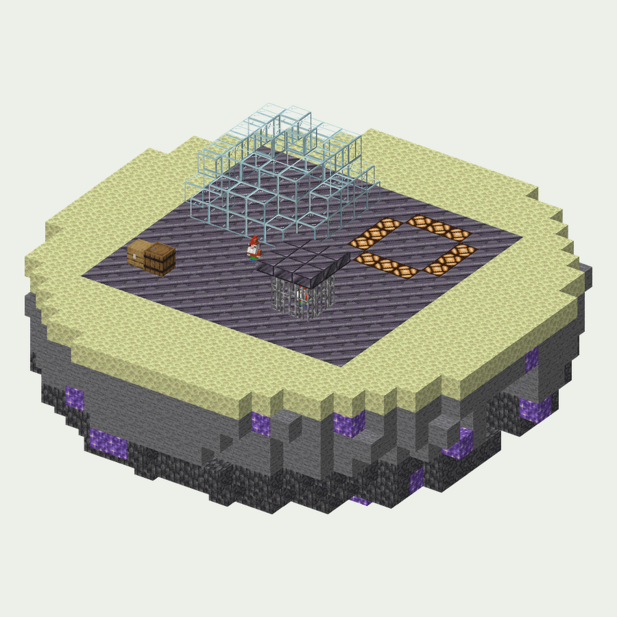</p>

Станция гномов на астероиде Гномьего космоса: шахта мозгания, ангар, клетка с пленённым Гномом-садовником и посадочная площадка тарелки Гномандира.

- **Облик:** платформа 16×16 из сплава мозгания на краю астероида, жилой купол, шахта с открытой рудой мозгания *(в планах)*, клетка из железных решёток, площадка с посадочными огнями.
- **Жители:** Гномы-космонавты и Гномы на ранце *(в планах)*.
- **Изюминка:** освободить Гнома-садовника *(союзник, в планах)* из клетки и приручить его золотой статуэткой гнома; положить золотую статуэтку на площадку, чтобы прилетела тарелка-босс *(в планах)*.
- **Добыча:** в сундуке ангара — мозганий, сплав мозгания, статуэтки гномов и фейерверки для полёта в низкой гравитации.

### Бриг на мели

`sproutsquad:stranded_brig` (задуманный id; по желанию)

<p align="center">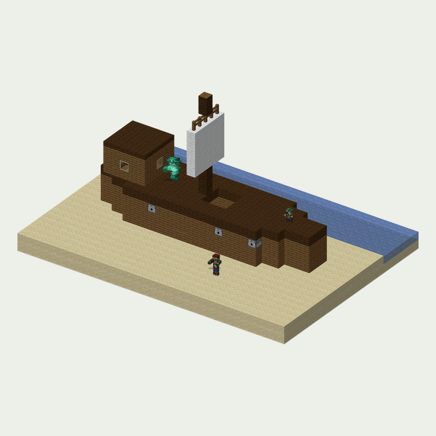</p>

Пиратский бриг, выброшенный на берег. В оригинале Капитан Пиратов появляется только в рейдах; бриг даёт пиратам дом в обычном мире.

- **Облик:** корпус из ели и тёмного дуба на песке, мачта с парусом, каюта капитана, «пушки» из раздатчиков.
- **Жители:** днём — Буканьеры и Чертята-Пираты, ночью на палубе — Призрак Капитана Пиратов.
- **Добыча:** в сундуке капитана — карта к ванильному кладу, пиратская шляпа *(в планах)*, золото, семена Морегриба и «послание в бутылке» (записка).

## Как делается постройка

1. **Эскиз.** План на бумаге в клетку (клетка = блок): комнаты, вход, где главная награда и изюминка.
2. **Стройка.** В отдельном суперплоском мире в творческом режиме, с выключенной сменой дня и погоды.
3. **Куски.** Каждая комната — в свой структурный блок (не больше 48×48×48), на стыках jigsaw-блоки с именами `sproutsquad:<id>/<стык>`.
4. **Добыча.** Сундуки остаются пустыми, им задаётся таблица добычи: `/data merge block <x y z> {LootTable:"sproutsquad:chests/<id>/<место>"}`. Хранилище (ключ, добыча) и испытательный спавнер (настройки) настраиваются тем же `/data merge`.
5. **Сохранение.** Структурный блок в режиме Save, имя `sproutsquad:<id>/<кусок>`; включить «сущности», если внутри стойки для брони, рамки или мобы.
6. **В мод.** Скопировать `run/saves/<мир>/generated/sproutsquad/structure/<id>/*.nbt` в `src/main/resources/data/sproutsquad/structure/<id>/`.
7. **Генерация мира.** Файлы JSON из списка ниже.
8. **Проверка.** `/place structure sproutsquad:<id>`, `/locate structure sproutsquad:<id>`, осмотреть 5–10 экземпляров; `./gradlew runServer`. В планах — GameTest, который загружает каждый шаблон и проверяет его таблицы добычи, ключи хранилищ и настройки испытательных спавнеров.
9. **Документация.** Абзац здесь и в [FEATURES](FEATURES.md#постройки) (на обоих языках), строка `<!-- pictures: structure:<id>_<кусок> -->` и имя в `STRUCTURE_NAMES` (`tools/docs/pictures.py`), затем `python3 tools/docs/refresh.py`.

**Или из сцены.** Постройку можно начать и как сцену из блоков в `tools/docs/sketch_structures.py`: `python3 tools/docs/sketch_structures.py --export <id>` записывает её шаблоны вместе с таблицами добычи, содержимым блоков и персонажами, отмеченными как сущности. Так сделана Огородная сторожка. Когда шаблон доработан в игре структурным блоком, источником становится `.nbt`.

Файлы одной постройки:

```
data/sproutsquad/
  structure/<id>/<кусок>.nbt                         шаблоны (комнаты)
  worldgen/structure/<id>.json                       jigsaw: биомы, высота, подгонка к рельефу, spawn_overrides
  worldgen/structure_set/<id>.json                   редкость: random_spread (spacing, separation, salt)
  worldgen/template_pool/<id>/{start,rooms,…}.json   пулы комнат
  worldgen/processor_list/<id>_aging.json            «старение»: часть кирпича становится треснувшим и мшистым
  tags/worldgen/biome/has_structure/<id>.json        где стоит
  tags/worldgen/structure/on_<id>_maps.json          цель для карт исследователя
  loot_table/chests/<id>/*.json                      сундуки, бочки, хранилище
  loot_table/archaeology/<id>.json                   подозрительный песок и гравий
  trial_spawner/<id>/*.json                          кого и сколько выпускает испытательный спавнер
  advancement/<id>/*.json                            «Нашёл», «Открыл хранилище»
assets/sproutsquad/lang/{en_us,ru_ru}.json           названия ключей, карт, достижений
```

Id постройки и пути её шаблонов после выхода версии не меняются: постройки в уже сгенерированных чанках ссылаются на шаблоны по имени.

### Картинки

- **Постройки мода:** `python3 tools/docs/render_structure.py <путь>` рисует шаблон из его `.nbt` (постройку, которую генерация утапливает в землю, — от земли вверх; `--whole` рисует целиком). `tools/docs/refresh.py` делает это для всех построек, которые показывает документация.
- **Задуманные постройки:** `python3 tools/docs/sketch_structures.py [id]` собирает каждый эскиз из блоков, описанных в скрипте, и рисует так же, с персонажами мода в виде их картинок. Чтобы изменить постройку, поправьте её в скрипте и запустите его снова; картинки сохраняются в `docs/images/sketches/structures/`.
