# Персонажи

У каждого растения, зомби и машины мода — своя карточка. Как добавить нового персонажа, чек-лист и гайд по стилю — в [WORKSHOP](../WORKSHOP.md); что позволяет мод в целом — в [FEATURES](../FEATURES.md).

## Свои персонажи (Sprout Squad) (1)

| | Персонаж | Роль | Статус | Что делает |
|---|---|---|---|---|
|  | [Горшочек](potling.md) | даёт солнце | в коде | Маскот мода: терракотовый горшок с лицом и ростком из двух листьев. |

## Растения (34)

| | Персонаж | Роль | Здоровье | Что делает |
|---|---|---|---|---|
| 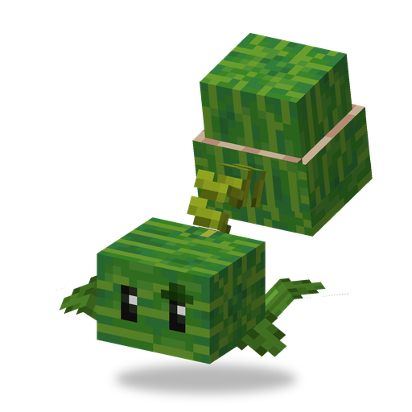 | [Арбузопульта](melonpult.md) | катапульта | 35 | Самая тяжёлая катапульта: стреляет медленно, зато каждый арбуз бьёт сильно и ранит всех вокруг места падения. |
|  | [Бархатцы](marigold.md) | даёт сокровища | 16 | Растение для фермы: вместо пакета семян с них собирают золотые слитки, изумруды и алмазы. |
| 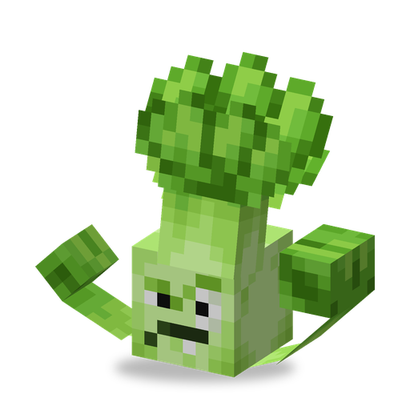 | [Бонк Чой](bonkchoy.md) | боец ближнего боя | 20 | Растение-кулачный боец: колотит всех, кто подойдёт вплотную, а время от времени подбрасывает врага апперкотом. |
| 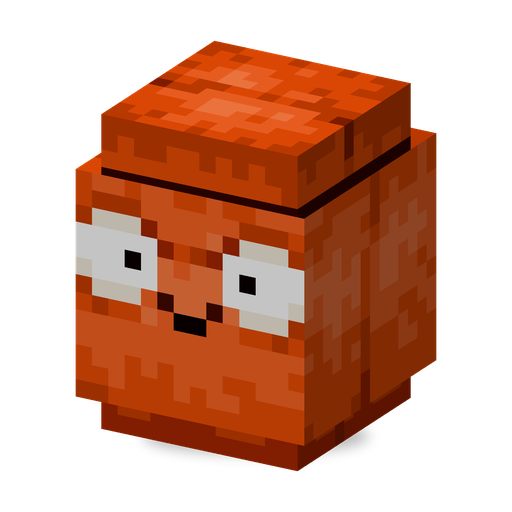 | [Взрыворех](explode_o_nut.md) | взрывная стена | 50 | Стенорех с сюрпризом: держит оборону, как обычный, но взрывается, когда враг его добивает. |
| 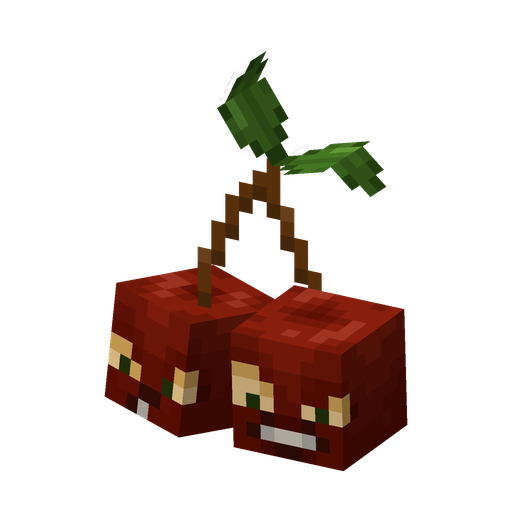 | [Вишнёвая Бомба](cherrybomb.md) | взрывчатка | 20 | Одноразовая бомба: когда враг подходит близко, она раздувается и взрывается, задевая всех вокруг. |
| 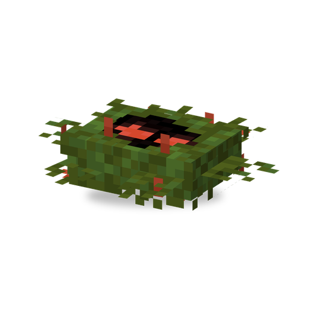 | [Водоросль](tanglekelp.md) | водяная ловушка | 25 | Водное растение: кусает ближайшего врага, опутывает его и подтаскивает к себе. |
| 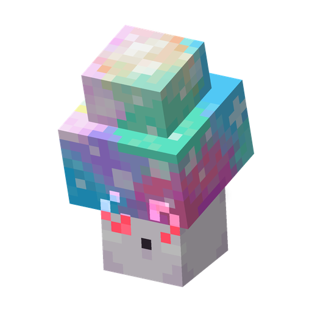 | [Гипногриб](hypnoshroom.md) | гипнотизёр | 4 | Хрупкий гриб, который обращает нападающих против своих: кто его ударит, тот попадает под гипноз. |
|  | [Горохострел](peashooter.md) | стрелок | 20 | Базовый стрелок: стреляет горошинами по зомби, которых видит. |
| 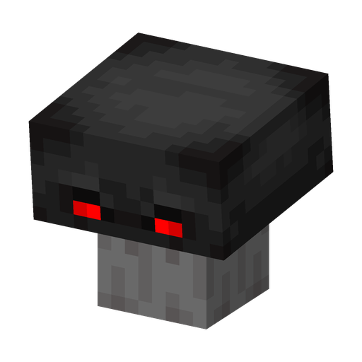 | [Гриб Судьбы](doomshroom.md) | взрывчатка | 28 | Самое мощное взрывное растение: один огромный взрыв, который ещё и выбивает воронку в земле. |
| 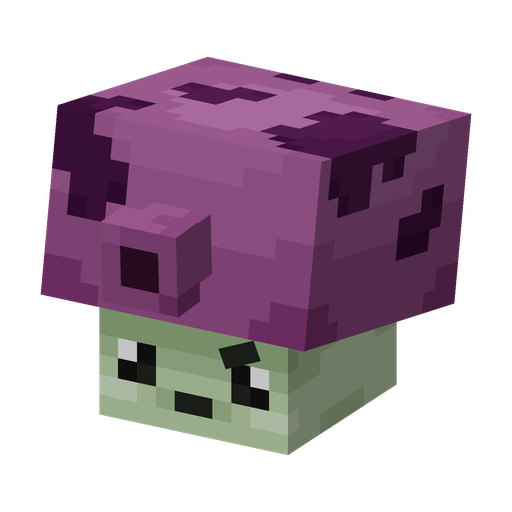 | [Дымогриб](fumeshroom.md) | распылитель | 20 | Гриб, который выпускает ядовитый дым сквозь всех врагов на линии перед собой. |
| 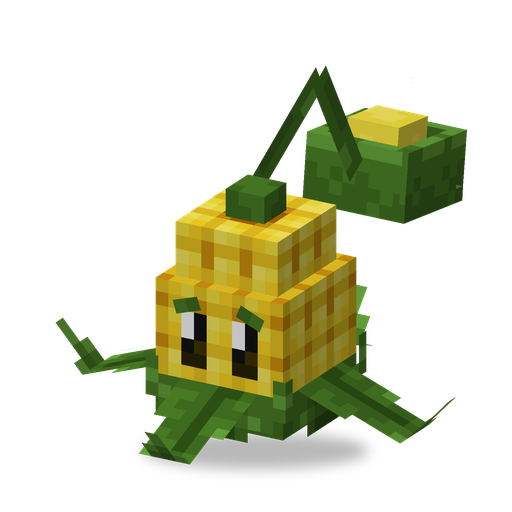 | [Зернопульта](kernelpult.md) | катапульта | 20 | Катапульта, которая бросает кукурузные зёрна, а время от времени — кусок масла, приклеивающий цель к месту. |
|  | [Кабачок](squash.md) | давилка | 20 | Одноразовое растение: запрыгивает на ближайшего зомби и расплющивает его. |
|  | [Кактус](cactus.md) | дальнобойный стрелок | 20 | Пустынный снайпер: стреляет пробивающими иглами по самому дальнему врагу, которого видит, и лопает воздушные шарики. |
| 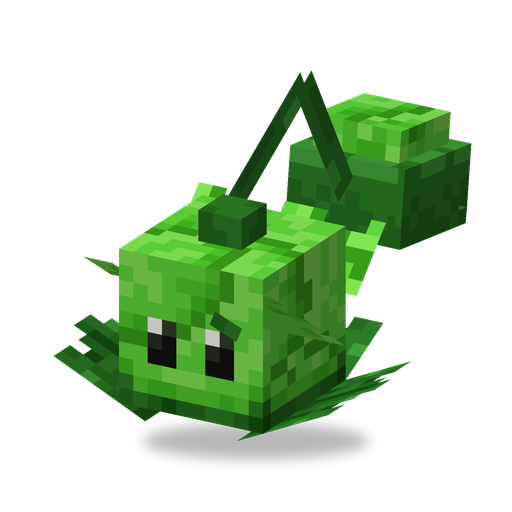 | [Капустопульта](cabbagepult.md) | катапульта | 20 | Катапульта, которая перебрасывает кочаны капусты через стены и заборы, — врага ей даже не нужно видеть. |
| 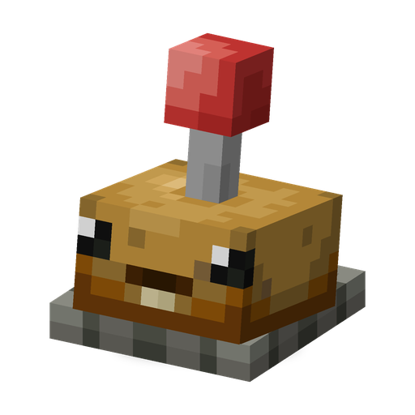 | [Картофельная Мина](potatomine.md) | мина | 8 | Дешёвая ловушка: после посадки взводится и взрывает первого врага, который на неё наступит. |
| 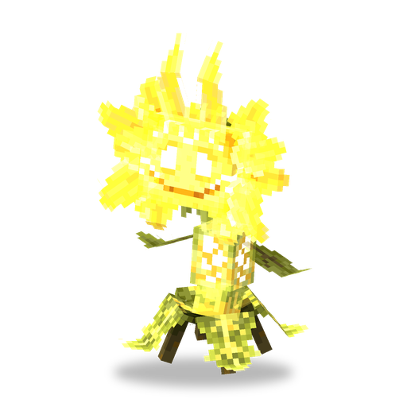 | [Королевский Подсолнух](royal_sunflower.md) | ходячий лазер | 450 | Гигантский ходячий подсолнух, который жжёт врагов длинным солнечным лучом. |
| 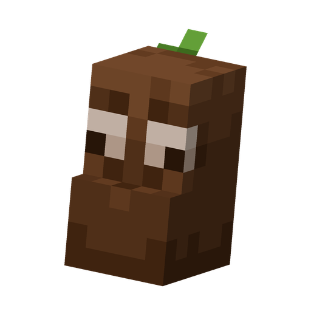 | [Кофейный Боб](coffeebean.md) | поддержка | 4 | Одноразовый будильник: будит спящее растение рядом с собой на 40 минут и исчезает. |
| 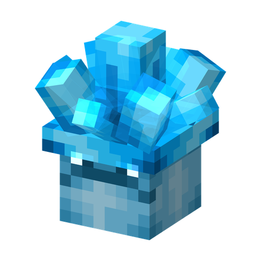 | [Ледогриб](iceshroom.md) | заморозка | 15 | Многоразовая ледяная бомба: когда враг подходит близко, гриб выпускает волну холода и замораживает всё вокруг. |
|  | [Ледяная Арбузопульта](winter_melon.md) | катапульта | 35 | Морозная разновидность Арбузопульты: навесом бросает замороженные арбузы и охлаждает всех вокруг места падения. |
| 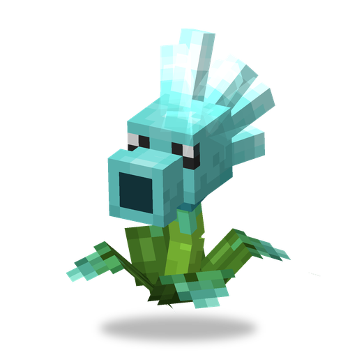 | [Ледяной Горохострел](ice_peashooter.md) | стрелок | 20 | Горохострел из снежных краёв: его замороженные горошины замедляют врагов. |
|  | [Могилоед](grave_buster.md) | уничтожает могилы | 6 | Поедает могилы: посаженный на могилу, сгрызает её, роняет её сокровища и исчезает. |
| 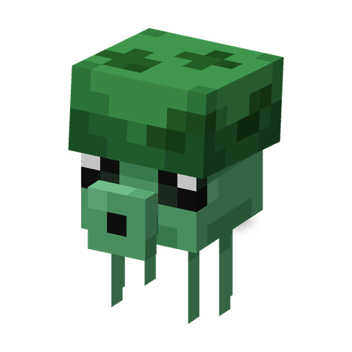 | [Морегриб](seashroom.md) | водяной стрелок | 12 | Бесплатный гриб, который сидит на воде и стреляет водяными спорами по зомби поблизости. |
| 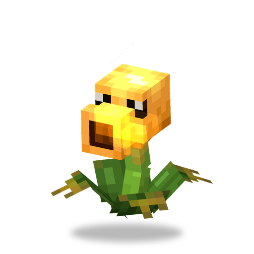 | [Огненный Горохострел](fire_peashooter.md) | стрелок | 20 | Горохострел из Нижнего мира: его горошины поджигают цель. |
| 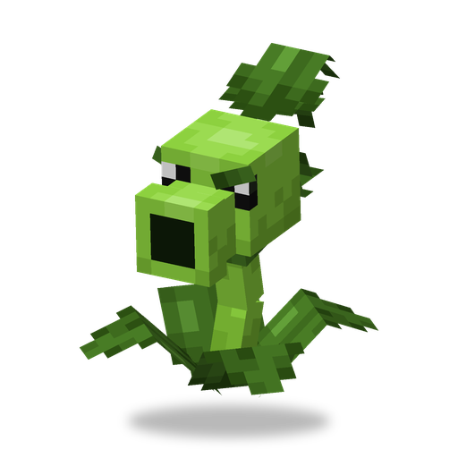 | [Повторитель](repeater.md) | стрелок | 20 | Горохострел, который стреляет горошинами парами и наносит вдвое больше урона, чем обычный. |
|  | [Подсолнух](sunflower.md) | даёт солнце | 20 | Основа экономики сада: сам не сражается, зато регулярно роняет солнце, которым оплачивается посадка всех остальных растений. |
| 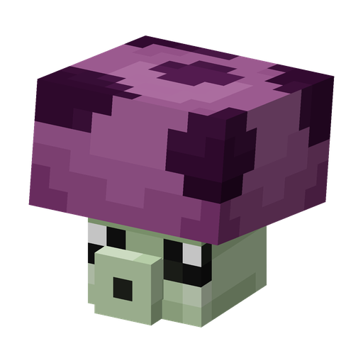 | [Пуффгриб](puffshroom.md) | стрелок | 12 | Бесплатный гриб ближнего радиуса, стреляет ядовитыми спорами; работает ночью, а днём на свету спит. |
|  | [Солнцегриб](sunshroom.md) | даёт солнце | 20 | Источник солнца для темноты: даёт солнце ночью, в пещерах и под крышей, а подросший — больше. |
| 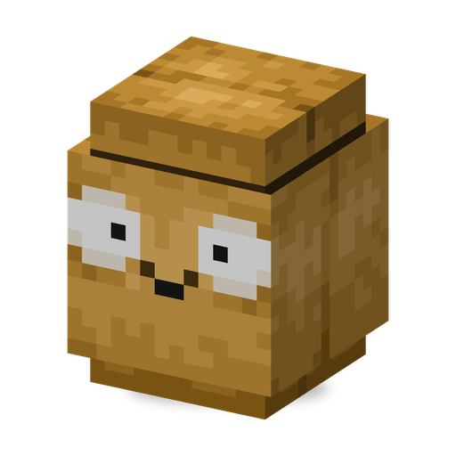 | [Стенорех](wallnut.md) | стена | 50 | Прочная живая стена: не атакует, но перекрывает путь и надолго занимает зомби, которые его грызут. |
| 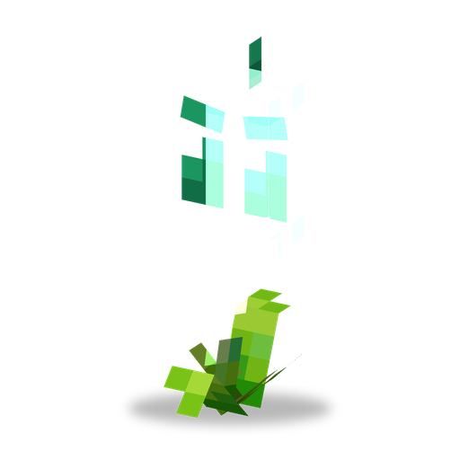 | [Тростник-молния](lightning_reed.md) | разрядник | 18 | Тонкий тростник, который появляется в грозу и бьёт ближних врагов электрическими дугами, перескакивающими на их соседей. |
| 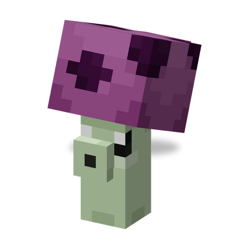 | [Трусогриб](scaredyshroom.md) | дальнобойный стрелок | 18 | Дальнобойный стрелок спорами, который прячется, как только враг подходит слишком близко. |
|  | [Тыква](pumpkin.md) | броня | 35 | Защитная оболочка: надетая на другое растение, принимает урон на себя, пока растение внутри цело. |
| 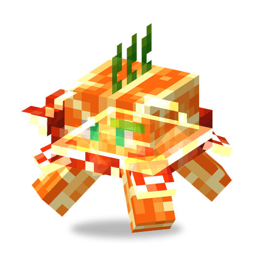 | [Цитрон](citron.md) | ходячий лазер | 50 | Ходячий цитрус, который гонится за врагами и стреляет в них тонким лазерным лучом. |
|  | [Чомпер](chomper.md) | ближний бой | 25 | Хищное растение: проглатывает подошедшего зомби целиком за один укус, а потом долго его жуёт. |
|  | [Электрический Горохострел](electric_peashooter.md) | стрелок | 20 | Горохострел, заряженный молнией: его горошины электризуют врагов, и заряд перескакивает с одного на другого. |

## Зомби (20)

| | Персонаж | Роль | Здоровье | Что делает |
|---|---|---|---|---|
| 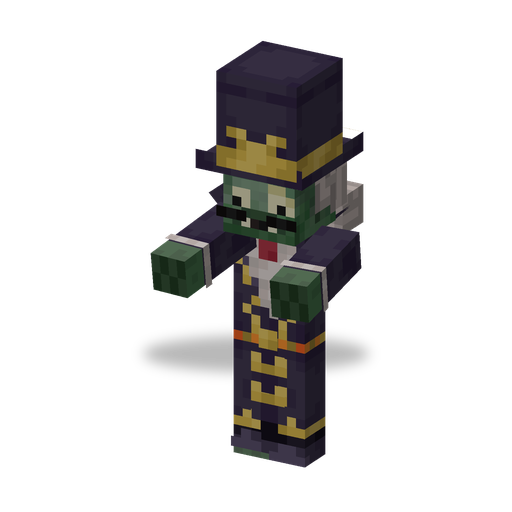 | [Барон фон Бэтс](baron_von_bats.md) | босс-вампир | 450 | Вампир-аристократ, который появляется только как босс рейда. |
| 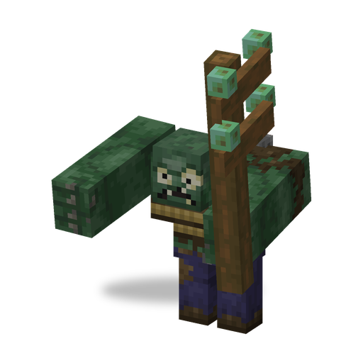 | [Гаргантюа](gargantuar.md) | гигант | 600 | Огромный зомби, который появляется только как босс рейда. |
| 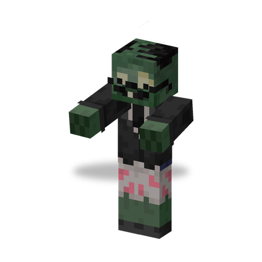 | [Зомби с Газетой](newspaper_zombie.md) | со щитом | 25 | Зомби, который прячется за Газетой. |
| 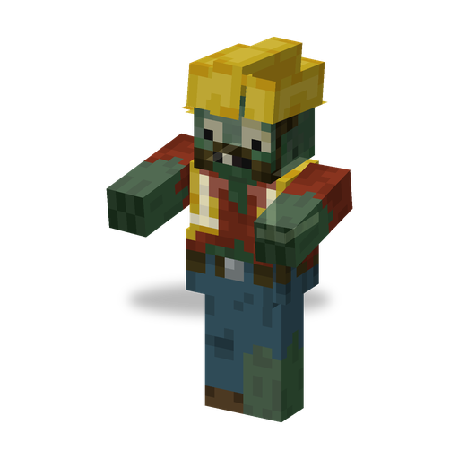 | [Зомби-Инженер](engineer_zombie.md) | строитель | 35 | Зомби с чертежом вместо оружия. |
| 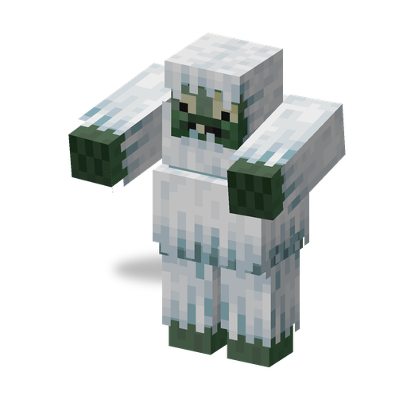 | [Зомби-Йети](zombie_yeti.md) | тяжёлый | 120 | Большой мохнатый зомби снежных краёв. |
| 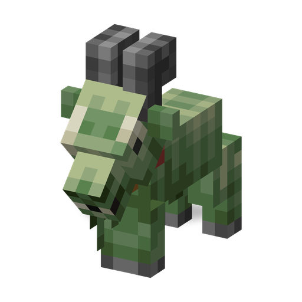 | [Зомби-Козёл](zombie_goat.md) | скакун | 14 | Небольшой горный козёл-зомби. |
| 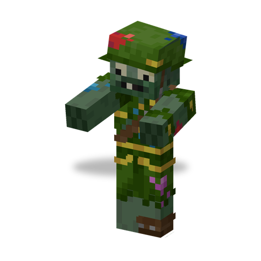 | [Зомби-Солдат](soldier_zombie.md) | стрелок | 35 | Бронированный стрелок с Пейнтбольным маркером. |
| 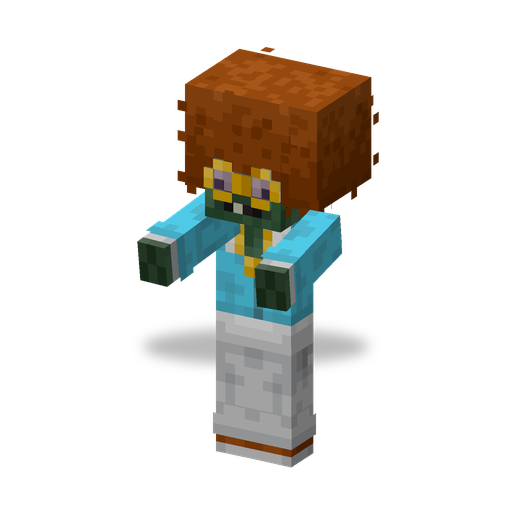 | [Зомби-Танцор](disco_zombie.md) | призыватель | 60 | Танцующий зомби, который снова и снова вызывает из-под земли вокруг себя труппу Подтанцовщиков. |
| 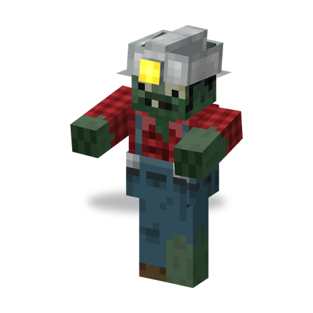 | [Зомби-Шахтёр](digger_zombie.md) | землекоп | 35 | Шахтёр с железной киркой, живущий глубоко под землёй. |
| 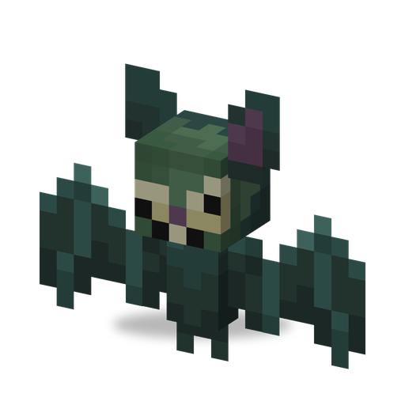 | [Зомбимышь](zombat.md) | летун | 20 | Летучая мышь-зомби, которая каждым укусом лечит себя. |
|  | [Капитан Пиратов](pirate_captain.md) | стрелок | 80 | Командир «Пиратского Нашествия»: крепкий зомби с арбалетом, заряженным фейерверками. |
| 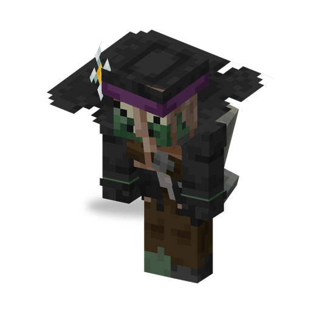 | [Могильщик](grave_digger.md) | метатель могил | 30 | Зомби с лопатой, который выкапывает Могилы и швыряет их в цель. |
| 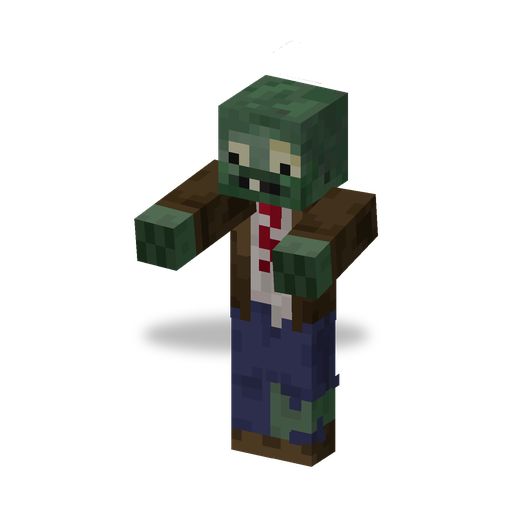 | [Обычный Зомби](browncoat.md) | обычный | 20 | Самый частый зомби мода и основа любого рейда. |
|  | [Подтанцовщик](backup_dancer.md) | прислужник | 12 | Быстрый и хрупкий танцор, которого Зомби-Танцор призывает группами до трёх. |
| 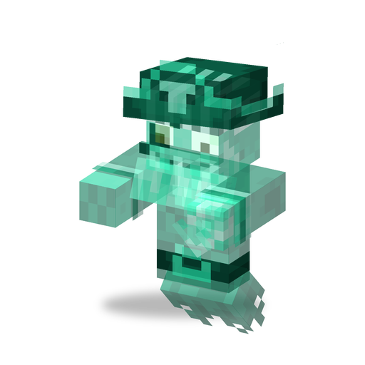 | [Призрак Капитана Пиратов](pirate_captain_ghost.md) | призрак | 50 | Вторая жизнь Капитана Пиратов: летающий призрак с мечом, который проходит сквозь стены. |
|  | [Робо-Зомби](robo_zombie.md) | машина | 128 | Тяжелобронированный боевой робот. |
| 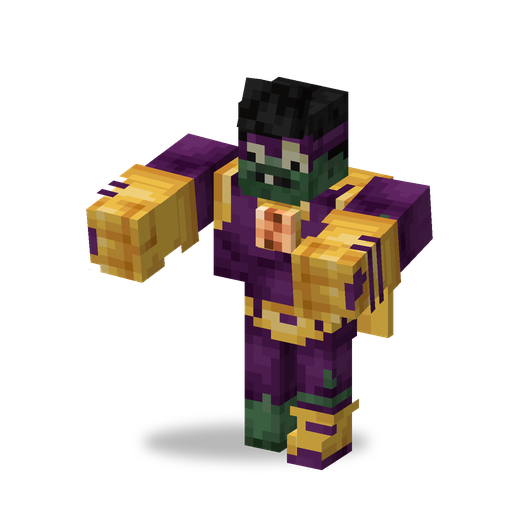 | [Супермозг](super_brainz.md) | супергерой | 160 | Зомби-супергерой в тяжёлой броне. |
| 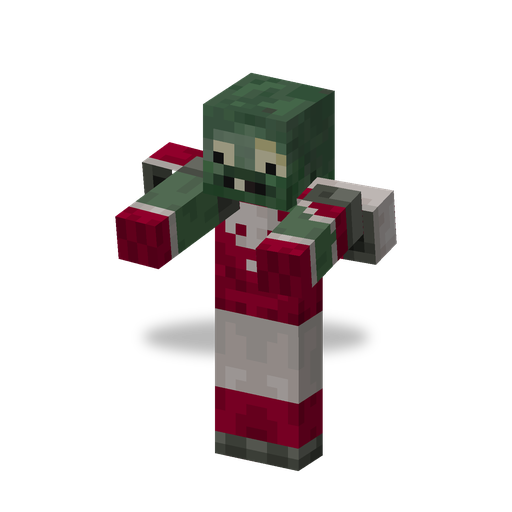 | [Футболист](all_star.md) | таран | 55 | Бронированный футболист в Футбольном шлеме. |
|  | [Чертёнок](imp.md) | мелкий | 20 | Маленький шустрый зомби с ядовитым укусом. |
|  | [Электро-Слайд](electric_slide.md) | электрический | 120 | Диско-зомби на роликовых коньках, который бьёт цели электричеством. |

## Машины (4)

| | Персонаж | Роль | Здоровье | Что делает |
|---|---|---|---|---|
| 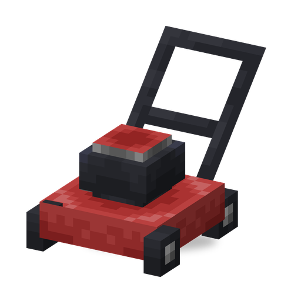 | [Газонокосилка](lawn_mower.md) | последний рубеж | 20 (ломается от одного удара игрока) | Газонокосилка — одноразовый последний рубеж обороны, как в оригинальной игре. |
| 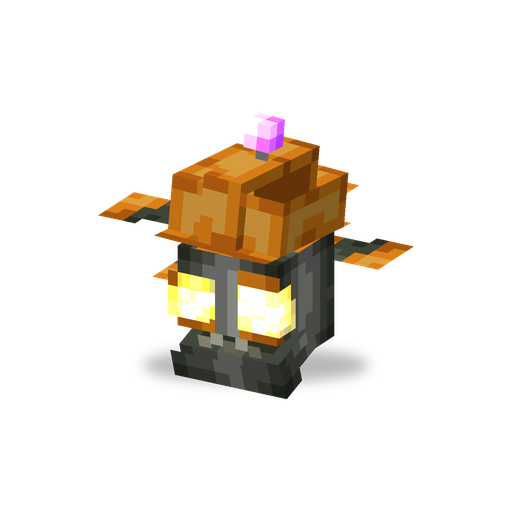 | [Зомби-Дрон](zombie_drone.md) | летающий боец | 8 | Маленький летающий робот: подлетает к цели и бьёт её вблизи. |
| 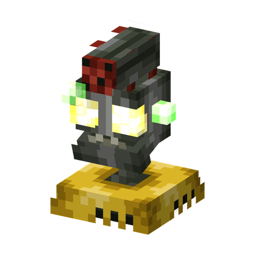 | [Зомби-Турель](zombie_turret.md) | стрелок | 8 | Неподвижная лазерная пушка. |
|  | [Электрическая Турель](electro_turret.md) | электрическая | 8 | Неподвижная турель: бьёт подошедших близко электрической дугой и накладывает на них «Электризацию». |

## Другие существа (1)

| | Персонаж | Роль | Здоровье | Что делает |
|---|---|---|---|---|
| 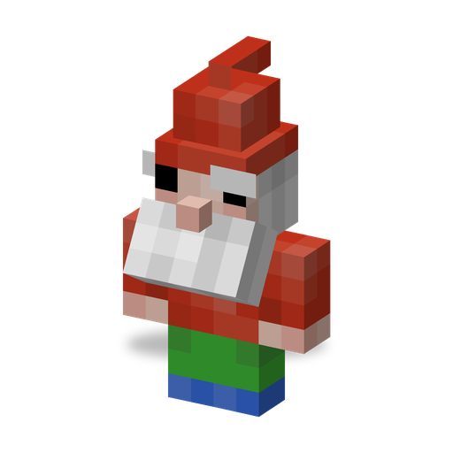 | [Садовый Гном](gnome.md) | враждебный гном | 18 | Маленький прыгучий гном, который ни за кого не воюет. |

## Шаблон карточки нового своего персонажа

Скопируйте в `docs/ru/characters/<id>.md` и напишите английскую карточку `docs/en/characters/<id>.md`; нарисуйте картинку командой `python3 tools/docs/render_character.py <id>`, затем пересоберите это оглавление командой `python3 tools/docs/build_character_index.py`. Статусы: `идея` → `модель` → `в коде` → `готов`.

```markdown
# <Имя>

<p align="center">.png" alt="<Имя>" width="320"></p>

**Растение · <роль>** · Sprout Squad

Одно-два предложения: для чего он.

| | |
|---|---|
| Id | `sproutsquad:<id>` |
| Здоровье | |
| Цена в солнцах | |
| Размер | |
| Атака | |
| Ночью | |
| Как получить | рецепт / лут / торговля / мутация семян |

## Умения

- …

## Карточка

| | |
|---|---|
| Идея | |
| Эскиз | `art/<id>/sketch.png` |
| Статус | идея |
```
