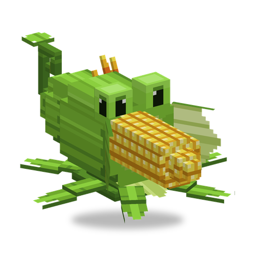

# Кукурузная пушка

**Растение · артиллерия** · Sprout Squad

Длинная кукурузная шелуха лежит на розетке из листьев. По глазу с каждой стороны, сзади закрученный усик, спереди торчит крупный початок. Пушка поднимает нос и запускает початок как ракету по высокой дуге; там, где он падает, он взрывается, а пушка за 3 секунды выращивает новый.

| | |
|---|---|
| Id | `sproutsquad:corn_cannon` |
| Здоровье | 90 |
| Цена в солнцах | 14 |
| Размер | 1,2 × 0,9 блока (модель около 1,8 блока в длину) |
| Атака | початок раз в 3,5 с; взрывается при попадании: 8 урона в центре, к краю до 4, радиус 2,5 блока |
| Дальность | от 5 до 40 блоков, прямая видимость не нужна |
| Ночью | не спит |
| Лимит | 10 на 32 блока |
| Как получить | крафт: пакет семян [Зернопульты](kernelpult.md) в центре и 8 солнц вокруг → пакет семян Кукурузной пушки; в природе не растёт |

## Умения

- Атакует любых зомби; приручённая — ещё и других монстров, но не криперов.
- Не видит зомби ближе 5 блоков: не целится в такого и отпускает цель, которая подошла ближе 5 блоков.
- Не целится в зомби под крышей, деревом, строительными лесами или в пещере: початок падает с неба и попал бы только в крышу. Вода крышей не считается: початок пролетает сквозь неё не замедляясь, так что зомби на дне пруда — тоже цель.
- Если три взрыва подряд не задели цель (початок разрывается о навес или стену рядом с ней), пушка на 5 секунд оставляет этого зомби в покое и выбирает другого.
- Загипнотизированные зомби и машины игрока — союзники: пушка в них не целится, и початок их не ранит.
- Выстрел: нос поднимается, глаза щурятся, примерно через полсекунды початок вылетает, шелуху откидывает назад. Пустая шелуха темна внутри, пока из неё не вырастет новый початок. Если выстрел отменился во время прицеливания (зомби подошёл слишком близко или спрятался), початок не тратится: пушка проделывает движение выстрела вхолостую.
- Початок летит высокой дугой, через стены и заборы, с упреждением по бегущей цели. Он одинаковый спереди и сзади, с конусом на обоих концах, без огня и дыма.
- Взрыв ранит только тех, в кого пушка стреляет. Игроков, питомцев, жителей и растения не задевает, початок пролетает сквозь них. Стена между взрывом и зомби его защищает. Блоки не ломает, огонь не поджигает, но блок, в который попал початок, срабатывает как от стрелы (мишень даёт сигнал). Из взрыва разлетается попкорн.
- У увеличенной пушки (атрибут масштаба) и взрыв больше.

## Заметки

- Над пушкой нужно открытое небо: под крышей или деревом она вообще не стреляет, ведь каждый початок попал бы в потолок.
- Примерно вдвое сильнее [Арбузопульты](melonpult.md), как задумал автор; плата — Зернопульта и 8 солнц в рецепте, 14 солнц за посадку и лимит в 10 штук.
- [Мак-погремушка](poppy_rattle.md) её не выдаёт.
- Звуки пока из оригинального мода: низкий выстрел и взрыв ракеты.

## Взаимодействия

- Рецепт пакета семян в верстаке:

  | | | |
  |---|---|---|
  | Солнце | Солнце | Солнце |
  | Солнце | Пакет семян Зернопульты | Солнце |
  | Солнце | Солнце | Солнце |

- Зомби, прилипшие к маслу [Зернопульты](kernelpult.md), — лёгкая цель для медленного початка.

## Карточка

| | |
|---|---|
| Идея | автор идеи: кукурузная пушка, которая стреляет початком как ракетой, 90 здоровья, 14 солнц, 8 урона, перезарядка 3 секунды, крафт из Зернопульты и солнц |
| Эскиз | `art/corn_cannon/sketch.jpg`; текстуры рисует `art/corn_cannon/draw_corn_cannon.py` |
| Статус | в коде |
