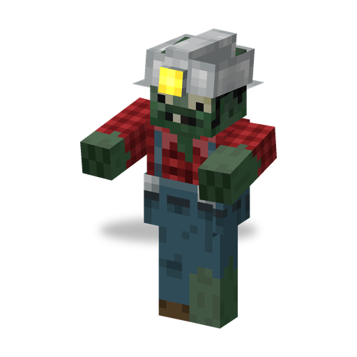

# Зомби-Шахтёр

**Зомби · землекоп** · Plants & Zombies (оригинал)

Шахтёр с железной киркой, живущий глубоко под землёй. Издалека он зарывается в землю и выныривает рядом с целью, минуя стены и оборону.

| | |
|---|---|
| Id | `sproutsquad:digger_zombie` |
| Здоровье | 35 |
| Броня | 0 |
| Урон | 2 (базовый) |
| Скорость | 0,225 |
| Сопротивление отбрасыванию | 0,2 |
| Размер | 0,63 × 1,95 блока |
| Появление | в темноте ниже Y = 10 в `#sproutsquad:zombie/has_digger` (биомы [Обычного Зомби](browncoat.md)): вес 8, поодиночке; и в `#sproutsquad:zombie/has_digger_alt` (пещерные биомы, `#c:is_underground`): вес 11, группами по 1–2; в заброшенных шахтах — на любой высоте и при любом освещении; выходит из Могил (2 из 53 появлений) |
| Рейды | обычные волны с 4-й |
| Лидер / босс | нет |
| Добыча | 8 %: пачка семян [Вишнёвой Бомбы](cherrybomb.md), если убил игрок или растение |

## Умения

- Прокапывает блоки на пути, если до цели не дойти пешком (стену, которую можно обойти, не трогает): камень, землю, песок, гравий, кирпичи и каменные кирпичи, булыжник, терракоту, бетон, стекло, рельсы и горшки (`#sproutsquad:digger_breakable`), примерно 1,5 с на блок; блоки выпадают, как добытые его киркой. Ступеньку в один блок перепрыгивает, а не копает, и не копает к цели, которая сильно выше или ниже. Нужно правило `mobGriefing`; моды защиты территорий могут это запретить (Sprout Squad).
- Подкоп: когда цель (в рейде без цели — Флаг цветкоф) в 16–40 блоках, он останавливается, уходит под землю и примерно через 2 с выныривает, пройдя 78–93 % пути, — на твёрдом грунте, где есть место встать. Весь манёвр занимает около 4 с.
- После подкопа (и после появления) ждёт 16–20 с до следующего; в воде не копает.
- Носит железную кирку, которую никогда не роняет; броню не подбирает; ломает двери.
- Обладает [общими чертами зомби мода](browncoat.md#общие-черты-зомби-мода).

## Взаимодействия

- Стены между ним и целью подкопу не мешают: точка выхода выбирается рядом с целью, а не вдоль пути.
- Зомби-Шахтёров на поверхность выводят и группы лидеров, и Могилы.
