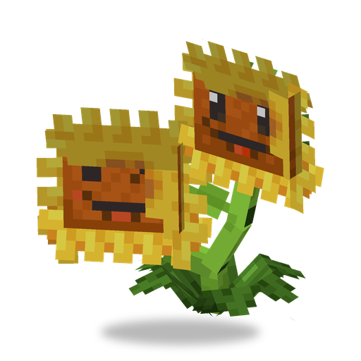

# Двойной подсолнух

**Растение · даёт солнце** · Sprout Squad

Подсолнух с двумя стеблями и цветком на каждом: высокий сзади — с лицом Подсолнуха, низкий впереди — подмигивает. Каждая голова роняет своё солнце, поэтому он даёт вдвое больше солнца, чем [Подсолнух](sunflower.md), за то же время.

| | |
|---|---|
| Id | `sproutsquad:double_sunflower` |
| Здоровье | 30 |
| Цена в солнцах | 8 |
| Размер | 0,9 × 1,5 блока |
| Солнце | 2 солнца (по одному из каждой головы) примерно раз в 45 с, пока не спит |
| Атака | нет |
| Ночью | спит |
| Лимит | 30 в радиусе 32 блоков |
| Как получить | семена [Подсолнуха](sunflower.md), выращенные на грядке, в 10% случаев превращаются в него; крафт: 2 пакета семян Подсолнуха в среднем столбце (центр и низ) и 7 солнц в остальных клетках → пакет семян Двойного подсолнуха; сам не растёт |

## Умения

- Примерно раз в 45 с каждая голова роняет солнце, всего 2. Незадолго до этого обе начинают светиться. Детёныш роняет одно.
- Засыпает, когда не видит солнца, — ночью и под землёй; во сне солнце не появляется. Во сне обе головы опускаются.
- В покое головы качаются по очереди: одна влево, другая вправо.
- Не атакует.

## Взаимодействия

- [Кофейный Боб](coffeebean.md) будит его, и разбуженный продолжает давать солнце всю ночь, как Подсолнух.
- Рецепт пакета семян на верстаке:

  | | | |
  |---|---|---|
  | Солнце | Солнце | Солнце |
  | Солнце | Пакет семян Подсолнуха | Солнце |
  | Солнце | Пакет семян Подсолнуха | Солнце |

- Семена, выращенные из него самого на грядке, остаются семенами Двойного подсолнуха.

## Карточка

| | |
|---|---|
| Идея | автор идеи: подсолнух с двумя стеблями и цветком на каждом, примерно в полтора раза сильнее, два солнца за время Подсолнуха |
| Эскиз | модель и текстура Подсолнуха; текстуры рисует `art/double_sunflower/draw_double_sunflower.py` |
| Статус | в коде |
