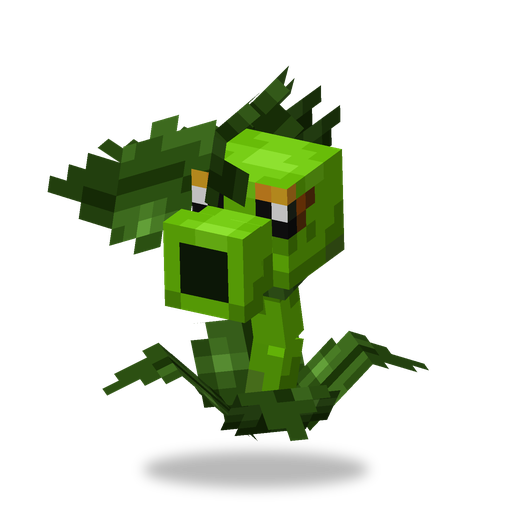

# Огненный Горохострел

**Растение · стрелок** · Plants & Zombies (оригинал)

Горохострел из Нижнего мира: его горошины поджигают цель.

| | |
|---|---|
| Id | `sproutsquad:fire_peashooter` |
| Здоровье | 20 |
| Цена в солнцах | 7 |
| Размер | 0,6 × 1,0 блока |
| Атака | огненная горошина примерно раз в 1,2 с, 1,25 урона + поджигает цель на 3,5 с |
| Дальность | 14 блоков, нужна прямая видимость |
| Ночью | не спит |
| Лимит | 30 в радиусе 32 блоков |
| Как получить | растёт сам в багровых лесах Нижнего мира (группами по 1–2); семена [Горохострела](peashooter.md) с грядки в багровом лесу с шансом 50% превращаются в него |

## Умения

- Не боится огня и лавы.
- Стреляет по любым зомби, в том числе по зомбифицированным пиглинам. Приручённый стреляет и по другим монстрам, но никогда — по криперам; дикий — ещё и по игрокам.
- Целится с упреждением и отстреливается от того, кто его ранил.
- Вокруг него летают искры.

## Взаимодействия

- Его семена с грядки в багровом лесу всегда остаются огненными; в других местах с шансом 15% возвращаются в обычный [Горохострел](peashooter.md).
- Обычная горошина [Горохострела](peashooter.md) или [Повторителя](repeater.md), пролетев сквозь огонь, тоже становится огненной.
- Дикий приручается солнцем: примерно 24% на каждое солнце.
- Если назвать его биркой `blaze`, он сменит облик.

<!-- pictures: fire_peashooter_blaze -->

