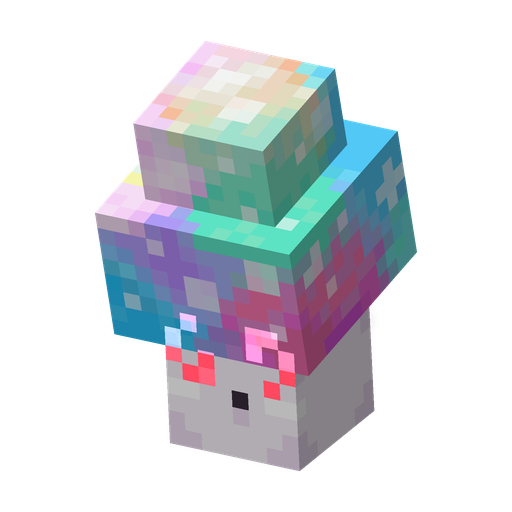

# Гипногриб

**Растение · гипнотизёр** · Plants & Zombies (оригинал)

Хрупкий гриб, который обращает нападающих против своих: кто его ударит, тот попадает под гипноз.

| | |
|---|---|
| Id | `sproutsquad:hypnoshroom` |
| Здоровье | 4 |
| Цена в солнцах | 7 |
| Размер | 0,6 × 1,3 блока |
| Атака | нет; гипнотизирует обидчика на 40 с |
| Ночью | активен; спит, пока видит дневное небо |
| Как получить | награды за рейд в почтовом ящике (обычные волны, первые 8 наград); выпадает из [Зомби-Танцора](disco_zombie.md) (4%, если его убил игрок или растение); дикий растёт в Заросших пещерах, тёмных лесах, Искажённом лесу и на грибных полях; дикого приручают солнцем (~24% за одно солнце) |

## Умения

- Зомби, которые на него натыкаются, переключаются на него, как на [Стенореха](wallnut.md).
- Когда бодрствующего Гипногриба ранит живое существо, на обидчика накладывается «Гипноз» на 40 с.
- Если гриб погибает не во сне, он оставляет сжимающееся гипнотическое облако (радиус 2,5, 15 с): всякий, кто в него попадёт, получает «Гипноз» примерно на 12 с.
- Загипнотизированный моб нападает на существ своего вида, а враждебный — на любых других враждебных мобов. Загипнотизированные налётчики перестают идти к Флагу цветкоф.
- Спящий гриб ничего не делает: ни гипноза, ни облака.
- Не действует на растения, Гаргантюа, Электро-Слайда, Барона фон Бэтса, роботов и боссов.

## Взаимодействия

- За гипноз [Зомби-Танцора](disco_zombie.md) дают достижение «Диско не Умрёт».
- [Кофейный Боб](coffeebean.md) не даёт ему спать днём 40 минут.
- Может носить [Тыкву](pumpkin.md): удары принимает Тыква, но обидчик всё равно попадает под гипноз.
