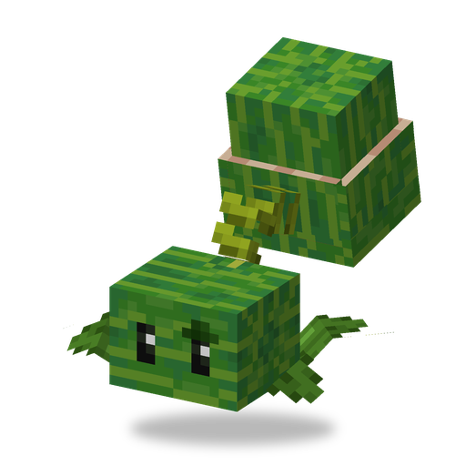

# Арбузопульта

**Растение · катапульта** · Plants & Zombies (оригинал)

Самая тяжёлая катапульта: стреляет медленно, зато каждый арбуз бьёт сильно и ранит всех вокруг места падения.

| | |
|---|---|
| Id | `sproutsquad:melonpult` |
| Здоровье | 35 |
| Цена в солнцах | 10 |
| Размер | 0,9 × 0,8 блока |
| Атака | арбуз примерно раз в 3,9 с, 4,5 урона + урон по площади в радиусе 1,5 блока |
| Дальность | 38 блоков, прямая видимость не нужна |
| Ночью | не спит |
| Лимит | 20 в радиусе 32 блоков |
| Как получить | растёт сама в джунглях (редко, по одной) |

## Умения

- Урон по площади: существа в радиусе около 1,5 блока от места падения тоже получают урон (чем ближе, тем больше) и отлетают. Растения не задевает.
- Бросает по высокой дуге, поэтому достаёт врагов за стенами и заборами, которые остановили бы прямой выстрел. Целится с упреждением.
- Атакует любых зомби, а приручённая — и других монстров, но никогда криперов. Отвечает тому, кто её ранил.
- Лимит посадки — 20 вместо обычных 30.

## Взаимодействия

- Семена с грядки в снежных биомах с шансом 33% превращаются в [Ледяную Арбузопульту](winter_melon.md).
- Катапульты полегче: [Капустопульта](cabbagepult.md), [Зернопульта](kernelpult.md).
- Дикая приручается солнцем: примерно 12% на каждое солнце.
