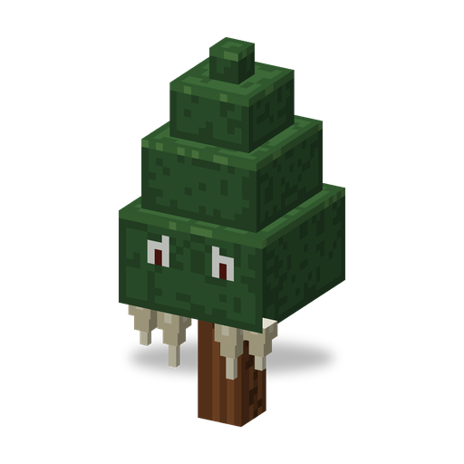
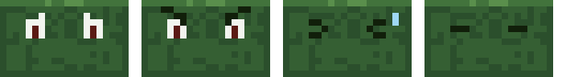

# Иглострел

**Растение · стрелок** · Sprout Squad

Горная ель высотой в три блока: два глаза на нижнем ярусе и четыре острых клыка, свисающих спереди. Обычно стоит прямо; увидев врага в 20 блоках, гнётся вперёд, как катапульта, и выпускает три иглы разом, по одной из каждого яруса. Пока стреляет, тужится и зажмуривает глаза.

| | |
|---|---|
| Id | `sproutsquad:needle_spruce` |
| Здоровье | 40 |
| Цена в солнцах | 7 |
| Размер | 0,9 × 2,9 блока; для посадки нужна высота 3 блока |
| Атака | 3 иглы за залп, по 1 урону; игла пробивает до 4 целей |
| Залп | раз в 3,5 с |
| Дальность | 20 блоков, нужна прямая видимость |
| Ночью | не спит |
| Почва | как у других растений, плюс снег (кроме рыхлого); не замерзает |
| Как получить | растёт на заснеженных склонах и в горных ельниках; рецепт без формы: саженец ели + 7 солнц → пакет семян Иглострела |

## Умения

- Атакует зомби; приручённый — ещё и других враждебных мобов, кроме криперов.
- Залп: ствол отгибается назад, рывком наклоняется вперёд (гнётся в двух местах, крона почти на 45°), три иглы вылетают вместе, и ель распрямляется с небольшой отдачей.
- По лицу видно, что она делает: обычные глаза, когда вокруг никого; злые, с нахмуренными бровями, пока есть цель; зажмуренные, с каплей пота, во время рывка.

 Обычное · злое (есть цель) · тужится (рывок) · гибель

## Когда погибает

- Ствол ломается в месте сгиба. Крона заваливается назад и осыпается хвоей, а нижняя часть ствола остаётся блоком **Пенёк Иглострела** с корнями, годовыми кольцами и маленьким зелёным ростком.
- Если сломать пенёк (рукой или топором), выпадут саженец ели и одна-две палки; из саженца собирается новый пакет семян Иглострела.
- Пенёк появляется только в пустом месте на твёрдой земле (снежный слой или трава заменяются). В воде, на полублоке или если ель надета на голову, саженец и палки выпадают предметами.
- Если Иглострела убил игрок, выпадают 4 солнца (у остальных растений — половина цены).

## Карточка

| | |
|---|---|
| Идея | автор идеи: исходный рисунок ели, стреляющей иглами |
| Эскиз | `art/needle_spruce/sketch.jpg`; текстуры рисует `art/needle_spruce/draw_needle_spruce.py` |
| Статус | в коде |
