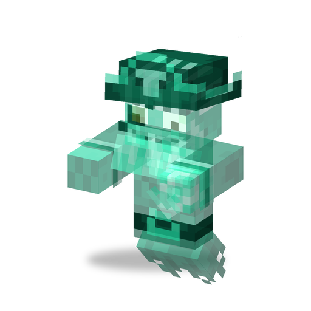

# Призрак Капитана Пиратов

**Зомби · призрак** · Plants & Zombies (оригинал)

Вторая жизнь [Капитана Пиратов](pirate_captain.md): летающий призрак с мечом, который проходит сквозь стены.

| | |
|---|---|
| Id | `sproutsquad:pirate_captain_ghost` |
| Здоровье | 50 |
| Броня | 0 |
| Урон | 6 (базовый, в руке железный меч) |
| Скорость | 0,25 |
| Сопротивление отбрасыванию | 0,2 |
| Размер | 0,6 × 1,95 блока |
| Появление | возникает при гибели [Капитана Пиратов](pirate_captain.md); сам в мире не появляется |
| Рейды | «Зомбиуин» (только с 17 октября по 1 ноября): в 60 % волн начиная с 7-й, до 6 за волну (в остальных 40 % вместо него приходит [Супермозг](super_brainz.md)); всегда с тыквой или светильником Джека на голове |
| Лидер / босс | нет |
| Добыча | 50 %: 0–1 мембрана фантома (+0–1 за каждый уровень «Добычи»); 3 %: пачка семян [Морегриба](seashroom.md); и то и другое — только если убил игрок или растение |

## Умения

- Всегда летает и проходит сквозь блоки; всегда видит цель, даже сквозь стены.
- Дерётся вблизи железным мечом, который никогда не роняет.
- Дальность преследования 100 блоков: замечает и догоняет цель издалека.
- Шагает и умирает беззвучно; шарики и Надувную утку не берёт; предметы не подбирает.
- Даёт 90 опыта.
- Обладает [общими чертами зомби мода](browncoat.md#общие-черты-зомби-мода).

## Взаимодействия

- Призрак капитана из рейда остаётся в этом рейде; стены и рвы его не задерживают.
