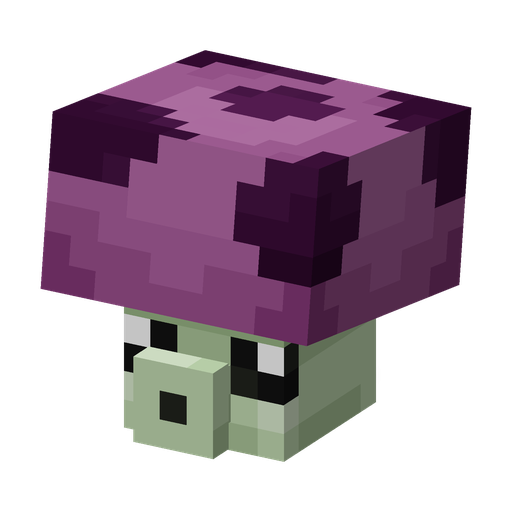

# Пуффгриб

**Растение · стрелок** · Plants & Zombies (оригинал)

Бесплатный гриб ближнего радиуса, стреляет ядовитыми спорами; работает ночью, а днём на свету спит.

| | |
|---|---|
| Id | `sproutsquad:puffshroom` |
| Здоровье | 12 |
| Цена в солнцах | 0 |
| Размер | 0,5 × 0,65 блока |
| Атака | спора примерно раз в 1,1 с: 0,5 урона и «Токсичность» на 2,5 с |
| Дальность | 10 блоков |
| Ночью | активен; спит, пока видит дневное небо |
| Как получить | дикий растёт в тёмных лесах, тайге, на грибных полях, в реликтовых лесах и тайге, Пёстром лесу и пещерах (группами по 1–4); дикого приручает первое же солнце |

## Умения

- «Токсичность» ранит раз в 0,75 с на 4 × долю оставшегося у цели здоровья (не меньше 0,4 урона), так что сильнее всего бьёт по здоровым целям.
- Спит, пока видит солнце (днём под открытым небом). В пещерах, под крышей и ночью бодрствует.
- Атакует зомби (и мода, и ванильных); приручённый — ещё и других враждебных мобов, кроме криперов.
- В дикой природе растёт и на камне, но пачкой семян сажается только на почву (траву, землю, мох и т. п.).

## Взаимодействия

- [Кофейный Боб](coffeebean.md) не даёт ему спать днём 40 минут.
- [Трусогриб](scaredyshroom.md) стреляет той же спорой с двойным уроном и более чем вдвое дальше.
- У [Морегриба](seashroom.md) те же характеристики, но он живёт на воде, и его споры не ядовиты.
- Может носить [Тыкву](pumpkin.md).
