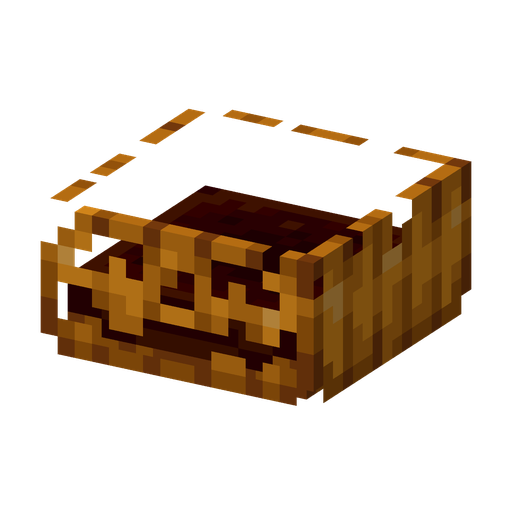

# Тыква

**Растение · броня** · Plants & Zombies (оригинал)

Защитная оболочка: надетая на другое растение, принимает урон на себя, пока растение внутри цело.

| | |
|---|---|
| Id | `sproutsquad:pumpkin` |
| Здоровье | 35 |
| Цена в солнцах | 6 |
| Размер | 0,85 × 0,5 блока |
| Атака | нет |
| Ночью | не спит |
| Как получить | вырезание тыквы ножницами (5,5%); награды за рейд в почтовом ящике за волны «Зомбиуин!»; в дикой природе не растёт |

## Умения

- Сама по себе стоит на любом блоке, не атакует и не поворачивается.
- Её здоровье (35, настройка сервера `pumpkinArmorAmount`) и есть та броня, которую она даёт: побитая Тыква защищает меньше.

## Взаимодействия

- Объединить её с растением можно двумя способами:
  - использовать пачку семян Тыквы на посаженном растении (6 солнц) — растение получает 35 единиц тыквенной брони;
  - сначала посадить Тыкву, а потом использовать на ней пачку семян другого растения — оно вырастет внутри, остаток здоровья Тыквы станет его бронёй, а платите вы цену этого растения.
- Тыквенная броня первой принимает урон; растение ранится, только когда она разобьётся. Магия, иссушение, утопление, замерзание, шипы, голод, удушье в стене, давка, пересыхание и пустота проходят мимо неё.
- Растение в Тыкве может стоять на любом блоке.
- Ножницы снимают Тыкву и роняют пачку её семян.
- Если выкопать растение лопатой, Тыква вернётся на своё место с оставшимся здоровьем. После взрыва [Гриба Судьбы](doomshroom.md) или удара [Кабачка](squash.md) Тыква остаётся.
- Нельзя надеть на [Водоросль](tanglekelp.md), [Морегриб](seashroom.md) и другую Тыкву.
