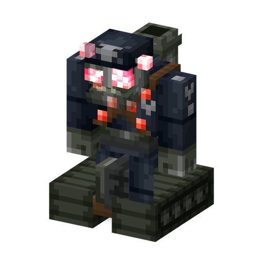

# Робо-Зомби

**Зомби · машина** · Plants & Zombies (оригинал)

Тяжелобронированный боевой робот. Вблизи бьёт, издалека пускает ракеты, а сильно повреждённый превращается в танк, лазающий по стенам.

| | |
|---|---|
| Id | `sproutsquad:robo_zombie` |
| Здоровье | 128 |
| Броня | 22 (твёрдость 9) |
| Урон | 11 |
| Скорость | 0,215; в облике танка +0,15 |
| Сопротивление отбрасыванию | 0,85 |
| Размер | 1,4 × 1,95 блока |
| Появление | только в темноте на [Свалке роботов](../STRUCTURES.md#свалка-роботов): вес 1 из 7, по одному |
| Рейды | обычные волны с 17-й (в 60 % из них, до 2); «Робо-Армия» (волны 10–16, только после того, как начавший рейд игрок посмотрел финальные титры; до 4) |
| Лидер / босс | босс рейда в облике Робо-Генерала в волнах 10–20 — обычных и «Робо-Армии», по одному на каждые семь номеров волны (минимум один) |
| Добыча | 90 %: 2–5 сплава мозгания (при любой смерти) |
| Варианты | Робо-Зомби, Робо-Генерал |

## Умения

- Удар вблизи на 11 урона.
- Ракета: примерно раз в 17 с по цели в пределах 30 блоков он останавливается и выпускает ракету; та взрывается радиусом 2,5 блока, не ломая блоки.
- Облик танка: при половине здоровья или меньше превращается насовсем — становится быстрее, лазает по стенам, держится в 3 блоках от цели и всегда смотрит на неё.
- Не поддаётся гипнозу и слишком велик, чтобы его проглотил [Чомпер](chomper.md); шарики и Надувную утку не берёт; предметы не подбирает; ломает двери.
- Обладает [общими чертами зомби мода](browncoat.md#общие-черты-зомби-мода): его ракеты не ранят зомби.

## Варианты

| | Вариант | Отличие |
|---|---|---|
|  | Робо-Зомби | по умолчанию |
|  | Робо-Генерал (`general`) | облик босса рейда: сразу танк, масштаб +0,33, здоровье ×3,25 (416), урон ×2,5 (27,5); яйцо призыва с этим вариантом тоже даёт характеристики босса |

## Взаимодействия

- В «Робо-Армии» на каждом третьем Робо-Зомби едет [Зомби-Солдат](soldier_zombie.md), и такой робот сразу появляется танком.
- Как босс рейда он получает от [Газонокосилки](lawn_mower.md) игрока только 40 урона, а не гибнет под ней (Sprout Squad).
- Достижение «Кладбищенское побоище»: одолейте Робо-Зомби, [Капитана Пиратов](pirate_captain.md) и [Супермозга](super_brainz.md).
