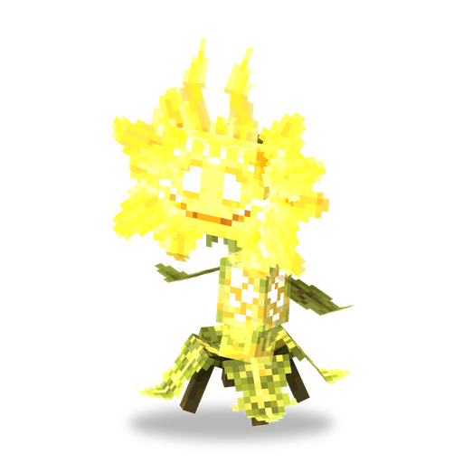

# Королевский Подсолнух

**Растение · ходячий лазер** · Plants & Zombies (оригинал), экспериментальное

Гигантский ходячий подсолнух, который жжёт врагов длинным солнечным лучом. Экспериментальный: скрыт, пока не включены экспериментальные возможности.

| | |
|---|---|
| Id | `sproutsquad:royal_sunflower` |
| Здоровье | 450 |
| Цена в солнцах | нет (не входит в список цен, сажается бесплатно) |
| Размер | 2,25 × 4,3 блока |
| Скорость | 0,17 (у ванильного зомби — 0,23) |
| Сопротивление отбрасыванию | 0,9 |
| Атака | солнечный луч примерно раз в 1,5 с, 10 урона всем на линии |
| Дальность | луч — 32 блока; замечает цели в радиусе 48 |
| Ночью | не спит |
| Как получить | только из творческой вкладки, если в `config/sproutsquad/server.json` выставить `enableExperimentalFeatures` в `true`; в добыче и дикой природе не встречается |

## Умения

- Ходит. Найдя цель, подходит к ней примерно на 8 блоков и стреляет оттуда.
- Луч шириной 1,5 блока проходит сквозь всех врагов на линии; урон — энергетический, цель должна быть в прямой видимости.
- Солнце не производит.
- Атакует зомби (и мода, и ванильных); приручённый — ещё и враждебных мобов; дикий — и игроков.

## Взаимодействия

- Не нужен для достижения «Ботаник» (посадить по одному растению каждого вида).
- Второе экспериментальное ходячее растение — [Цитрон](citron.md); обычный — [Подсолнух](sunflower.md).
