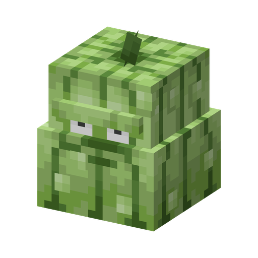

# Кабачок

**Растение · давилка** · Plants & Zombies (оригинал); атака — Sprout Squad

Одноразовое растение: запрыгивает на ближайшего зомби и расплющивает его. В оригинальном моде у Кабачка не было атаки — прыжок и удар добавил Sprout Squad.

| | |
|---|---|
| Id | `sproutsquad:squash` |
| Здоровье | 20 |
| Цена в солнцах | 4 |
| Размер | 0,8 × 0,9 блока |
| Атака | один удар: 1000 урона (боссам — 40) всем подходящим целям под ним; одноразовый |
| Срабатывание | цель ближе 3 блоков по горизонтали и не дальше 1,5 блока по высоте |
| Ночью | не спит |
| Как получить | дикий растёт на равнинах, в саваннах и Пёстром лесу; дикого приручают солнцем (~45% за одно солнце) |

## Умения

- Около 2 с замахивается, затем прыгает, зависает в 2 блоках над целью, обрушивается примерно на 3,65 с и исчезает на 4-й секунде.
- В прыжке следует за целью, но не дальше ~4,5 блока от места, где стоял.
- Удар задевает все подходящие цели в области 1,6 × 2 × 1,6 блока вокруг точки приземления, так что стоящих рядом зомби он давит разом.
- Давит только зомби, а приручённый — ещё и других враждебных мобов. Игроков, растения, жителей, питомцев и машины игроков не трогает никогда.
- Если цель погибла или ушла до прыжка, атака отменяется и Кабачок ждёт следующую; в воздухе он всегда доводит дело до конца.
- Не атакует, пока сидит на голове у игрока или едет в Вагонетке с горшком.
- Выживает на любом блоке и не оглядывается по сторонам.

## Взаимодействия

- Если на нём была [Тыква](pumpkin.md), она остаётся на месте приземления.
- Код Sprout Squad: `dev/efureev/sproutsquad/fixes/SquashAttackGoal.kt`.
