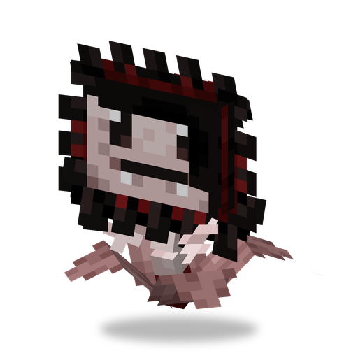

# Подсолнух

**Растение · даёт солнце** · Plants & Zombies (оригинал)

Основа экономики сада: сам не сражается, зато регулярно роняет солнце, которым оплачивается посадка всех остальных растений.

| | |
|---|---|
| Id | `sproutsquad:sunflower` |
| Здоровье | 20 |
| Цена в солнцах | 5 |
| Размер | 0,6 × 1,1 блока |
| Солнце | 1 солнце примерно раз в 45 с, пока не спит |
| Атака | нет |
| Ночью | спит |
| Лимит | 30 в радиусе 32 блоков |
| Как получить | растёт сам на равнинах, подсолнечниковых равнинах и в цветочных лесах (группами до 4); редкий дроп (1% на троих с Горохострелом и Стенорехом) с [Обычного Зомби](browncoat.md), убитого игроком или растением |

## Умения

- Примерно раз в 45 с роняет одно солнце. Незадолго до этого он начинает светиться.
- Засыпает, когда не видит солнца, — ночью и под землёй. Во сне отсчёт останавливается и солнце не появляется.
- Не атакует и не отвечает на удары.

## Взаимодействия

- Дикий подсолнух приручается солнцем: примерно 36% на каждое скормленное солнце.
- [Кофейный Боб](coffeebean.md) будит его. Подсолнух умеет давать солнце и в темноте, поэтому разбуженный продолжает работать всю ночь.
- Если назвать его биркой `vampire`, он сменит облик.
- [Горшочек](potling.md) можно скрафтить, но солнце он даёт медленнее (примерно раз в 60 с).

<!-- pictures: sunflower_vampire -->

