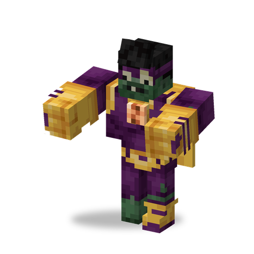

# Супермозг

**Зомби · супергерой** · Plants & Zombies (оригинал)

Зомби-супергерой в тяжёлой броне. Сильно бьёт кулаками, стреляет лазером, пронзающим всех на линии, и взлетает, чтобы достать цель наверху.

| | |
|---|---|
| Id | `sproutsquad:super_brainz` |
| Здоровье | 160 |
| Броня | 20 (твёрдость 6) |
| Урон | 12; лазер — 3 за попадание |
| Скорость | 0,25; в полёте 0,29 |
| Сопротивление отбрасыванию | 0,8 |
| Размер | 1,3 × 2,4 блока |
| Появление | сам в мире не появляется |
| Рейды | обычные волны с 16-й (в 40 % из них, до 2); «Зомбиуин» с 8-й волны (в 40 % его волн, до 2, всегда Токсичный); «Лига Великолепия» (волны 12–20, только после того, как начавший рейд игрок посмотрел финальные титры; не меньше 3, варианты случайные) |
| Лидер / босс | нет |
| Добыча | 70 %: 1–3 сплава мозгания (при любой смерти) |
| Варианты | Супермозг, Токсичный, Электро |

## Умения

- Бьёт кулаками попеременно, по 12 урона.
- Лазер: стоя на земле, бьёт лучом длиной до 12 блоков, который задевает всех существ на линии на четверть его урона. Стреляет так около 4 с, всё это время двигаясь на 30 % медленнее, а потом 14–15 с ждёт до следующей очереди.
- Полёт: если цель выше него больше чем на 3,5 блока, он взлетает (проверка раз в 3 с); приземляется, когда оказывается у самой земли, а цель не над ним. В полёте лазером не стреляет.
- Шарики не берёт; слишком велик, чтобы его проглотил [Чомпер](chomper.md); ломает двери.
- Обладает [общими чертами зомби мода](browncoat.md#общие-черты-зомби-мода): его лазер не ранит зомби.

## Варианты

| Вариант | Отличие |
|---|---|
| Супермозг | по умолчанию, розовый лазер |
| Токсичный Супермозг (`toxic`) | зелёный лазер; удары отравляют примерно на 2 с, лазер — на 5 с; таков каждый Супермозг «Зомбиуина» |
| Электро-Супермозг (`electro`) | вместо лазера электрическая дуга; удары накладывают «Электризацию» на 1,5 с, дуга — на 5 с |

## Взаимодействия

- «Электризация»: пока эффект действует, электрический урон по цели перескакивает на соседнее существо.
- Достижение «Кладбищенское побоище»: одолейте [Робо-Зомби](robo_zombie.md), [Капитана Пиратов](pirate_captain.md) и Супермозга.
