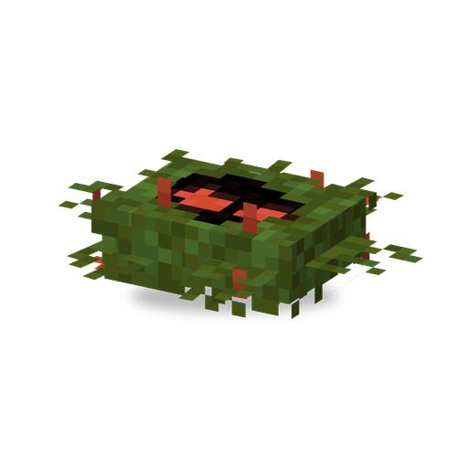

# Водоросль

**Растение · водяная ловушка** · Plants & Zombies (оригинал)

Водное растение: кусает ближайшего врага, опутывает его и подтаскивает к себе.

| | |
|---|---|
| Id | `sproutsquad:tanglekelp` |
| Здоровье | 25 |
| Цена в солнцах | 2 |
| Размер | 1,0 × 0,4 блока |
| Атака | укус: 0,75 урона и «Запутан» на 4 с, затем ~7 с тянет цель к себе и только потом кусает снова |
| Дальность | ~5,75 блока |
| Ночью | не спит |
| Как получить | дикая растёт в воде болот и мангровых болот группами по 3–5 (в дождь чаще); дикую приручают солнцем (~67% за одно солнце) |

## Умения

- Сажается на воду: пачку семян используют на поверхности воды. На суше выживает только на пашне или в Горшке дзен, в остальных местах засыхает.
- «Запутан»: цель не может ходить, прыгать, плавать и атаковать.
- Пока действует захват (6,5–8 с), Водоросль подтягивает цель к себе, если та не дальше ~5,75 блока. Когда Водоросль саму ранят, она на время отпускает.
- Цель, которую уже держит другая Водоросль, она не перехватывает.
- Всё, что в неё упирается, получает 0,75 урона в секунду (кроме растений, а у приручённой — ещё игроков и союзников хозяина).
- Зомби не выбирают её целью.
- Атакует зомби; приручённая — ещё и враждебных мобов; дикая хватает и игроков.
- Дышит под водой.

## Взаимодействия

- Не может носить [Тыкву](pumpkin.md).
- Второе растение, которое сажают на воду, — [Морегриб](seashroom.md).
