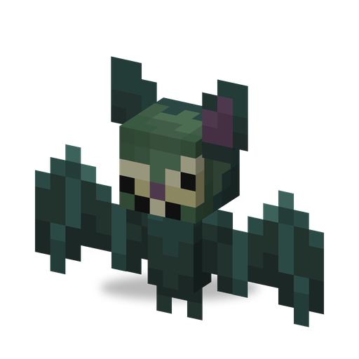

# Зомбимышь

**Зомби · летун** · Plants & Zombies (оригинал)

Летучая мышь-зомби, которая каждым укусом лечит себя. Водится на Кладбище, наполняет волны «Зомбиуина» и служит обликом стаи [Барона фон Бэтса](baron_von_bats.md).

| | |
|---|---|
| Id | `sproutsquad:zombat` |
| Здоровье | 20 |
| Броня | 0 |
| Урон | 2 |
| Скорость | 0,23; в полёте 0,39 |
| Сопротивление отбрасыванию | 0,2 |
| Размер | 0,5 × 0,9 блока |
| Появление | на Кладбище (`#sproutsquad:zombie/day_spawns`) при любом освещении: вес 20, группами по 1–2 |
| Рейды | «Зомбиуин» (только с 17 октября по 1 ноября; волны 4–11): не меньше 2 за волну |
| Лидер / босс | нет; часть босса Барона фон Бэтса |
| Добыча | 60 %: 0–1 кожа (+0–1 за каждый уровень «Добычи»); 3 %: пачка семян [Могилоеда](grave_buster.md); и то и другое — только если убил игрок или растение |

## Умения

- Всегда летает: без гравитации, без урона от падения, шагов не слышно.
- Каждый удачный укус лечит её на 10 % максимального здоровья.
- Дальность преследования 24 блока.
- Не держит предметы, не ломает двери, не берёт шарики и Надувную утку.
- Не получает случайных бонусов при появлении, как ванильные зомби.
- Обладает [общими чертами зомби мода](browncoat.md#общие-черты-зомби-мода).

## Взаимодействия

- [Барон фон Бэтс](baron_von_bats.md) превращается в 6–7 Зомбимышей на срок до 10 с. Они делят его здоровье, кусают на 2 урона, и их укусы лечат и Барона; мышь, которая несёт Барона, носит его имя и передаёт ему урон. Когда стая распадается, оставшиеся мыши исчезают.
