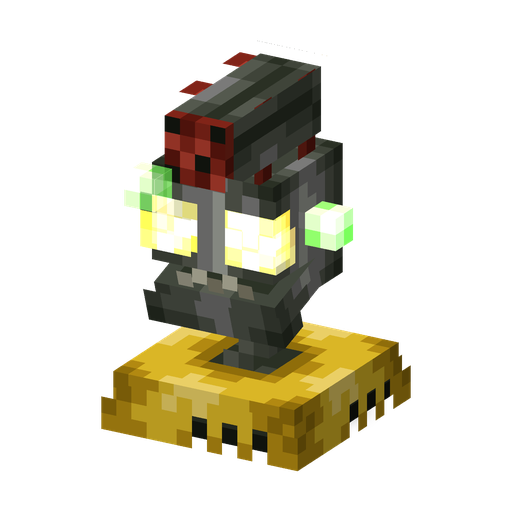

# Зомби-Турель

**Машина · стрелок** · Plants & Zombies (оригинал); Sprout Squad научил турели игрока сражаться на его стороне

Неподвижная лазерная пушка. Зомби-Инженеры строят её, чтобы обстреливать игроков и растения, а игрок с чертежом может поставить свою — охранять базу от монстров.

| | |
|---|---|
| Id | `sproutsquad:zombie_turret` |
| Здоровье | 8 |
| Броня | 7 |
| Размер | 0,8 × 1,0 блока |
| Передвижение | нет: стоит ровно по центру своего блока |
| Атака | лазерный заряд примерно раз в 0,8 с, до 20 блоков; 0,5 урона (враждебная) или 2 урона (построенная игроком) |
| Сопротивление отбрасыванию | 0,2 |
| Цена постройки | 12 сплава мозгания |
| Появление | её строит [Зомби-Инженер](engineer_zombie.md); сама по себе не появляется |
| Где взять чертёж | добыча с [Зомби-Инженера](engineer_zombie.md) (8,5 %, если убил игрок или растение); сокровище в почте героя за волну «Робо-Армия» |

## Умения

- Стреляет прямыми лазерными зарядами без гравитации и с большим разбросом; на упреждение не целится.
- Не двигается, не получает урона от падения, не поддаётся гипнозу.
- В творческом режиме «выбор блока» на турели даёт её чертёж.

## Два вида

**Враждебная (строит Инженер).** [Зомби-Инженер](engineer_zombie.md) собирает рядом с собой случайную машину (эту турель, [Электрическую Турель](electro_turret.md) или [Зомби-Дрона](zombie_drone.md)), если у него есть цель, а враждебных машин в радиусе 16 блоков меньше двух. Такая турель входит в рейд, целится в игроков и растения и неуязвима для «зомбячьих» видов урона (её лазеры зомби не ранят). Турель из яйца призыва тоже враждебная.

**Построенная игроком (по чертежу).** Примените на блоке `sproutsquad:blueprint` для Зомби-Турели. Нужно 12 `sproutsquad:brainz_alloy` в инвентаре (в творческом режиме — ничего), тратится одно из 20 применений чертежа; если место занято блоком или существом, постройка не выйдет. Турель разворачивается к игроку и помечается как его машина. После этого она:

- стреляет только по монстрам, враждебным игрокам: не трогает криперов, эндерменов, зомбифицированных пиглинов и других нейтральных мобов, загипнотизированных зомби и растения;
- не попадает в игроков, растения и машины других игроков, а растения не целятся и не стреляют в неё;
- бьёт на полную силу атаки — 2 вместо 0,5;
- не обращает внимания на флаг рейда и никогда не исчезает, даже на мирной сложности.

## Взаимодействия

- Сплав мозгания: рецепт без формы, 1 мозганий + 4 медных слитка + 4 железных слитка → 16 сплава; Инженеры тоже роняют 1–2 (30 %).
- Растения бьют враждебные турели, как любых зомби; [Гипногриб](hypnoshroom.md) их не перевербует.
- [Электрическая Турель](electro_turret.md) — ближнебойная электрическая родственница.
