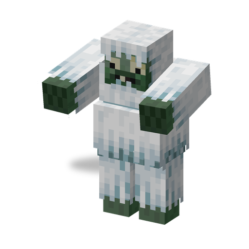

# Зомби-Йети

**Зомби · тяжёлый** · Plants & Zombies (оригинал)

Большой мохнатый зомби снежных краёв. Бьёт очень сильно, охлаждает жертв и швыряется комьями рыхлого снега в тех, до кого не может дойти.

| | |
|---|---|
| Id | `sproutsquad:zombie_yeti` |
| Здоровье | 120 |
| Броня | 0 |
| Урон | 13 |
| Скорость | 0,27 |
| Сопротивление отбрасыванию | 0,5 |
| Размер | 1,25 × 2,6 блока, масштаб ×1,25 |
| Появление | в темноте в `#sproutsquad:zombie/has_zombie_yeti` (заснеженная равнина, заснеженная тайга, `#c:is_cold`): вес 8, поодиночке; в `#sproutsquad:zombie/has_zombie_yeti_alt` (ледяные шипы, заледеневшие пики, замёрзший океан, заснеженные склоны, горные пики, `#c:is_icy`): вес 20, группами по 1–2; на снегу или льду выше уровня моря — при любом освещении |
| Рейды | «Зимняя Страна Чудес» (волны 5–9, хотя бы один за волну) |
| Лидер / босс | нет |
| Добыча | 6 %: пачка семян [Ледяного Горохострела](ice_peashooter.md); 15 %: 0–1 алмаз (+1–3 за каждый уровень «Добычи»); и то и другое — только если убил игрок или растение |

## Умения

- Удар вблизи на 13 урона; половина ударов вдобавок накладывает «Прохладу» (медленнее и слабее) на 4 с.
- Ком снега: если цель дальше 6,5 блока и путь до неё не проложить, он может бросить ком рыхлого снега (каждый раз с шансом 25 %). Прямое попадание — 5 урона, затем ком лопается небольшим взрывом, не ломающим блоки; при включённом `mobGriefing` рыхлый снег может остаться там, где упал.
- По пути к цели расталкивает игроков и других существ, кроме зомби, на которых натыкается.
- Перешагивает целые блоки; Надувную утку не надевает; предметы не подбирает.
- 6 % появляются с ведром на голове, 0,5 % — верхом на белом медведе.
- Обладает [общими чертами зомби мода](browncoat.md#общие-черты-зомби-мода).

## Взаимодействия

- Слишком велик, чтобы его проглотил [Чомпер](chomper.md).
- С него выпадают семена [Ледяного Горохострела](ice_peashooter.md) — растения, которое замедляет зомби.
- Достижение «Три Зомбитёра»: одолейте [Футболиста](all_star.md), [Зомби-Танцора](disco_zombie.md) и Зомби-Йети.
